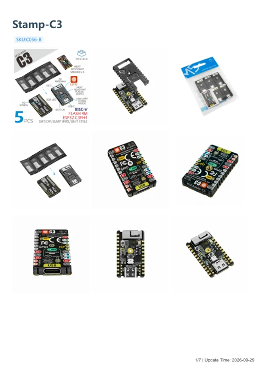

# M5Stamp C3

**M5Stack** · ESP32-C3

Revision: Not identified

Coverage: Manufacturer references available; physical pinout and complete connector review are tracked separately

[Browse all manufacturers](../../../../BROWSE.md) · [Devices & IoT](../../../../DEVICES.md) · [Open in the browser guide](https://valleytech-black-wire-guide.pages.dev/?board=m5stack-esp32-m5stamp-c3)

## Datasheets and original documentation

Board datasheet: **not yet recorded**. Visual reference: **available**.

[Manufacturer model documentation](https://docs.m5stack.com/en/core/stamp_c3)

- **hardware-guide / board**: [Stamp-C3 — manufacturer hardware guide](https://m5stack.oss-cn-shenzhen.aliyuncs.com/resource/docs/static/pdf/static/en/core/Stamp-C3.pdf) · [saved document](../../../../library/media/19b301c0c07a8d79d2d15ba66d25461438005611028d734aa6813db52bb909e1.pdf)

A chip datasheet, schematic and board datasheet have different scopes. Match the exact hardware revision.

[Documentation coverage and remaining gaps](../../../../DOCUMENTATION.md)

## Physical board pinout

**pinout image** · Reviewed source · JPG

[Open original reference](../../../../library/media/f3e857e16971f20b9aea3330d7507145bbeeba484dc640a496f31bc477ba5ab1.jpg)

**Credit and rights:** Not established; source attribution retained. Source/manufacturer: M5Stack.

[Source 1](https://m5stack-doc.oss-cn-shenzhen.aliyuncs.com/524/C056-B_PinMap_01.jpg) · [Source 2](https://docs.m5stack.com/en/core/stamp_c3)

Discovered from CircuitPython board metadata and the linked product/documentation page. Exact hardware revision requires matching to the diagram.

Image revision: Not identified

SHA-256: `f3e857e16971f20b9aea3330d7507145bbeeba484dc640a496f31bc477ba5ab1`

## Stamp-C3 — manufacturer hardware guide

**reference PDF** · Source model/link and PDF signature/title checked; individual pin assignments and electrical validation pending · PDF

[Open original reference](../../../../library/media/19b301c0c07a8d79d2d15ba66d25461438005611028d734aa6813db52bb909e1.pdf)

**Credit and rights:** Original publisher/manufacturer artwork; redistribution and print rights not established. Attribution is not a license grant.. Source/manufacturer: M5Stack.

[Source 1](https://m5stack.oss-cn-shenzhen.aliyuncs.com/resource/docs/static/pdf/static/en/core/Stamp-C3.pdf) · [Source 2](https://docs.m5stack.com/en/core/stamp_c3)

Original document linked from this model’s manufacturer page. Preserve the document’s exact revision and named subassembly scope; a linked accessory schematic is not a whole-device pinout. This is a hardware manual, not a separately classified board datasheet.

Image revision: Use the revision printed in the original document; do not assume all hardware revisions are interchangeable

SHA-256: `19b301c0c07a8d79d2d15ba66d25461438005611028d734aa6813db52bb909e1`

Pin assignments have not been independently electrically verified. Check board revision before wiring.
