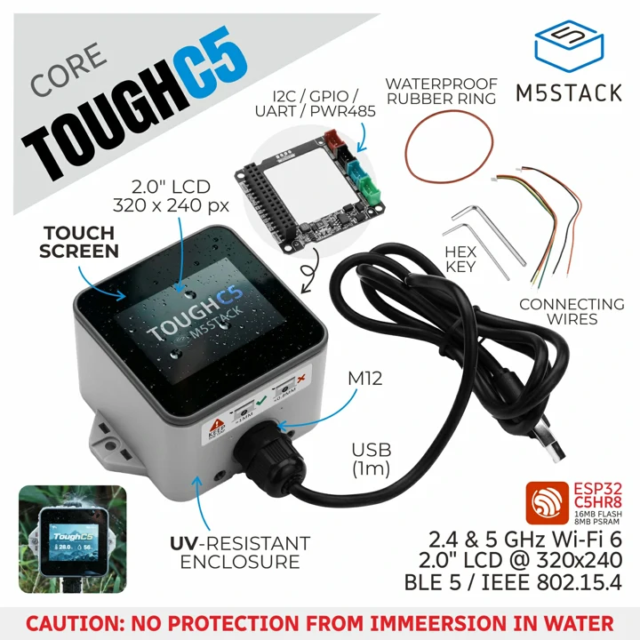
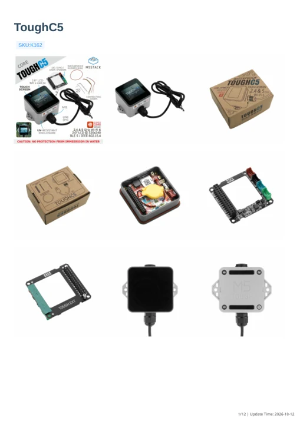
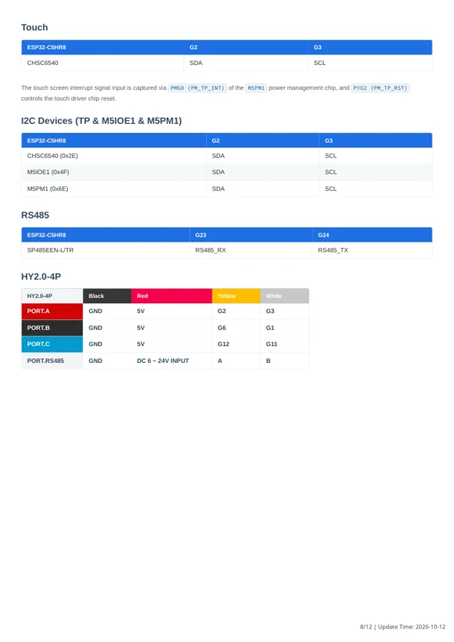
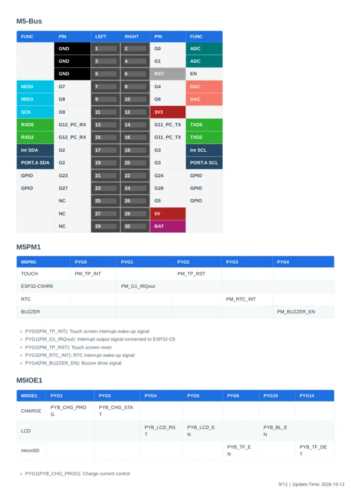

# ToughC5

**M5Stack** · ESP32-C5HR8

Revision: Match revision in each original source

Coverage: Manufacturer references available; physical pinout and complete connector review are tracked separately

[Browse all manufacturers](../../../../BROWSE.md) · [Devices & IoT](../../../../DEVICES.md) · [Open in the browser guide](https://valleytech-black-wire-guide.pages.dev/?board=m5stack-toughc5)

Device category: **Controllers & instruments**

Manufacturer documentation recorded; confirm the exact hardware revision before use.

## Datasheets and original documentation

Board datasheet: **not yet recorded**. Visual reference: **available**.

[Manufacturer model documentation](https://docs.m5stack.com/en/core/ToughC5)

- **schematic / board**: [ToughC5 Schematics PDF](https://m5stack-doc.oss-cn-shenzhen.aliyuncs.com/1275/K162_ToughC5_sche.pdf) · [saved document](../../../../library/media/c01592b61b0f4bec13957c23589536b1140e42666c42379324087d0e8fa0b37b.pdf)
- **hardware-guide / board**: [Manufacturer pin and hardware documentation](https://docs.m5stack.com/en/core/ToughC5) · online
- **hardware-guide / board**: [ToughC5 — manufacturer hardware guide](https://m5stack.oss-cn-shenzhen.aliyuncs.com/resource/docs/static/pdf/static/en/core/ToughC5.pdf) · [saved document](../../../../library/media/75db2cc7a83633333a9611582dbe84d867217a210824c25c94c55efb34036a86.pdf)
- **datasheet / component**: [ESP32-C5 component datasheet V1.5](https://documentation.espressif.com/esp32-c5_datasheet_en.pdf) · [saved document](../../../../library/media/e3cb7ad57b6fdf165ded30bdb75b4972c92fbe0a9159666eb553999032f1dc22.pdf)

A chip datasheet, schematic and board datasheet have different scopes. Match the exact hardware revision.

[Documentation coverage and remaining gaps](../../../../DOCUMENTATION.md)

## ToughC5 Schematics PDF

**original reference PDF** · Manufacturer source and first-page preview inspected; electrical correctness and all-connector completeness not independently approved. · PDF

[Open original reference](../../../../library/media/c01592b61b0f4bec13957c23589536b1140e42666c42379324087d0e8fa0b37b.pdf)

**Credit and rights:** Manufacturer artwork; reuse and print rights not established. Inclusion does not relicense the original.. Source/manufacturer: M5Stack.

[Source 1](https://m5stack-doc.oss-cn-shenzhen.aliyuncs.com/1275/K162_ToughC5_sche.pdf) · [Source 2](https://docs.m5stack.com/en/core/ToughC5)

Manufacturer source retained unchanged. Manufacturer source and first-page preview inspected; electrical correctness and all-connector completeness not independently approved.

Image revision: As supplied in the original; match exact board revision

SHA-256: `c01592b61b0f4bec13957c23589536b1140e42666c42379324087d0e8fa0b37b`

## ToughC5 hardware and interface overview

**board labeling image** · Visually reviewed for identity and reference scope; independent electrical and all-connector review pending · WEBP

[Open original reference](../../../../library/media/28c1a816f19893433f87e13d91ca7a1c75aca348e7b3e3fab8537d3e3037a328.webp)

**Credit and rights:** Manufacturer artwork; reuse and print rights not established. Inclusion does not relicense the original.. Source/manufacturer: M5Stack.

[Source 1](https://m5stack-doc.oss-cn-shenzhen.aliyuncs.com/1275/K162_ToughC5_main_pictures_01.webp) · [Source 2](https://docs.m5stack.com/en/core/ToughC5)

Labeled interface overview only; not a physical pinout. Use the existing source connector tables and schematic for assignments.

Image revision: Match revision in each original source

SHA-256: `28c1a816f19893433f87e13d91ca7a1c75aca348e7b3e3fab8537d3e3037a328`

## ToughC5 — manufacturer hardware guide

**reference PDF** · Source model/link and PDF signature/title checked; individual pin assignments and electrical validation pending · PDF

[Open original reference](../../../../library/media/75db2cc7a83633333a9611582dbe84d867217a210824c25c94c55efb34036a86.pdf)

**Credit and rights:** Original publisher/manufacturer artwork; redistribution and print rights not established. Attribution is not a license grant.. Source/manufacturer: M5Stack.

[Source 1](https://m5stack.oss-cn-shenzhen.aliyuncs.com/resource/docs/static/pdf/static/en/core/ToughC5.pdf) · [Source 2](https://docs.m5stack.com/en/core/ToughC5)

Original document linked from this model’s manufacturer page. Preserve the document’s exact revision and named subassembly scope; a linked accessory schematic is not a whole-device pinout. This is a hardware manual, not a separately classified board datasheet.

Image revision: Use the revision printed in the original document; do not assume all hardware revisions are interchangeable

SHA-256: `75db2cc7a83633333a9611582dbe84d867217a210824c25c94c55efb34036a86`

## ESP32-C5 component datasheet V1.5

**reference PDF** · Source model/link and PDF signature/title checked; individual pin assignments and electrical validation pending · PDF

[Open original reference](../../../../library/media/e3cb7ad57b6fdf165ded30bdb75b4972c92fbe0a9159666eb553999032f1dc22.pdf)

**Credit and rights:** Original publisher/manufacturer artwork; redistribution and print rights not established. Attribution is not a license grant.. Source/manufacturer: M5Stack.

[Source 1](https://documentation.espressif.com/esp32-c5_datasheet_en.pdf) · [Source 2](https://documentation.espressif.com/esp32-c5_datasheet_en.html)

Chip electrical/peripheral data only. Board supply limits and connector routing must come from the exact board documentation.

Image revision: Use the revision printed in the original document; do not assume all hardware revisions are interchangeable

SHA-256: `e3cb7ad57b6fdf165ded30bdb75b4972c92fbe0a9159666eb553999032f1dc22`

## ToughC5 connector functions — manual page 8

**pin function reference** · Visually reviewed for identity and reference scope; independent electrical review pending · PNG

[Open original reference](../../../../library/media/4d6968f8075e63b5b51d228a59395acebebf592e8dc5e4e5c13aa97c82fb3faf.png)

**Credit and rights:** Original publisher/manufacturer artwork; redistribution and print rights not established. Attribution is not a license grant.. Source/manufacturer: M5Stack.

[Source 1](https://m5stack.oss-cn-shenzhen.aliyuncs.com/resource/docs/static/pdf/static/en/core/ToughC5.pdf) · [Source 2](https://docs.m5stack.com/en/core/ToughC5)

Uncropped manufacturer manual page. Function table, not a physical whole-device map. Retained source labels have not been independently electrically validated. Cross-check ESP32-C5 peripheral capabilities before relying on alternative-function labels.

Image revision: Use the revision printed in the original document; do not assume all hardware revisions are interchangeable

SHA-256: `4d6968f8075e63b5b51d228a59395acebebf592e8dc5e4e5c13aa97c82fb3faf`

## ToughC5 connector functions — manual page 9

**pin function reference** · Visually reviewed for identity and reference scope; independent electrical review pending · PNG

[Open original reference](../../../../library/media/a5a703190535d57e8c541b87e19efdc2ced833c9133fa12af2a8b594f61cc6e3.png)

**Credit and rights:** Original publisher/manufacturer artwork; redistribution and print rights not established. Attribution is not a license grant.. Source/manufacturer: M5Stack.

[Source 1](https://m5stack.oss-cn-shenzhen.aliyuncs.com/resource/docs/static/pdf/static/en/core/ToughC5.pdf) · [Source 2](https://docs.m5stack.com/en/core/ToughC5)

Uncropped manufacturer manual page. Function table, not a physical whole-device map. Retained source labels have not been independently electrically validated. Cross-check ESP32-C5 peripheral capabilities before relying on alternative-function labels.

Image revision: Use the revision printed in the original document; do not assume all hardware revisions are interchangeable

SHA-256: `a5a703190535d57e8c541b87e19efdc2ced833c9133fa12af2a8b594f61cc6e3`

Pin assignments have not been independently electrically verified. Check board revision before wiring.
