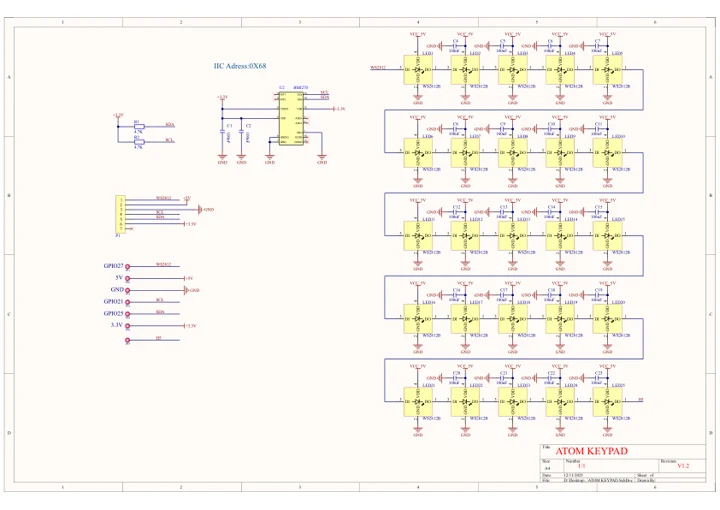
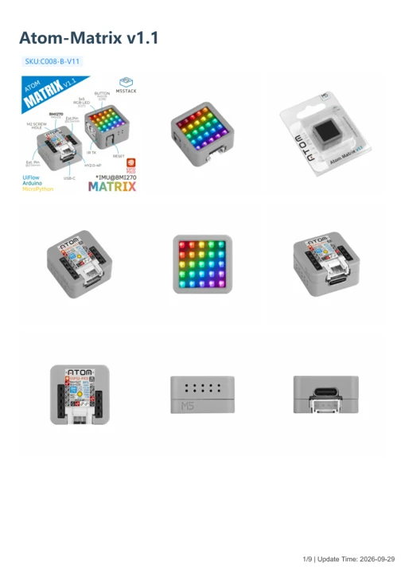

# Atom-Matrix v1.1

**M5Stack** · ESP32 original

Revision: Not identified

Coverage: Manufacturer references available; physical pinout and complete connector review are tracked separately

[Browse all manufacturers](../../../../BROWSE.md) · [Devices & IoT](../../../../DEVICES.md) · [Open in the browser guide](https://valleytech-black-wire-guide.pages.dev/?board=m5stack-gpio-device-atom-matrix-v1-1)

Device category: **Controllers & instruments**

## Datasheets and original documentation

Board datasheet: **not yet recorded**. Visual reference: **available**.

[Manufacturer model documentation](https://docs.m5stack.com/en/core/Atom-Matrix_v1.1)

- **schematic / board**: [Atom-Matrix v1.1 LED Board Schematics PDF — schematic](https://m5stack-doc.oss-cn-shenzhen.aliyuncs.com/1228/SCH_ATOM_KEYPAD_V1.2_20251211_2025_12_13_11_18_14.pdf) · [saved document](../../../../library/media/b4149d94898e4e0a8ded6f1056cc5e4bf0e11b1df17e1f236a9315cc17110c2a.pdf)
- **hardware-guide / board**: [Atom-Matrix v1.1 — manufacturer hardware guide](https://m5stack.oss-cn-shenzhen.aliyuncs.com/resource/docs/static/pdf/static/en/core/Atom-Matrix_v1.1.pdf) · [saved document](../../../../library/media/fc0f2cb91fd2ec7f5a41dd627fd5bd293f3cbb696a0e8f467ed583d0ac877a5f.pdf)

A chip datasheet, schematic and board datasheet have different scopes. Match the exact hardware revision.

[Documentation coverage and remaining gaps](../../../../DOCUMENTATION.md)

## Pinout

**pinout image** · Reviewed source · JPG

[Open original reference](../../../../library/media/bba6704a0f8a17931ce75d4e4db97a1250d2f6eacef058d27fd850e7ec417cdb.jpg)

**Credit and rights:** Not established; source attribution retained. Source/manufacturer: M5Stack.

[Source 1](https://m5stack-doc.oss-cn-shenzhen.aliyuncs.com/1228/C008-B-V11_PinMap.jpg) · [Source 2](https://docs.m5stack.com/en/core/Atom-Matrix_v1.1)

Imported from existing M5Stack Board Reference; original working path preserved.

Image revision: Not identified

SHA-256: `bba6704a0f8a17931ce75d4e4db97a1250d2f6eacef058d27fd850e7ec417cdb`

## Atom-Matrix v1.1 LED Board Schematics PDF — schematic

**reference PDF** · Source model/link and PDF signature/title checked; individual pin assignments and electrical validation pending · PDF

[Open original reference](../../../../library/media/b4149d94898e4e0a8ded6f1056cc5e4bf0e11b1df17e1f236a9315cc17110c2a.pdf)

**Credit and rights:** Original publisher/manufacturer artwork; redistribution and print rights not established. Attribution is not a license grant.. Source/manufacturer: M5Stack.

[Source 1](https://m5stack-doc.oss-cn-shenzhen.aliyuncs.com/1228/SCH_ATOM_KEYPAD_V1.2_20251211_2025_12_13_11_18_14.pdf) · [Source 2](https://docs.m5stack.com/en/core/Atom-Matrix_v1.1)

Original document linked from this model’s manufacturer page. Preserve the document’s exact revision and named subassembly scope; a linked accessory schematic is not a whole-device pinout. This is a circuit schematic, not a physical board pinout.

Image revision: Use the revision printed in the original document; do not assume all hardware revisions are interchangeable

SHA-256: `b4149d94898e4e0a8ded6f1056cc5e4bf0e11b1df17e1f236a9315cc17110c2a`

## Atom-Matrix v1.1 — manufacturer hardware guide

**reference PDF** · Source model/link and PDF signature/title checked; individual pin assignments and electrical validation pending · PDF

[Open original reference](../../../../library/media/fc0f2cb91fd2ec7f5a41dd627fd5bd293f3cbb696a0e8f467ed583d0ac877a5f.pdf)

**Credit and rights:** Original publisher/manufacturer artwork; redistribution and print rights not established. Attribution is not a license grant.. Source/manufacturer: M5Stack.

[Source 1](https://m5stack.oss-cn-shenzhen.aliyuncs.com/resource/docs/static/pdf/static/en/core/Atom-Matrix_v1.1.pdf) · [Source 2](https://docs.m5stack.com/en/core/Atom-Matrix_v1.1)

Original document linked from this model’s manufacturer page. Preserve the document’s exact revision and named subassembly scope; a linked accessory schematic is not a whole-device pinout. This is a hardware manual, not a separately classified board datasheet.

Image revision: Use the revision printed in the original document; do not assume all hardware revisions are interchangeable

SHA-256: `fc0f2cb91fd2ec7f5a41dd627fd5bd293f3cbb696a0e8f467ed583d0ac877a5f`

Pin assignments have not been independently electrically verified. Check board revision before wiring.
