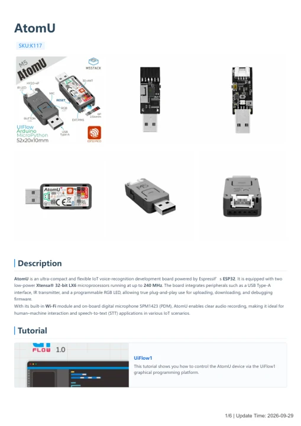

# AtomU

**M5Stack** · ESP32 original

Revision: Not identified

Coverage: Manufacturer references available; physical pinout and complete connector review are tracked separately

[Browse all manufacturers](../../../../BROWSE.md) · [Devices & IoT](../../../../DEVICES.md) · [Open in the browser guide](https://valleytech-black-wire-guide.pages.dev/?board=m5stack-gpio-device-atomu)

Device category: **Controllers & instruments**

## Datasheets and original documentation

Board datasheet: **not yet recorded**. Visual reference: **available**.

[Manufacturer model documentation](https://docs.m5stack.com/en/core/ATOM%20U)

- **hardware-guide / board**: [AtomU — manufacturer hardware guide](https://m5stack.oss-cn-shenzhen.aliyuncs.com/resource/docs/static/pdf/static/en/core/AtomU.pdf) · [saved document](../../../../library/media/374728fd1b3c02bf3df94d91e63425056877f7a6fb8e1cf09ab55ae9b4b95dba.pdf)

A chip datasheet, schematic and board datasheet have different scopes. Match the exact hardware revision.

[Documentation coverage and remaining gaps](../../../../DOCUMENTATION.md)

## Pinout

**pinout image** · Reviewed source · JPG

[Open original reference](../../../../library/media/c7db861a6847f743e1a4c4e4a0ac912e34c70ed16a4b4ccee1c89aef9750025c.jpg)

**Credit and rights:** Not established; source attribution retained. Source/manufacturer: M5Stack.

[Source 1](https://m5stack-doc.oss-cn-shenzhen.aliyuncs.com/675/K117_PinMap_01.jpg) · [Source 2](https://docs.m5stack.com/en/core/ATOM%20U)

Imported from existing M5Stack Board Reference; original working path preserved.

Image revision: Not identified

SHA-256: `c7db861a6847f743e1a4c4e4a0ac912e34c70ed16a4b4ccee1c89aef9750025c`

## AtomU — manufacturer hardware guide

**reference PDF** · Source model/link and PDF signature/title checked; individual pin assignments and electrical validation pending · PDF

[Open original reference](../../../../library/media/374728fd1b3c02bf3df94d91e63425056877f7a6fb8e1cf09ab55ae9b4b95dba.pdf)

**Credit and rights:** Original publisher/manufacturer artwork; redistribution and print rights not established. Attribution is not a license grant.. Source/manufacturer: M5Stack.

[Source 1](https://m5stack.oss-cn-shenzhen.aliyuncs.com/resource/docs/static/pdf/static/en/core/AtomU.pdf) · [Source 2](https://docs.m5stack.com/en/core/ATOM%20U)

Original document linked from this model’s manufacturer page. Preserve the document’s exact revision and named subassembly scope; a linked accessory schematic is not a whole-device pinout. This is a hardware manual, not a separately classified board datasheet.

Image revision: Use the revision printed in the original document; do not assume all hardware revisions are interchangeable

SHA-256: `374728fd1b3c02bf3df94d91e63425056877f7a6fb8e1cf09ab55ae9b4b95dba`

Pin assignments have not been independently electrically verified. Check board revision before wiring.
