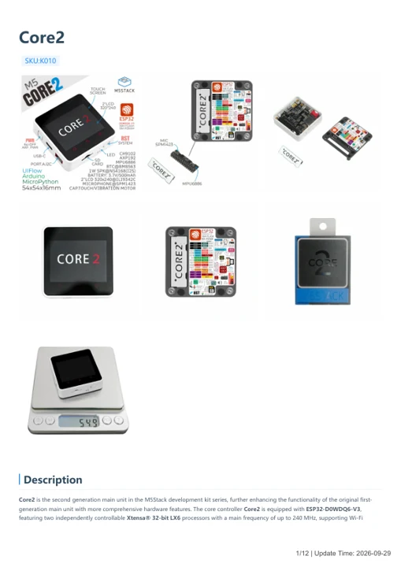

# Core2

**M5Stack** · ESP32 original

Revision: Not identified

Coverage: Manufacturer references available; physical pinout and complete connector review are tracked separately

[Browse all manufacturers](../../../../BROWSE.md) · [Devices & IoT](../../../../DEVICES.md) · [Open in the browser guide](https://valleytech-black-wire-guide.pages.dev/?board=m5stack-gpio-device-core2)

Device category: **Controllers & instruments**

## Datasheets and original documentation

Board datasheet: **not yet recorded**. Visual reference: **available**.

[Manufacturer model documentation](https://docs.m5stack.com/en/core/core2)

- **schematic / board**: [Core2 - Core Section Schematics PDF — schematic](https://m5stack-doc.oss-cn-shenzhen.aliyuncs.com/644/CORE2_V1.0_SCH.pdf) · [saved document](../../../../library/media/4a59d16291c7de9d9deda31fe154c8b5ac3c8f92209f6f8206d72f97afeea94f.pdf)
- **hardware-guide / board**: [Core2 — manufacturer hardware guide](https://m5stack.oss-cn-shenzhen.aliyuncs.com/resource/docs/static/pdf/static/en/core/Core2.pdf) · [saved document](../../../../library/media/5954e69fc57581ae0ca0318911ec326d20a4d191df9f45f06b87c3b6952a761b.pdf)

A chip datasheet, schematic and board datasheet have different scopes. Match the exact hardware revision.

[Documentation coverage and remaining gaps](../../../../DOCUMENTATION.md)

## Pinout

**GPIO reference image** · Reviewed source · PNG

[Open original reference](../../../../library/media/31abfdb0fd464a87fd03e0cd0c713fec83d3b550f3b4958eccbc3123a3b8de6f.png)

**Credit and rights:** Not established; source attribution retained. Source/manufacturer: M5Stack.

[Source 1](https://www.gwendesign.com/kb/m5stack/img/M5StackM5Core2GPIO.png) · [Source 2](https://docs.m5stack.com/en/core/core2)

Imported from existing M5Stack Board Reference; original working path preserved.

Image revision: Not identified

SHA-256: `31abfdb0fd464a87fd03e0cd0c713fec83d3b550f3b4958eccbc3123a3b8de6f`

## Dimensions

**source reference** · Unreviewed source · JPG

[Open original reference](../../../../library/media/3e20685bc8d203c5380e4ce97c72475059d89a89c6785ebd77af87c1ef546b1b.jpg)

**Credit and rights:** Source rights not yet established. Source/manufacturer: M5Stack.

[Source 1](https://m5stack.oss-cn-shenzhen.aliyuncs.com/resource/docs/products/core/core2/%E5%B0%BA%E5%AF%B8%E5%9B%BE.jpg) · [Source 2](https://docs.m5stack.com/en/core/core2)

Original source index: Dimensions. This file is searchable but has not been promoted to a reviewed physical board pinout.

Image revision: Not identified

SHA-256: `3e20685bc8d203c5380e4ce97c72475059d89a89c6785ebd77af87c1ef546b1b`

## Core2 - Core Section Schematics PDF — schematic

**reference PDF** · Source model/link and PDF signature/title checked; individual pin assignments and electrical validation pending · PDF

[Open original reference](../../../../library/media/4a59d16291c7de9d9deda31fe154c8b5ac3c8f92209f6f8206d72f97afeea94f.pdf)

**Credit and rights:** Original publisher/manufacturer artwork; redistribution and print rights not established. Attribution is not a license grant.. Source/manufacturer: M5Stack.

[Source 1](https://m5stack-doc.oss-cn-shenzhen.aliyuncs.com/644/CORE2_V1.0_SCH.pdf) · [Source 2](https://docs.m5stack.com/en/core/core2)

Original document linked from this model’s manufacturer page. Preserve the document’s exact revision and named subassembly scope; a linked accessory schematic is not a whole-device pinout. This is a circuit schematic, not a physical board pinout.

Image revision: Use the revision printed in the original document; do not assume all hardware revisions are interchangeable

SHA-256: `4a59d16291c7de9d9deda31fe154c8b5ac3c8f92209f6f8206d72f97afeea94f`

## Core2 — manufacturer hardware guide

**reference PDF** · Source model/link and PDF signature/title checked; individual pin assignments and electrical validation pending · PDF

[Open original reference](../../../../library/media/5954e69fc57581ae0ca0318911ec326d20a4d191df9f45f06b87c3b6952a761b.pdf)

**Credit and rights:** Original publisher/manufacturer artwork; redistribution and print rights not established. Attribution is not a license grant.. Source/manufacturer: M5Stack.

[Source 1](https://m5stack.oss-cn-shenzhen.aliyuncs.com/resource/docs/static/pdf/static/en/core/Core2.pdf) · [Source 2](https://docs.m5stack.com/en/core/core2)

Original document linked from this model’s manufacturer page. Preserve the document’s exact revision and named subassembly scope; a linked accessory schematic is not a whole-device pinout. This is a hardware manual, not a separately classified board datasheet.

Image revision: Use the revision printed in the original document; do not assume all hardware revisions are interchangeable

SHA-256: `5954e69fc57581ae0ca0318911ec326d20a4d191df9f45f06b87c3b6952a761b`

Pin assignments have not been independently electrically verified. Check board revision before wiring.
