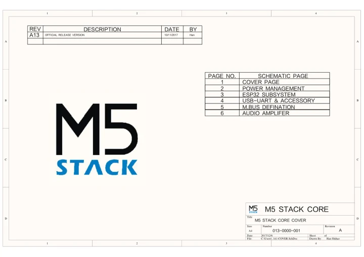
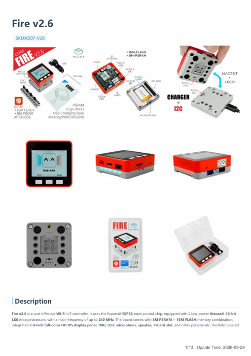

# M5Stack FIRE IoT

**M5Stack** · ESP32 original

Revision: Not identified

Coverage: Manufacturer references available; physical pinout and complete connector review are tracked separately

[Browse all manufacturers](../../../../BROWSE.md) · [Devices & IoT](../../../../DEVICES.md) · [Open in the browser guide](https://valleytech-black-wire-guide.pages.dev/?board=m5stack-esp32-fire-iot)

## Datasheets and original documentation

Board datasheet: **not yet recorded**. Visual reference: **available**.

[Manufacturer model documentation](https://docs.m5stack.com/en/core/fire_v2.6)

- **schematic / board**: [M5Core Schematics PDF — schematic](https://m5stack-doc.oss-cn-shenzhen.aliyuncs.com/480/M5-Core-Schematic_20171206.pdf) · [saved document](../../../../library/media/eee2755593110b6e7ce508b02a5af48b64e236b34ad0e150214cb6eee588271b.pdf)
- **hardware-guide / board**: [Fire v2.6 — manufacturer hardware guide](https://m5stack.oss-cn-shenzhen.aliyuncs.com/resource/docs/static/pdf/static/en/core/Fire_v2.6.pdf) · [saved document](../../../../library/media/4b2d75ade65f90fe3948c52745e9808bd9a398142941714ed9b5410ef1f534ff.pdf)

A chip datasheet, schematic and board datasheet have different scopes. Match the exact hardware revision.

[Documentation coverage and remaining gaps](../../../../DOCUMENTATION.md)

## M5Core Schematics PDF — schematic

**reference PDF** · Source model/link and PDF signature/title checked; individual pin assignments and electrical validation pending · PDF

[Open original reference](../../../../library/media/eee2755593110b6e7ce508b02a5af48b64e236b34ad0e150214cb6eee588271b.pdf)

**Credit and rights:** Original publisher/manufacturer artwork; redistribution and print rights not established. Attribution is not a license grant.. Source/manufacturer: M5Stack.

[Source 1](https://m5stack-doc.oss-cn-shenzhen.aliyuncs.com/480/M5-Core-Schematic_20171206.pdf) · [Source 2](https://docs.m5stack.com/en/core/fire_v2.6)

Original document linked from this model’s manufacturer page. Preserve the document’s exact revision and named subassembly scope; a linked accessory schematic is not a whole-device pinout. This is a circuit schematic, not a physical board pinout.

Image revision: Use the revision printed in the original document; do not assume all hardware revisions are interchangeable

SHA-256: `eee2755593110b6e7ce508b02a5af48b64e236b34ad0e150214cb6eee588271b`

## Fire v2.6 — manufacturer hardware guide

**reference PDF** · Source model/link and PDF signature/title checked; individual pin assignments and electrical validation pending · PDF

[Open original reference](../../../../library/media/4b2d75ade65f90fe3948c52745e9808bd9a398142941714ed9b5410ef1f534ff.pdf)

**Credit and rights:** Original publisher/manufacturer artwork; redistribution and print rights not established. Attribution is not a license grant.. Source/manufacturer: M5Stack.

[Source 1](https://m5stack.oss-cn-shenzhen.aliyuncs.com/resource/docs/static/pdf/static/en/core/Fire_v2.6.pdf) · [Source 2](https://docs.m5stack.com/en/core/fire_v2.6)

Original document linked from this model’s manufacturer page. Preserve the document’s exact revision and named subassembly scope; a linked accessory schematic is not a whole-device pinout. This is a hardware manual, not a separately classified board datasheet.

Image revision: Use the revision printed in the original document; do not assume all hardware revisions are interchangeable

SHA-256: `4b2d75ade65f90fe3948c52745e9808bd9a398142941714ed9b5410ef1f534ff`

Pin assignments have not been independently electrically verified. Check board revision before wiring.
