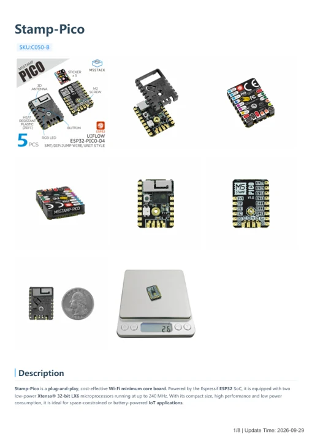

# Stamp-Pico

**M5Stack** · ESP32 original

Revision: Not identified

Coverage: Manufacturer references available; physical pinout and complete connector review are tracked separately

[Browse all manufacturers](../../../../BROWSE.md) · [Devices & IoT](../../../../DEVICES.md) · [Open in the browser guide](https://valleytech-black-wire-guide.pages.dev/?board=m5stack-esp32-stamp-pico)

## Datasheets and original documentation

Board datasheet: **not yet recorded**. Visual reference: **available**.

[Manufacturer model documentation](https://docs.m5stack.com/en/core/stamp_pico)

- **hardware-guide / board**: [Stamp-Pico — manufacturer hardware guide](https://m5stack.oss-cn-shenzhen.aliyuncs.com/resource/docs/static/pdf/static/en/core/Stamp-Pico.pdf) · [saved document](../../../../library/media/96361298949fd726a591a7ca6974d6f7e8daff5cf2b568e4222f3bb8d8ac828b.pdf)

A chip datasheet, schematic and board datasheet have different scopes. Match the exact hardware revision.

[Documentation coverage and remaining gaps](../../../../DOCUMENTATION.md)

## Pinout

**pinout image** · Reviewed source · PNG

[Open original reference](../../../../library/media/e105afee2022b08e7d867779965b32fb78e09b8cba3d53f594e23ba8b2dc593f.png)

**Credit and rights:** Not established; source attribution retained. Source/manufacturer: M5Stack.

[Source 1](https://static-cdn.m5stack.com/resource/docs/products/core/stamp_pico/stamp_pico_12.webp) · [Source 2](https://docs.m5stack.com/en/core/stamp_pico)

Imported from existing M5Stack Board Reference; original working path preserved.

Image revision: Not identified

SHA-256: `e105afee2022b08e7d867779965b32fb78e09b8cba3d53f594e23ba8b2dc593f`

## Dimensions

**source reference** · Unreviewed source · JPG

[Open original reference](../../../../library/media/0ada4de57fa408aa9589bc7ad1cfa855442ef9717595f299d5fe516505c23664.jpg)

**Credit and rights:** Source rights not yet established. Source/manufacturer: M5Stack.

[Source 1](https://m5stack.oss-cn-shenzhen.aliyuncs.com/resource/docs/products/core/stamp_pico/model%20size.jpg) · [Source 2](https://docs.m5stack.com/en/core/stamp_pico)

Original source index: Dimensions. This file is searchable but has not been promoted to a reviewed physical board pinout.

Image revision: Not identified

SHA-256: `0ada4de57fa408aa9589bc7ad1cfa855442ef9717595f299d5fe516505c23664`

## Dimensions

**source reference** · Unreviewed source · PNG

[Open original reference](../../../../library/media/071d366650d1e6f1516838fccda8d89bb948e5847463ed94988e3b601ab05632.png)

**Credit and rights:** Source rights not yet established. Source/manufacturer: M5Stack.

[Source 1](https://static-cdn.m5stack.com/resource/docs/products/core/stamp_pico/stamp_pico_size_01.webp) · [Source 2](https://docs.m5stack.com/en/core/stamp_pico)

Original source index: Dimensions. This file is searchable but has not been promoted to a reviewed physical board pinout.

Image revision: Not identified

SHA-256: `071d366650d1e6f1516838fccda8d89bb948e5847463ed94988e3b601ab05632`

## Stamp-Pico — manufacturer hardware guide

**reference PDF** · Source model/link and PDF signature/title checked; individual pin assignments and electrical validation pending · PDF

[Open original reference](../../../../library/media/96361298949fd726a591a7ca6974d6f7e8daff5cf2b568e4222f3bb8d8ac828b.pdf)

**Credit and rights:** Original publisher/manufacturer artwork; redistribution and print rights not established. Attribution is not a license grant.. Source/manufacturer: M5Stack.

[Source 1](https://m5stack.oss-cn-shenzhen.aliyuncs.com/resource/docs/static/pdf/static/en/core/Stamp-Pico.pdf) · [Source 2](https://docs.m5stack.com/en/core/stamp_pico)

Original document linked from this model’s manufacturer page. Preserve the document’s exact revision and named subassembly scope; a linked accessory schematic is not a whole-device pinout. This is a hardware manual, not a separately classified board datasheet.

Image revision: Use the revision printed in the original document; do not assume all hardware revisions are interchangeable

SHA-256: `96361298949fd726a591a7ca6974d6f7e8daff5cf2b568e4222f3bb8d8ac828b`

Pin assignments have not been independently electrically verified. Check board revision before wiring.
