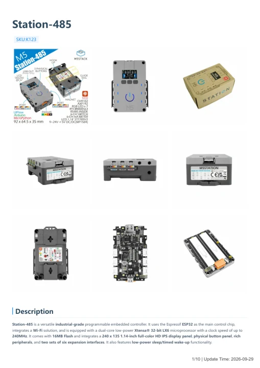
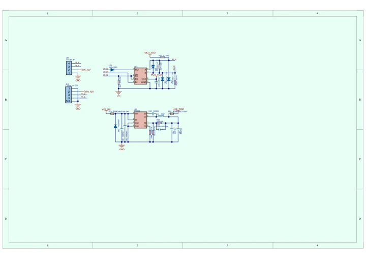

# Station-485

**M5Stack** · ESP32 original

Revision: Not identified

Coverage: Manufacturer references available; physical pinout and complete connector review are tracked separately

[Browse all manufacturers](../../../../BROWSE.md) · [Devices & IoT](../../../../DEVICES.md) · [Open in the browser guide](https://valleytech-black-wire-guide.pages.dev/?board=m5stack-gpio-device-station-485)

Device category: **Controllers & instruments**

## Datasheets and original documentation

Board datasheet: **not yet recorded**. Visual reference: **available**.

[Manufacturer model documentation](https://docs.m5stack.com/en/core/station_485)

- **hardware-guide / board**: [Station-485 — manufacturer hardware guide](https://m5stack.oss-cn-shenzhen.aliyuncs.com/resource/docs/static/pdf/static/en/core/Station-485.pdf) · [saved document](../../../../library/media/1f132bc58e253f9ece457430e9cd6de91e47e46a395f9a2c814f795461ba7553.pdf)
- **schematic / board**: [Station-485 Schematics PDF — schematic](https://m5stack-doc.oss-cn-shenzhen.aliyuncs.com/521/Sch_M5Station_v1.3.pdf) · [saved document](../../../../library/media/40d96965c6db10fead266fce7e20ff7cf3c8b683a10ed74becd9d6a64a38a10a.pdf)

A chip datasheet, schematic and board datasheet have different scopes. Match the exact hardware revision.

[Documentation coverage and remaining gaps](../../../../DOCUMENTATION.md)

## Pinout

**pinout image** · Reviewed source · JPG

[Open original reference](../../../../library/media/3fbfeecc25cae5c681b58fe342d6815aaac74ce99df60c8222c5dae9208d827a.jpg)

**Credit and rights:** Not established; source attribution retained. Source/manufacturer: M5Stack.

[Source 1](https://m5stack-doc.oss-cn-shenzhen.aliyuncs.com/521/K124-BK123.jpg) · [Source 2](https://docs.m5stack.com/en/core/station_485)

Imported from existing M5Stack Board Reference; original working path preserved.

Image revision: Not identified

SHA-256: `3fbfeecc25cae5c681b58fe342d6815aaac74ce99df60c8222c5dae9208d827a`

## Dimensions

**source reference** · Unreviewed source · JPG

[Open original reference](../../../../library/media/a8c1586508b09723e1f445d7e9011249014e5c9b493e58cee195a8d108009400.jpg)

**Credit and rights:** Source rights not yet established. Source/manufacturer: M5Stack.

[Source 1](https://m5stack.oss-cn-shenzhen.aliyuncs.com/resource/docs/products/core/station_485/module%20size.jpg) · [Source 2](https://docs.m5stack.com/en/core/station_485)

Original source index: Dimensions. This file is searchable but has not been promoted to a reviewed physical board pinout.

Image revision: Not identified

SHA-256: `a8c1586508b09723e1f445d7e9011249014e5c9b493e58cee195a8d108009400`

## Station-485 — manufacturer hardware guide

**reference PDF** · Source model/link and PDF signature/title checked; individual pin assignments and electrical validation pending · PDF

[Open original reference](../../../../library/media/1f132bc58e253f9ece457430e9cd6de91e47e46a395f9a2c814f795461ba7553.pdf)

**Credit and rights:** Original publisher/manufacturer artwork; redistribution and print rights not established. Attribution is not a license grant.. Source/manufacturer: M5Stack.

[Source 1](https://m5stack.oss-cn-shenzhen.aliyuncs.com/resource/docs/static/pdf/static/en/core/Station-485.pdf) · [Source 2](https://docs.m5stack.com/en/core/station_485)

Original document linked from this model’s manufacturer page. Preserve the document’s exact revision and named subassembly scope; a linked accessory schematic is not a whole-device pinout. This is a hardware manual, not a separately classified board datasheet.

Image revision: Use the revision printed in the original document; do not assume all hardware revisions are interchangeable

SHA-256: `1f132bc58e253f9ece457430e9cd6de91e47e46a395f9a2c814f795461ba7553`

## Station-485 Schematics PDF — schematic

**reference PDF** · Source model/link and PDF signature/title checked; individual pin assignments and electrical validation pending · PDF

[Open original reference](../../../../library/media/40d96965c6db10fead266fce7e20ff7cf3c8b683a10ed74becd9d6a64a38a10a.pdf)

**Credit and rights:** Original publisher/manufacturer artwork; redistribution and print rights not established. Attribution is not a license grant.. Source/manufacturer: M5Stack.

[Source 1](https://m5stack-doc.oss-cn-shenzhen.aliyuncs.com/521/Sch_M5Station_v1.3.pdf) · [Source 2](https://docs.m5stack.com/en/core/station_485)

Original document linked from this model’s manufacturer page. Preserve the document’s exact revision and named subassembly scope; a linked accessory schematic is not a whole-device pinout. This is a circuit schematic, not a physical board pinout.

Image revision: Use the revision printed in the original document; do not assume all hardware revisions are interchangeable

SHA-256: `40d96965c6db10fead266fce7e20ff7cf3c8b683a10ed74becd9d6a64a38a10a`

Pin assignments have not been independently electrically verified. Check board revision before wiring.
