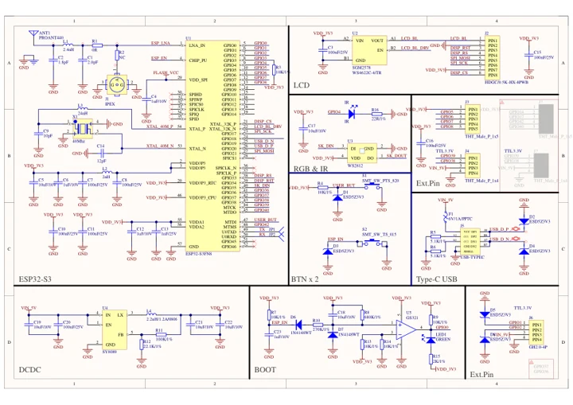
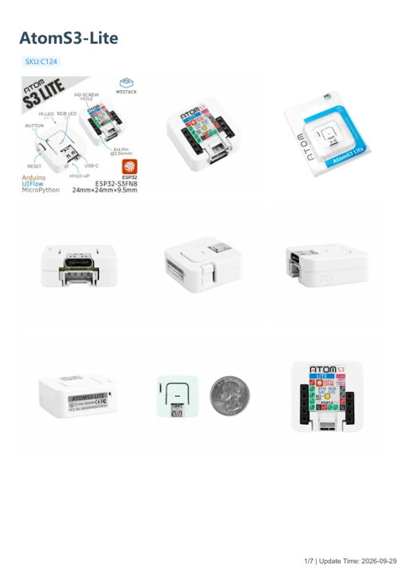

# AtomS3 Lite ESP32S3 Dev Kit

**M5Stack** · ESP32-S3

Revision: Not identified

Coverage: Manufacturer references available; physical pinout and complete connector review are tracked separately

[Browse all manufacturers](../../../../BROWSE.md) · [Devices & IoT](../../../../DEVICES.md) · [Open in the browser guide](https://valleytech-black-wire-guide.pages.dev/?board=m5stack-esp32-atoms3-lite-esp32s3-dev-kit)

Device category: **Controllers & instruments**

## Datasheets and original documentation

Board datasheet: **not yet recorded**. Visual reference: **available**.

[Manufacturer model documentation](https://docs.m5stack.com/en/core/AtomS3%20Lite)

- **schematic / board**: [AtomS3-Lite Schematics PDF — schematic](https://m5stack-doc.oss-cn-shenzhen.aliyuncs.com/471/Sch_M5_AtomS3_v1.0.pdf) · [saved document](../../../../library/media/de57d7dc001da15e33558525867c3b20b36dd7c396f079c25374669ad0ff270a.pdf)
- **hardware-guide / board**: [AtomS3-Lite — manufacturer hardware guide](https://m5stack.oss-cn-shenzhen.aliyuncs.com/resource/docs/static/pdf/static/en/core/AtomS3-Lite.pdf) · [saved document](../../../../library/media/8b12326d564ddce08584f8c7e3635697fa59e74fc74ddd87801bed2c2145b05b.pdf)

A chip datasheet, schematic and board datasheet have different scopes. Match the exact hardware revision.

[Documentation coverage and remaining gaps](../../../../DOCUMENTATION.md)

## Physical board pinout

**pinout image** · Reviewed source · JPG

[Open original reference](../../../../library/media/e5e70596d5d0f760c1f0c178c4424a030c3e37e38fe90523c6600828581cd610.jpg)

**Credit and rights:** Not established; source attribution retained. Source/manufacturer: M5Stack.

[Source 1](https://m5stack-doc.oss-cn-shenzhen.aliyuncs.com/471/C124_PinMap_01.jpg) · [Source 2](https://docs.m5stack.com/en/core/AtomS3%20Lite)

Discovered from CircuitPython board metadata and the linked product/documentation page. Exact hardware revision requires matching to the diagram.

Image revision: Not identified

SHA-256: `e5e70596d5d0f760c1f0c178c4424a030c3e37e38fe90523c6600828581cd610`

## AtomS3-Lite Schematics PDF — schematic

**reference PDF** · Source model/link and PDF signature/title checked; individual pin assignments and electrical validation pending · PDF

[Open original reference](../../../../library/media/de57d7dc001da15e33558525867c3b20b36dd7c396f079c25374669ad0ff270a.pdf)

**Credit and rights:** Original publisher/manufacturer artwork; redistribution and print rights not established. Attribution is not a license grant.. Source/manufacturer: M5Stack.

[Source 1](https://m5stack-doc.oss-cn-shenzhen.aliyuncs.com/471/Sch_M5_AtomS3_v1.0.pdf) · [Source 2](https://docs.m5stack.com/en/core/AtomS3%20Lite)

Original document linked from this model’s manufacturer page. Preserve the document’s exact revision and named subassembly scope; a linked accessory schematic is not a whole-device pinout. This is a circuit schematic, not a physical board pinout.

Image revision: Use the revision printed in the original document; do not assume all hardware revisions are interchangeable

SHA-256: `de57d7dc001da15e33558525867c3b20b36dd7c396f079c25374669ad0ff270a`

## AtomS3-Lite — manufacturer hardware guide

**reference PDF** · Source model/link and PDF signature/title checked; individual pin assignments and electrical validation pending · PDF

[Open original reference](../../../../library/media/8b12326d564ddce08584f8c7e3635697fa59e74fc74ddd87801bed2c2145b05b.pdf)

**Credit and rights:** Original publisher/manufacturer artwork; redistribution and print rights not established. Attribution is not a license grant.. Source/manufacturer: M5Stack.

[Source 1](https://m5stack.oss-cn-shenzhen.aliyuncs.com/resource/docs/static/pdf/static/en/core/AtomS3-Lite.pdf) · [Source 2](https://docs.m5stack.com/en/core/AtomS3%20Lite)

Original document linked from this model’s manufacturer page. Preserve the document’s exact revision and named subassembly scope; a linked accessory schematic is not a whole-device pinout. This is a hardware manual, not a separately classified board datasheet.

Image revision: Use the revision printed in the original document; do not assume all hardware revisions are interchangeable

SHA-256: `8b12326d564ddce08584f8c7e3635697fa59e74fc74ddd87801bed2c2145b05b`

Pin assignments have not been independently electrically verified. Check board revision before wiring.
