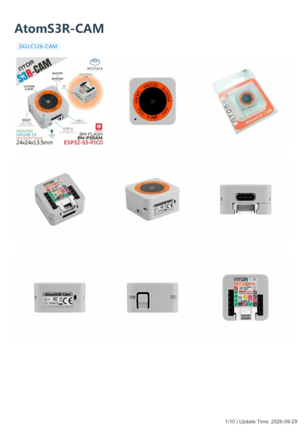

# AtomS3R-CAM

**M5Stack** · ESP32-S3

Revision: Not identified

Coverage: Manufacturer references available; physical pinout and complete connector review are tracked separately

[Browse all manufacturers](../../../../BROWSE.md) · [Devices & IoT](../../../../DEVICES.md) · [Open in the browser guide](https://valleytech-black-wire-guide.pages.dev/?board=m5stack-gpio-device-atoms3r-cam)

Device category: **Controllers & instruments**

## Datasheets and original documentation

Board datasheet: **not yet recorded**. Visual reference: **available**.

[Manufacturer model documentation](https://docs.m5stack.com/en/core/AtomS3R%20Cam)

- **schematic / board**: [AtomS3R-CAM ext board Schematics PDF — schematic](https://m5stack-doc.oss-cn-shenzhen.aliyuncs.com/681/ext_board_schematic.pdf) · [saved document](../../../../library/media/9184bdbfa402b57fd0d5a83bfa8b606650c2aebac61988e751272a42aa472ae0.pdf)
- **schematic / board**: [AtomS3R-CAM main board Schematics PDF — schematic](https://m5stack-doc.oss-cn-shenzhen.aliyuncs.com/681/main_board_schematic.pdf) · [saved document](../../../../library/media/62aec2833f60b30cf1b5c3e6a37e2e19792c83b501fac58ed94febca8303bc65.pdf)
- **hardware-guide / board**: [AtomS3R-CAM — manufacturer hardware guide](https://m5stack.oss-cn-shenzhen.aliyuncs.com/resource/docs/static/pdf/static/en/core/AtomS3R-CAM.pdf) · [saved document](../../../../library/media/913eb0e09f9629671d219907cfeacd339cafa9fb8d8b7f011c41c3bf6a629272.pdf)

A chip datasheet, schematic and board datasheet have different scopes. Match the exact hardware revision.

[Documentation coverage and remaining gaps](../../../../DOCUMENTATION.md)

## Pinout

**pinout image** · Reviewed source · JPG

[Open original reference](../../../../library/media/5f6b2adae17dcf671160daa54efbc8f5bcca58c1f0116507ead3a96069148715.jpg)

**Credit and rights:** Not established; source attribution retained. Source/manufacturer: M5Stack.

[Source 1](https://m5stack-doc.oss-cn-shenzhen.aliyuncs.com/681/C126-CAM_PinMap_01.jpg) · [Source 2](https://docs.m5stack.com/en/core/AtomS3R%20Cam)

Imported from existing M5Stack Board Reference; original working path preserved.

Image revision: Not identified

SHA-256: `5f6b2adae17dcf671160daa54efbc8f5bcca58c1f0116507ead3a96069148715`

## Dimensions

**source reference** · Unreviewed source · PNG

[Open original reference](../../../../library/media/616531139097ee4708fe6adda0905a91a72eef0761e52e09516824033eeaaaf7.png)

**Credit and rights:** Source rights not yet established. Source/manufacturer: M5Stack.

[Source 1](https://static-cdn.m5stack.com/resource/docs/products/core/AtomS3R Cam/img-1f8b0888-c56b-424c-95d3-b67a45015569.png) · [Source 2](https://docs.m5stack.com/en/core/AtomS3R%20Cam)

Original source index: Dimensions. This file is searchable but has not been promoted to a reviewed physical board pinout.

Image revision: Not identified

SHA-256: `616531139097ee4708fe6adda0905a91a72eef0761e52e09516824033eeaaaf7`

## AtomS3R-CAM ext board Schematics PDF — schematic

**reference PDF** · Source model/link and PDF signature/title checked; individual pin assignments and electrical validation pending · PDF

[Open original reference](../../../../library/media/9184bdbfa402b57fd0d5a83bfa8b606650c2aebac61988e751272a42aa472ae0.pdf)

**Credit and rights:** Original publisher/manufacturer artwork; redistribution and print rights not established. Attribution is not a license grant.. Source/manufacturer: M5Stack.

[Source 1](https://m5stack-doc.oss-cn-shenzhen.aliyuncs.com/681/ext_board_schematic.pdf) · [Source 2](https://docs.m5stack.com/en/core/AtomS3R%20Cam)

Original document linked from this model’s manufacturer page. Preserve the document’s exact revision and named subassembly scope; a linked accessory schematic is not a whole-device pinout. This is a circuit schematic, not a physical board pinout.

Image revision: Use the revision printed in the original document; do not assume all hardware revisions are interchangeable

SHA-256: `9184bdbfa402b57fd0d5a83bfa8b606650c2aebac61988e751272a42aa472ae0`

## AtomS3R-CAM main board Schematics PDF — schematic

**reference PDF** · Source model/link and PDF signature/title checked; individual pin assignments and electrical validation pending · PDF

[Open original reference](../../../../library/media/62aec2833f60b30cf1b5c3e6a37e2e19792c83b501fac58ed94febca8303bc65.pdf)

**Credit and rights:** Original publisher/manufacturer artwork; redistribution and print rights not established. Attribution is not a license grant.. Source/manufacturer: M5Stack.

[Source 1](https://m5stack-doc.oss-cn-shenzhen.aliyuncs.com/681/main_board_schematic.pdf) · [Source 2](https://docs.m5stack.com/en/core/AtomS3R%20Cam)

Original document linked from this model’s manufacturer page. Preserve the document’s exact revision and named subassembly scope; a linked accessory schematic is not a whole-device pinout. This is a circuit schematic, not a physical board pinout.

Image revision: Use the revision printed in the original document; do not assume all hardware revisions are interchangeable

SHA-256: `62aec2833f60b30cf1b5c3e6a37e2e19792c83b501fac58ed94febca8303bc65`

## AtomS3R-CAM — manufacturer hardware guide

**reference PDF** · Source model/link and PDF signature/title checked; individual pin assignments and electrical validation pending · PDF

[Open original reference](../../../../library/media/913eb0e09f9629671d219907cfeacd339cafa9fb8d8b7f011c41c3bf6a629272.pdf)

**Credit and rights:** Original publisher/manufacturer artwork; redistribution and print rights not established. Attribution is not a license grant.. Source/manufacturer: M5Stack.

[Source 1](https://m5stack.oss-cn-shenzhen.aliyuncs.com/resource/docs/static/pdf/static/en/core/AtomS3R-CAM.pdf) · [Source 2](https://docs.m5stack.com/en/core/AtomS3R%20Cam)

Original document linked from this model’s manufacturer page. Preserve the document’s exact revision and named subassembly scope; a linked accessory schematic is not a whole-device pinout. This is a hardware manual, not a separately classified board datasheet.

Image revision: Use the revision printed in the original document; do not assume all hardware revisions are interchangeable

SHA-256: `913eb0e09f9629671d219907cfeacd339cafa9fb8d8b7f011c41c3bf6a629272`

Pin assignments have not been independently electrically verified. Check board revision before wiring.
