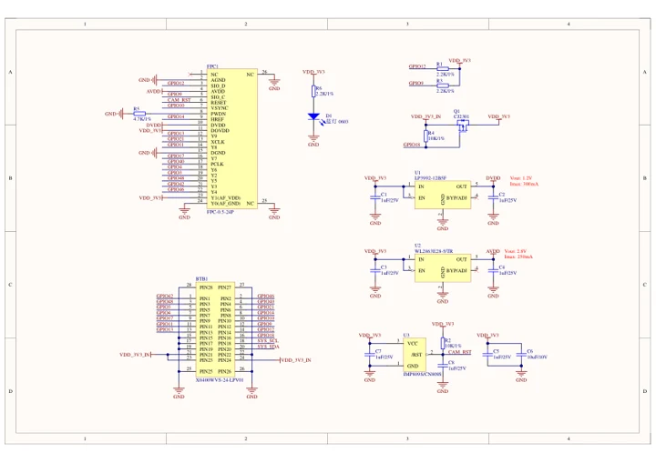
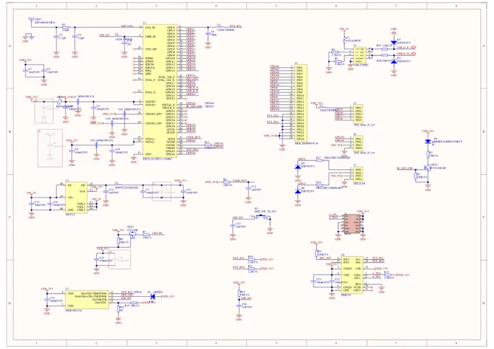

# AtomS3R-Ext

**M5Stack** · ESP32-S3

Revision: Not identified

Coverage: Manufacturer references available; physical pinout and complete connector review are tracked separately

[Browse all manufacturers](../../../../BROWSE.md) · [Devices & IoT](../../../../DEVICES.md) · [Open in the browser guide](https://valleytech-black-wire-guide.pages.dev/?board=m5stack-gpio-device-atoms3r-ext)

Device category: **Controllers & instruments**

## Datasheets and original documentation

Board datasheet: **not yet recorded**. Visual reference: **available**.

[Manufacturer model documentation](https://docs.m5stack.com/en/core/AtomS3R%20Cam)

- **schematic / board**: [AtomS3R-CAM ext board Schematics PDF — schematic](https://m5stack-doc.oss-cn-shenzhen.aliyuncs.com/681/ext_board_schematic.pdf) · [saved document](../../../../library/media/9184bdbfa402b57fd0d5a83bfa8b606650c2aebac61988e751272a42aa472ae0.pdf)
- **schematic / board**: [AtomS3R-CAM main board Schematics PDF — schematic](https://m5stack-doc.oss-cn-shenzhen.aliyuncs.com/681/main_board_schematic.pdf) · [saved document](../../../../library/media/62aec2833f60b30cf1b5c3e6a37e2e19792c83b501fac58ed94febca8303bc65.pdf)

A chip datasheet, schematic and board datasheet have different scopes. Match the exact hardware revision.

[Documentation coverage and remaining gaps](../../../../DOCUMENTATION.md)

## Pinout

**pinout image** · Reviewed source · JPG

[Open original reference](../../../../library/media/c9a248c4e6125c5924aff0cb7af4e2e5706987076d06f60b200f140be4700773.jpg)

**Credit and rights:** Not established; source attribution retained. Source/manufacturer: M5Stack.

[Source 1](https://m5stack-doc.oss-cn-shenzhen.aliyuncs.com/682/C126-Ext_PinMap_01.jpg) · [Source 2](https://docs.m5stack.com/en/core/AtomS3R%20Ext)

Imported from existing M5Stack Board Reference; original working path preserved.

Image revision: Not identified

SHA-256: `c9a248c4e6125c5924aff0cb7af4e2e5706987076d06f60b200f140be4700773`

## Dimensions

**source reference** · Unreviewed source · PNG

[Open original reference](../../../../library/media/8022e882c3a2f7efe5e0bd6d3ae1997c3280c84820bf6ff0308e13b8fd0b8897.png)

**Credit and rights:** Source rights not yet established. Source/manufacturer: M5Stack.

[Source 1](https://m5stack.oss-cn-shenzhen.aliyuncs.com/resource/docs/products/core/AtomS3R%20Ext/%E5%B0%BA%E5%AF%B8%E5%9B%BE.png) · [Source 2](https://docs.m5stack.com/en/core/AtomS3R%20Ext)

Original source index: Dimensions. This file is searchable but has not been promoted to a reviewed physical board pinout.

Image revision: Not identified

SHA-256: `8022e882c3a2f7efe5e0bd6d3ae1997c3280c84820bf6ff0308e13b8fd0b8897`

## AtomS3R-CAM ext board Schematics PDF — schematic

**reference PDF** · Source model/link and PDF signature/title checked; individual pin assignments and electrical validation pending · PDF

[Open original reference](../../../../library/media/9184bdbfa402b57fd0d5a83bfa8b606650c2aebac61988e751272a42aa472ae0.pdf)

**Credit and rights:** Original publisher/manufacturer artwork; redistribution and print rights not established. Attribution is not a license grant.. Source/manufacturer: M5Stack.

[Source 1](https://m5stack-doc.oss-cn-shenzhen.aliyuncs.com/681/ext_board_schematic.pdf) · [Source 2](https://docs.m5stack.com/en/core/AtomS3R%20Cam)

Original document linked from this model’s manufacturer page. Preserve the document’s exact revision and named subassembly scope; a linked accessory schematic is not a whole-device pinout. This is a circuit schematic, not a physical board pinout.

Image revision: Use the revision printed in the original document; do not assume all hardware revisions are interchangeable

SHA-256: `9184bdbfa402b57fd0d5a83bfa8b606650c2aebac61988e751272a42aa472ae0`

## AtomS3R-CAM main board Schematics PDF — schematic

**reference PDF** · Source model/link and PDF signature/title checked; individual pin assignments and electrical validation pending · PDF

[Open original reference](../../../../library/media/62aec2833f60b30cf1b5c3e6a37e2e19792c83b501fac58ed94febca8303bc65.pdf)

**Credit and rights:** Original publisher/manufacturer artwork; redistribution and print rights not established. Attribution is not a license grant.. Source/manufacturer: M5Stack.

[Source 1](https://m5stack-doc.oss-cn-shenzhen.aliyuncs.com/681/main_board_schematic.pdf) · [Source 2](https://docs.m5stack.com/en/core/AtomS3R%20Cam)

Original document linked from this model’s manufacturer page. Preserve the document’s exact revision and named subassembly scope; a linked accessory schematic is not a whole-device pinout. This is a circuit schematic, not a physical board pinout.

Image revision: Use the revision printed in the original document; do not assume all hardware revisions are interchangeable

SHA-256: `62aec2833f60b30cf1b5c3e6a37e2e19792c83b501fac58ed94febca8303bc65`

Pin assignments have not been independently electrically verified. Check board revision before wiring.
