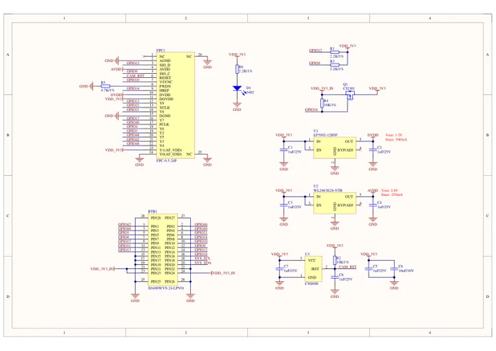
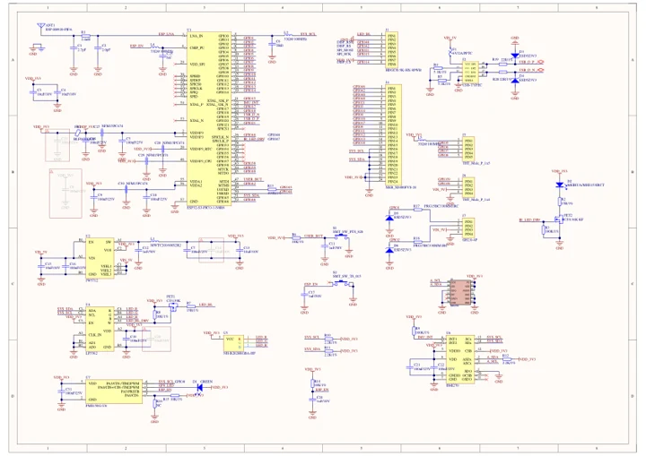

# AtomS3R-M12 Volcengine Kit

**M5Stack** · ESP32-S3

Revision: Not identified

Coverage: Manufacturer references available; physical pinout and complete connector review are tracked separately

[Browse all manufacturers](../../../../BROWSE.md) · [Devices & IoT](../../../../DEVICES.md) · [Open in the browser guide](https://valleytech-black-wire-guide.pages.dev/?board=m5stack-gpio-device-atoms3r-m12-volcengine-kit)

Device category: **Controllers & instruments**

## Datasheets and original documentation

Board datasheet: **not yet recorded**. Visual reference: **available**.

[Manufacturer model documentation](https://docs.m5stack.com/en/core/AtomS3R-M12%20Volcengine%20Kit)

- **schematic / board**: [AtomS3R-M12 Daughterboard Schematic PDF — schematic](https://m5stack-doc.oss-cn-shenzhen.aliyuncs.com/683/C126-CAM-Sch_M5_AtomS3R_CAM.pdf) · [saved document](../../../../library/media/cfcd17239517965cb2b2845ea6fec2d312d2fc053540ca9c77339d192362d2c4.pdf)
- **schematic / board**: [AtomS3R-M12 Mainboard Schematic PDF — schematic](https://m5stack-doc.oss-cn-shenzhen.aliyuncs.com/683/C126-CAM-Sch_M5_AtomS3R_v0.4.1.pdf) · [saved document](../../../../library/media/b9cc5d5bd7a539cae3027ae1a221943337435c2141a2c249d13abb2e8616a4ab.pdf)

A chip datasheet, schematic and board datasheet have different scopes. Match the exact hardware revision.

[Documentation coverage and remaining gaps](../../../../DOCUMENTATION.md)

## Pinout

**pinout image** · Reviewed source · JPG

[Open original reference](../../../../library/media/8e31ba0c03a24246e322fab5d6af4132453425fe4a6548f5c8beb23e029bbbe2.jpg)

**Credit and rights:** Not established; source attribution retained. Source/manufacturer: M5Stack.

[Source 1](https://m5stack.oss-cn-shenzhen.aliyuncs.com/resource/docs/products/core/AtomS3R-M12/%E5%8E%9F%E7%90%86%E5%9B%BE-pixel.jpg) · [Source 2](https://docs.m5stack.com/en/core/AtomS3R-M12%20Volcengine%20Kit)

Imported from existing M5Stack Board Reference; original working path preserved.

Image revision: Not identified

SHA-256: `8e31ba0c03a24246e322fab5d6af4132453425fe4a6548f5c8beb23e029bbbe2`

## AtomS3R-M12 Daughterboard Schematic PDF — schematic

**reference PDF** · Source model/link and PDF signature/title checked; individual pin assignments and electrical validation pending · PDF

[Open original reference](../../../../library/media/cfcd17239517965cb2b2845ea6fec2d312d2fc053540ca9c77339d192362d2c4.pdf)

**Credit and rights:** Original publisher/manufacturer artwork; redistribution and print rights not established. Attribution is not a license grant.. Source/manufacturer: M5Stack.

[Source 1](https://m5stack-doc.oss-cn-shenzhen.aliyuncs.com/683/C126-CAM-Sch_M5_AtomS3R_CAM.pdf) · [Source 2](https://docs.m5stack.com/en/core/AtomS3R-M12%20Volcengine%20Kit)

Original document linked from this model’s manufacturer page. Preserve the document’s exact revision and named subassembly scope; a linked accessory schematic is not a whole-device pinout. This is a circuit schematic, not a physical board pinout.

Image revision: Use the revision printed in the original document; do not assume all hardware revisions are interchangeable

SHA-256: `cfcd17239517965cb2b2845ea6fec2d312d2fc053540ca9c77339d192362d2c4`

## AtomS3R-M12 Mainboard Schematic PDF — schematic

**reference PDF** · Source model/link and PDF signature/title checked; individual pin assignments and electrical validation pending · PDF

[Open original reference](../../../../library/media/b9cc5d5bd7a539cae3027ae1a221943337435c2141a2c249d13abb2e8616a4ab.pdf)

**Credit and rights:** Original publisher/manufacturer artwork; redistribution and print rights not established. Attribution is not a license grant.. Source/manufacturer: M5Stack.

[Source 1](https://m5stack-doc.oss-cn-shenzhen.aliyuncs.com/683/C126-CAM-Sch_M5_AtomS3R_v0.4.1.pdf) · [Source 2](https://docs.m5stack.com/en/core/AtomS3R-M12%20Volcengine%20Kit)

Original document linked from this model’s manufacturer page. Preserve the document’s exact revision and named subassembly scope; a linked accessory schematic is not a whole-device pinout. This is a circuit schematic, not a physical board pinout.

Image revision: Use the revision printed in the original document; do not assume all hardware revisions are interchangeable

SHA-256: `b9cc5d5bd7a539cae3027ae1a221943337435c2141a2c249d13abb2e8616a4ab`

Pin assignments have not been independently electrically verified. Check board revision before wiring.
