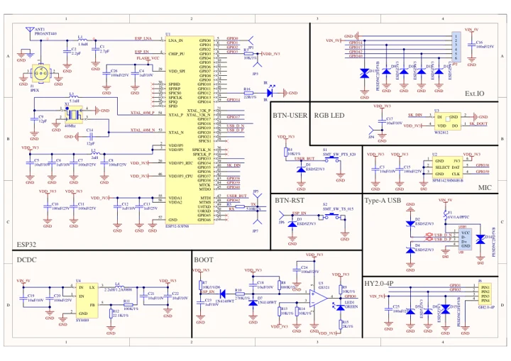

# AtomS3U

**M5Stack** · ESP32-S3

Revision: Not identified

Coverage: Manufacturer references available; physical pinout and complete connector review are tracked separately

[Browse all manufacturers](../../../../BROWSE.md) · [Devices & IoT](../../../../DEVICES.md) · [Open in the browser guide](https://valleytech-black-wire-guide.pages.dev/?board=m5stack-gpio-device-atoms3u)

Device category: **Controllers & instruments**

## Datasheets and original documentation

Board datasheet: **not yet recorded**. Visual reference: **available**.

[Manufacturer model documentation](https://docs.m5stack.com/en/core/AtomS3U)

- **schematic / board**: [AtomS3U Schematics PDF — schematic](https://m5stack-doc.oss-cn-shenzhen.aliyuncs.com/477/Sch_AtomS3U_v1.0.pdf) · [saved document](../../../../library/media/c3cab868cf249cd5f7901d318a9469a2e8e27066de86be9eb3b106f11c1728d0.pdf)

A chip datasheet, schematic and board datasheet have different scopes. Match the exact hardware revision.

[Documentation coverage and remaining gaps](../../../../DOCUMENTATION.md)

## Pinout

**pinout image** · Reviewed source · JPG

[Open original reference](../../../../library/media/5dd54cd8f4c46e2aee72aaeef3932a526c149e122c64a68f7ea98a381e6e677c.jpg)

**Credit and rights:** Not established; source attribution retained. Source/manufacturer: M5Stack.

[Source 1](https://m5stack-doc.oss-cn-shenzhen.aliyuncs.com/477/K125_PinMap_01.jpg) · [Source 2](https://docs.m5stack.com/en/core/AtomS3U)

Imported from existing M5Stack Board Reference; original working path preserved.

Image revision: Not identified

SHA-256: `5dd54cd8f4c46e2aee72aaeef3932a526c149e122c64a68f7ea98a381e6e677c`

## Dimensions

**source reference** · Unreviewed source · JPG

[Open original reference](../../../../library/media/e13d53c4f1e78d4be962b1d70d640a3362bbf9baca742d0d8f0a2cc947e5690f.jpg)

**Credit and rights:** Source rights not yet established. Source/manufacturer: M5Stack.

[Source 1](https://m5stack.oss-cn-shenzhen.aliyuncs.com/resource/docs/products/core/AtomS3U/module%20size.jpg) · [Source 2](https://docs.m5stack.com/en/core/AtomS3U)

Original source index: Dimensions. This file is searchable but has not been promoted to a reviewed physical board pinout.

Image revision: Not identified

SHA-256: `e13d53c4f1e78d4be962b1d70d640a3362bbf9baca742d0d8f0a2cc947e5690f`

## AtomS3U Schematics PDF — schematic

**reference PDF** · Source model/link and PDF signature/title checked; individual pin assignments and electrical validation pending · PDF

[Open original reference](../../../../library/media/c3cab868cf249cd5f7901d318a9469a2e8e27066de86be9eb3b106f11c1728d0.pdf)

**Credit and rights:** Original publisher/manufacturer artwork; redistribution and print rights not established. Attribution is not a license grant.. Source/manufacturer: M5Stack.

[Source 1](https://m5stack-doc.oss-cn-shenzhen.aliyuncs.com/477/Sch_AtomS3U_v1.0.pdf) · [Source 2](https://docs.m5stack.com/en/core/AtomS3U)

Original document linked from this model’s manufacturer page. Preserve the document’s exact revision and named subassembly scope; a linked accessory schematic is not a whole-device pinout. This is a circuit schematic, not a physical board pinout.

Image revision: Use the revision printed in the original document; do not assume all hardware revisions are interchangeable

SHA-256: `c3cab868cf249cd5f7901d318a9469a2e8e27066de86be9eb3b106f11c1728d0`

Pin assignments have not been independently electrically verified. Check board revision before wiring.
