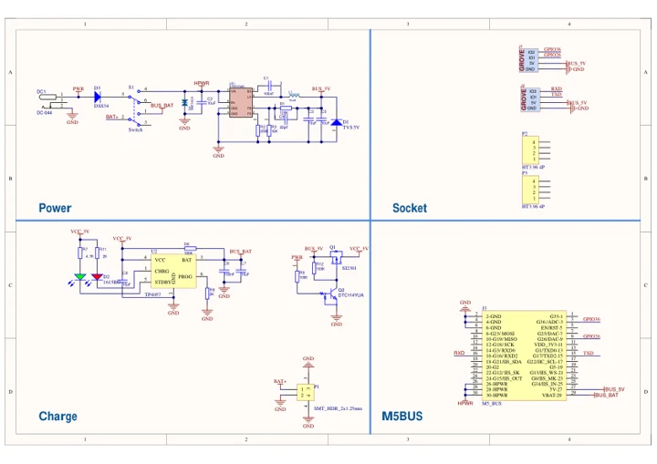
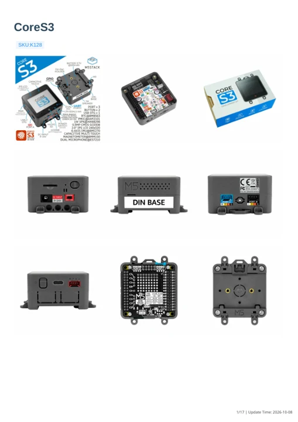

# CoreS3

**M5Stack** · ESP32-S3

Revision: Not identified

Coverage: Manufacturer references available; physical pinout and complete connector review are tracked separately

[Browse all manufacturers](../../../../BROWSE.md) · [Devices & IoT](../../../../DEVICES.md) · [Open in the browser guide](https://valleytech-black-wire-guide.pages.dev/?board=m5stack-esp32-cores3)

Device category: **Controllers & instruments**

## Datasheets and original documentation

Board datasheet: **not yet recorded**. Visual reference: **available**.

[Manufacturer model documentation](https://docs.m5stack.com/en/core/cores3)

- **schematic / board**: [Base DIN Schematics PDF — schematic](https://m5stack-doc.oss-cn-shenzhen.aliyuncs.com/559/SCH_DinBase_V1.1.pdf) · [saved document](../../../../library/media/91298e0fbfb2b73b92f8d53a6f24dd68f543e40adba93f3be1b686b515515af2.pdf)
- **schematic / board**: [CoreS3 Schematics PDF — schematic](https://m5stack-doc.oss-cn-shenzhen.aliyuncs.com/490/Sch_M5_CoreS3_v1.0.pdf) · [saved document](../../../../library/media/58a15454eccb11d2668e1a9a3ad85943b9a58b104c5f1ed137b790192ec27c04.pdf)
- **hardware-guide / board**: [CoreS3 — manufacturer hardware guide](https://m5stack.oss-cn-shenzhen.aliyuncs.com/resource/docs/static/pdf/static/en/core/CoreS3.pdf) · [saved document](../../../../library/media/a8c62ec1e4ce230898ca44ef3fdeeee6d2870198eaead647dc9f9d44ef4529ac.pdf)

A chip datasheet, schematic and board datasheet have different scopes. Match the exact hardware revision.

[Documentation coverage and remaining gaps](../../../../DOCUMENTATION.md)

## Pinout

**GPIO reference image** · Reviewed source · PNG

[Open original reference](../../../../library/media/a54886479bb8056bc4f1d3cbff5434f4c70656d7ea41212139513a92a46d4fbd.png)

**Credit and rights:** Not established; source attribution retained. Source/manufacturer: M5Stack.

[Source 1](https://m5stack.oss-cn-shenzhen.aliyuncs.com/resource/docs/products/core/M5CORES3%20SE/c9024cfa50b8d7c31ca7505668770ee.png) · [Source 2](https://docs.m5stack.com/en/core/CoreS3)

Imported from existing M5Stack Board Reference; original working path preserved.

Image revision: Not identified

SHA-256: `a54886479bb8056bc4f1d3cbff5434f4c70656d7ea41212139513a92a46d4fbd`

## Dimensions

**source reference** · Unreviewed source · PNG

[Open original reference](../../../../library/media/72972ff58cc25164fb538e0383e198176f7ddcc548f3d9173c6077e5870a0d1a.png)

**Credit and rights:** Source rights not yet established. Source/manufacturer: M5Stack.

[Source 1](https://m5stack.oss-cn-shenzhen.aliyuncs.com/resource/docs/products/core/CoreS3/%E5%B0%BA%E5%AF%B8%E5%9B%BE.png) · [Source 2](https://docs.m5stack.com/en/core/CoreS3)

Original source index: Dimensions. This file is searchable but has not been promoted to a reviewed physical board pinout.

Image revision: Not identified

SHA-256: `72972ff58cc25164fb538e0383e198176f7ddcc548f3d9173c6077e5870a0d1a`

## Base DIN Schematics PDF — schematic

**reference PDF** · Source model/link and PDF signature/title checked; individual pin assignments and electrical validation pending · PDF

[Open original reference](../../../../library/media/91298e0fbfb2b73b92f8d53a6f24dd68f543e40adba93f3be1b686b515515af2.pdf)

**Credit and rights:** Original publisher/manufacturer artwork; redistribution and print rights not established. Attribution is not a license grant.. Source/manufacturer: M5Stack.

[Source 1](https://m5stack-doc.oss-cn-shenzhen.aliyuncs.com/559/SCH_DinBase_V1.1.pdf) · [Source 2](https://docs.m5stack.com/en/base/DIN%20BASE)

Original document linked from this model’s manufacturer page. Preserve the document’s exact revision and named subassembly scope; a linked accessory schematic is not a whole-device pinout. This is a circuit schematic, not a physical board pinout.

Image revision: Use the revision printed in the original document; do not assume all hardware revisions are interchangeable

SHA-256: `91298e0fbfb2b73b92f8d53a6f24dd68f543e40adba93f3be1b686b515515af2`

## CoreS3 Schematics PDF — schematic

**reference PDF** · Source model/link and PDF signature/title checked; individual pin assignments and electrical validation pending · PDF

[Open original reference](../../../../library/media/58a15454eccb11d2668e1a9a3ad85943b9a58b104c5f1ed137b790192ec27c04.pdf)

**Credit and rights:** Original publisher/manufacturer artwork; redistribution and print rights not established. Attribution is not a license grant.. Source/manufacturer: M5Stack.

[Source 1](https://m5stack-doc.oss-cn-shenzhen.aliyuncs.com/490/Sch_M5_CoreS3_v1.0.pdf) · [Source 2](https://docs.m5stack.com/en/core/cores3)

Original document linked from this model’s manufacturer page. Preserve the document’s exact revision and named subassembly scope; a linked accessory schematic is not a whole-device pinout. This is a circuit schematic, not a physical board pinout.

Image revision: Use the revision printed in the original document; do not assume all hardware revisions are interchangeable

SHA-256: `58a15454eccb11d2668e1a9a3ad85943b9a58b104c5f1ed137b790192ec27c04`

## CoreS3 — manufacturer hardware guide

**reference PDF** · Source model/link and PDF signature/title checked; individual pin assignments and electrical validation pending · PDF

[Open original reference](../../../../library/media/a8c62ec1e4ce230898ca44ef3fdeeee6d2870198eaead647dc9f9d44ef4529ac.pdf)

**Credit and rights:** Original publisher/manufacturer artwork; redistribution and print rights not established. Attribution is not a license grant.. Source/manufacturer: M5Stack.

[Source 1](https://m5stack.oss-cn-shenzhen.aliyuncs.com/resource/docs/static/pdf/static/en/core/CoreS3.pdf) · [Source 2](https://docs.m5stack.com/en/core/cores3)

Original document linked from this model’s manufacturer page. Preserve the document’s exact revision and named subassembly scope; a linked accessory schematic is not a whole-device pinout. This is a hardware manual, not a separately classified board datasheet.

Image revision: Use the revision printed in the original document; do not assume all hardware revisions are interchangeable

SHA-256: `a8c62ec1e4ce230898ca44ef3fdeeee6d2870198eaead647dc9f9d44ef4529ac`

Pin assignments have not been independently electrically verified. Check board revision before wiring.
