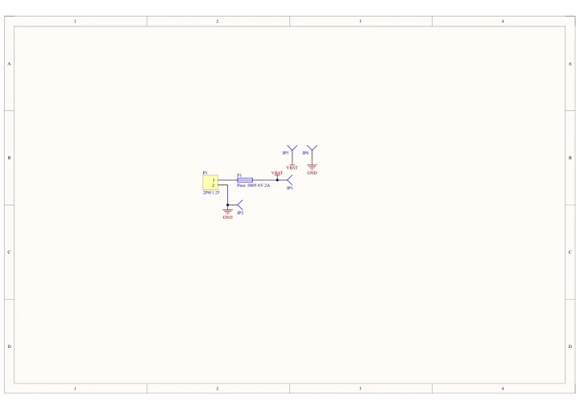
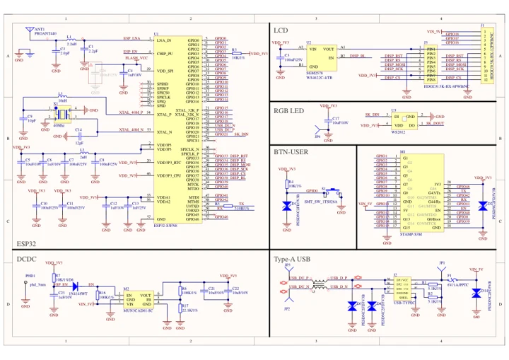

# M5Stack CardPuter - M5StampS3 powered mini computer (MicroROS)

**M5Stack** · ESP32-S3

Revision: Not identified

Coverage: Manufacturer references available; physical pinout and complete connector review are tracked separately

[Browse all manufacturers](../../../../BROWSE.md) · [Devices & IoT](../../../../DEVICES.md) · [Open in the browser guide](https://valleytech-black-wire-guide.pages.dev/?board=m5stack-esp32-cardputer-m5stamps3-powered-mini-computer-microros)

## Datasheets and original documentation

Board datasheet: **not yet recorded**. Visual reference: **available**.

[Manufacturer model documentation](https://docs.m5stack.com/en/core/Cardputer)

- **schematic / board**: [Cardputer Base Schematics PDF — schematic](https://m5stack-doc.oss-cn-shenzhen.aliyuncs.com/481/Sch_M5cardputer_Base.pdf) · [saved document](../../../../library/media/29542fe18b8687e4bd5fe7c533decd6a21e434cac8ac4b3f4cb1a6dd407be2cc.pdf)
- **schematic / board**: [Stamp-S3 Schematics PDF — schematic](https://m5stack-doc.oss-cn-shenzhen.aliyuncs.com/522/Sch_M5StampS3_v0.2.pdf) · [saved document](../../../../library/media/6d92e1aef6577838b9abffcf1adf6c86e1b0c8374fcd372af451bb58ef19eb94.pdf)

A chip datasheet, schematic and board datasheet have different scopes. Match the exact hardware revision.

[Documentation coverage and remaining gaps](../../../../DOCUMENTATION.md)

## Cardputer Base Schematics PDF — schematic

**reference PDF** · Source model/link and PDF signature/title checked; individual pin assignments and electrical validation pending · PDF

[Open original reference](../../../../library/media/29542fe18b8687e4bd5fe7c533decd6a21e434cac8ac4b3f4cb1a6dd407be2cc.pdf)

**Credit and rights:** Original publisher/manufacturer artwork; redistribution and print rights not established. Attribution is not a license grant.. Source/manufacturer: M5Stack.

[Source 1](https://m5stack-doc.oss-cn-shenzhen.aliyuncs.com/481/Sch_M5cardputer_Base.pdf) · [Source 2](https://docs.m5stack.com/en/core/Cardputer)

Original document linked from this model’s manufacturer page. Preserve the document’s exact revision and named subassembly scope; a linked accessory schematic is not a whole-device pinout. This is a circuit schematic, not a physical board pinout.

Image revision: Use the revision printed in the original document; do not assume all hardware revisions are interchangeable

SHA-256: `29542fe18b8687e4bd5fe7c533decd6a21e434cac8ac4b3f4cb1a6dd407be2cc`

## Stamp-S3 Schematics PDF — schematic

**reference PDF** · Source model/link and PDF signature/title checked; individual pin assignments and electrical validation pending · PDF

[Open original reference](../../../../library/media/6d92e1aef6577838b9abffcf1adf6c86e1b0c8374fcd372af451bb58ef19eb94.pdf)

**Credit and rights:** Original publisher/manufacturer artwork; redistribution and print rights not established. Attribution is not a license grant.. Source/manufacturer: M5Stack.

[Source 1](https://m5stack-doc.oss-cn-shenzhen.aliyuncs.com/522/Sch_M5StampS3_v0.2.pdf) · [Source 2](https://docs.m5stack.com/en/core/Cardputer)

Original document linked from this model’s manufacturer page. Preserve the document’s exact revision and named subassembly scope; a linked accessory schematic is not a whole-device pinout. This is a circuit schematic, not a physical board pinout.

Image revision: Use the revision printed in the original document; do not assume all hardware revisions are interchangeable

SHA-256: `6d92e1aef6577838b9abffcf1adf6c86e1b0c8374fcd372af451bb58ef19eb94`

Pin assignments have not been independently electrically verified. Check board revision before wiring.
