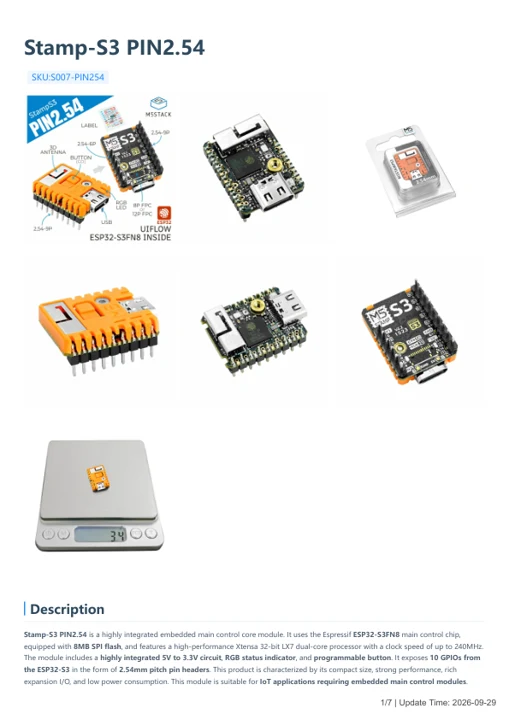

# Stamp-S3 PIN2.54

**M5Stack** · ESP32-S3

Revision: Not identified

Coverage: Manufacturer references available; physical pinout and complete connector review are tracked separately

[Browse all manufacturers](../../../../BROWSE.md) · [Devices & IoT](../../../../DEVICES.md) · [Open in the browser guide](https://valleytech-black-wire-guide.pages.dev/?board=m5stack-esp32-stamp-s3-pin2-54)

## Datasheets and original documentation

Board datasheet: **not yet recorded**. Visual reference: **available**.

[Manufacturer model documentation](https://docs.m5stack.com/en/core/M5StampS3%20PIN2.54)

- **hardware-guide / board**: [Stamp-S3 PIN2.54 — manufacturer hardware guide](https://m5stack.oss-cn-shenzhen.aliyuncs.com/resource/docs/static/pdf/static/en/core/Stamp-S3_PIN2.54.pdf) · [saved document](../../../../library/media/2a29364fd664f8d245dfaedb0e3350d94aecd2fb0fa7bed3494de96f0c367328.pdf)

A chip datasheet, schematic and board datasheet have different scopes. Match the exact hardware revision.

[Documentation coverage and remaining gaps](../../../../DOCUMENTATION.md)

## Pinout

**pinout image** · Reviewed source · PNG

[Open original reference](../../../../library/media/7b3485c05bcd50a560f1ccc593508b8b8b1be6a9c7d96d9a46a6caae4cac70f9.png)

**Credit and rights:** Not established; source attribution retained. Source/manufacturer: M5Stack.

[Source 1](https://m5stack.oss-cn-shenzhen.aliyuncs.com/resource/docs/products/core/M5StampS3%20PIN2.54/254.png) · [Source 2](https://docs.m5stack.com/en/core/M5StampS3%20PIN2.54)

Imported from existing M5Stack Board Reference; original working path preserved.

Image revision: Not identified

SHA-256: `7b3485c05bcd50a560f1ccc593508b8b8b1be6a9c7d96d9a46a6caae4cac70f9`

## Pinout

**pinout image** · Reviewed source · JPG

[Open original reference](../../../../library/media/37249f2574a8702c053b1807a9793ea4dbf7d44ff7ddccf3640c61a5a9863b77.jpg)

**Credit and rights:** Not established; source attribution retained. Source/manufacturer: M5Stack.

[Source 1](https://m5stack-doc.oss-cn-shenzhen.aliyuncs.com/684/S007_PinMap_01.jpg) · [Source 2](https://docs.m5stack.com/en/core/M5StampS3%20PIN2.54)

Imported from existing M5Stack Board Reference; original working path preserved.

Image revision: Not identified

SHA-256: `37249f2574a8702c053b1807a9793ea4dbf7d44ff7ddccf3640c61a5a9863b77`

## Stamp-S3 PIN2.54 — manufacturer hardware guide

**reference PDF** · Source model/link and PDF signature/title checked; individual pin assignments and electrical validation pending · PDF

[Open original reference](../../../../library/media/2a29364fd664f8d245dfaedb0e3350d94aecd2fb0fa7bed3494de96f0c367328.pdf)

**Credit and rights:** Original publisher/manufacturer artwork; redistribution and print rights not established. Attribution is not a license grant.. Source/manufacturer: M5Stack.

[Source 1](https://m5stack.oss-cn-shenzhen.aliyuncs.com/resource/docs/static/pdf/static/en/core/Stamp-S3_PIN2.54.pdf) · [Source 2](https://docs.m5stack.com/en/core/M5StampS3%20PIN2.54)

Original document linked from this model’s manufacturer page. Preserve the document’s exact revision and named subassembly scope; a linked accessory schematic is not a whole-device pinout. This is a hardware manual, not a separately classified board datasheet.

Image revision: Use the revision printed in the original document; do not assume all hardware revisions are interchangeable

SHA-256: `2a29364fd664f8d245dfaedb0e3350d94aecd2fb0fa7bed3494de96f0c367328`

Pin assignments have not been independently electrically verified. Check board revision before wiring.
