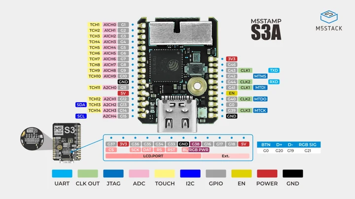
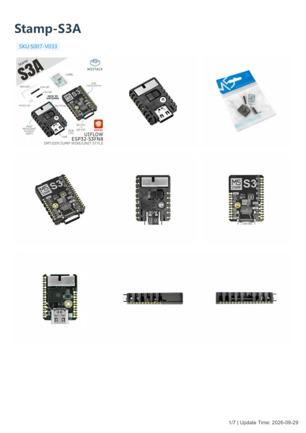

# Stamp-S3A

**M5Stack** · ESP32-S3

Revision: Not identified

Coverage: Manufacturer references available; physical pinout and complete connector review are tracked separately

[Browse all manufacturers](../../../../BROWSE.md) · [Devices & IoT](../../../../DEVICES.md) · [Open in the browser guide](https://valleytech-black-wire-guide.pages.dev/?board=m5stack-esp32-stamp-s3a)

## Datasheets and original documentation

Board datasheet: **not yet recorded**. Visual reference: **available**.

[Manufacturer model documentation](https://docs.m5stack.com/en/core/Stamp-S3A)

- **schematic / board**: [Stamp-S3A Schematics PDF — schematic](https://m5stack-doc.oss-cn-shenzhen.aliyuncs.com/1150/Sch_StampS3_v0.3.3.pdf) · [saved document](../../../../library/media/2f9610aecc5a5d2ee51b33c75df31cf90c7639d2997e7a2bb147ba8d46b46966.pdf)
- **hardware-guide / board**: [Stamp-S3A — manufacturer hardware guide](https://m5stack.oss-cn-shenzhen.aliyuncs.com/resource/docs/static/pdf/static/en/core/Stamp-S3A.pdf) · [saved document](../../../../library/media/95c0db2384fb17fe0ddcb161279545017a59803429aba8c4cecf55a4036f01a7.pdf)

A chip datasheet, schematic and board datasheet have different scopes. Match the exact hardware revision.

[Documentation coverage and remaining gaps](../../../../DOCUMENTATION.md)

## PinMap

**pinout image** · Reviewed source · JPG

[Open original reference](../../../../library/media/979f3572d60fd9ef9017bb28f0953ba59f48072d7c8bcdfa07f916a3060493d3.jpg)

**Credit and rights:** Not established; source attribution retained. Source/manufacturer: M5Stack.

[Source 1](https://m5stack-doc.oss-cn-shenzhen.aliyuncs.com/1150/S007-V033_PinMap_01.jpg) · [Source 2](https://docs.m5stack.com/en/core/Stamp-S3A)

Image revision: Not identified

SHA-256: `979f3572d60fd9ef9017bb28f0953ba59f48072d7c8bcdfa07f916a3060493d3`

## Stamp-S3A Schematics PDF — schematic

**reference PDF** · Source model/link and PDF signature/title checked; individual pin assignments and electrical validation pending · PDF

[Open original reference](../../../../library/media/2f9610aecc5a5d2ee51b33c75df31cf90c7639d2997e7a2bb147ba8d46b46966.pdf)

**Credit and rights:** Original publisher/manufacturer artwork; redistribution and print rights not established. Attribution is not a license grant.. Source/manufacturer: M5Stack.

[Source 1](https://m5stack-doc.oss-cn-shenzhen.aliyuncs.com/1150/Sch_StampS3_v0.3.3.pdf) · [Source 2](https://docs.m5stack.com/en/core/Stamp-S3A)

Original document linked from this model’s manufacturer page. Preserve the document’s exact revision and named subassembly scope; a linked accessory schematic is not a whole-device pinout. This is a circuit schematic, not a physical board pinout.

Image revision: Use the revision printed in the original document; do not assume all hardware revisions are interchangeable

SHA-256: `2f9610aecc5a5d2ee51b33c75df31cf90c7639d2997e7a2bb147ba8d46b46966`

## Stamp-S3A — manufacturer hardware guide

**reference PDF** · Source model/link and PDF signature/title checked; individual pin assignments and electrical validation pending · PDF

[Open original reference](../../../../library/media/95c0db2384fb17fe0ddcb161279545017a59803429aba8c4cecf55a4036f01a7.pdf)

**Credit and rights:** Original publisher/manufacturer artwork; redistribution and print rights not established. Attribution is not a license grant.. Source/manufacturer: M5Stack.

[Source 1](https://m5stack.oss-cn-shenzhen.aliyuncs.com/resource/docs/static/pdf/static/en/core/Stamp-S3A.pdf) · [Source 2](https://docs.m5stack.com/en/core/Stamp-S3A)

Original document linked from this model’s manufacturer page. Preserve the document’s exact revision and named subassembly scope; a linked accessory schematic is not a whole-device pinout. This is a hardware manual, not a separately classified board datasheet.

Image revision: Use the revision printed in the original document; do not assume all hardware revisions are interchangeable

SHA-256: `95c0db2384fb17fe0ddcb161279545017a59803429aba8c4cecf55a4036f01a7`

Pin assignments have not been independently electrically verified. Check board revision before wiring.
