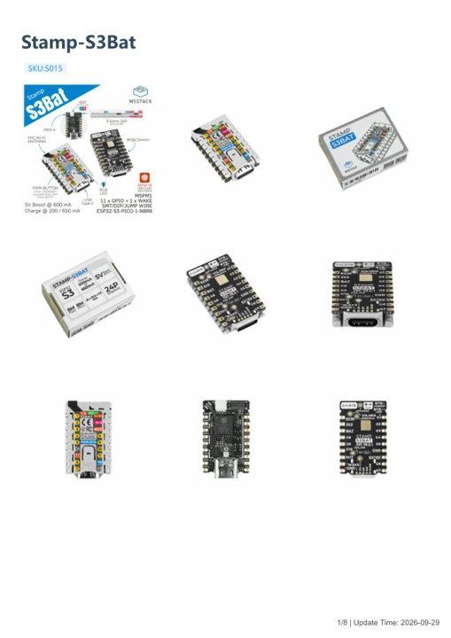

# Stamp-S3Bat

**M5Stack** · ESP32-S3

Revision: Not identified

Coverage: Manufacturer references available; physical pinout and complete connector review are tracked separately

[Browse all manufacturers](../../../../BROWSE.md) · [Devices & IoT](../../../../DEVICES.md) · [Open in the browser guide](https://valleytech-black-wire-guide.pages.dev/?board=m5stack-esp32-stamp-s3bat)

## Datasheets and original documentation

Board datasheet: **not yet recorded**. Visual reference: **available**.

[Manufacturer model documentation](https://docs.m5stack.com/en/core/Stamp-S3Bat)

- **hardware-guide / board**: [Stamp-S3Bat — manufacturer hardware guide](https://m5stack.oss-cn-shenzhen.aliyuncs.com/resource/docs/static/pdf/static/en/core/Stamp-S3Bat.pdf) · [saved document](../../../../library/media/3dba675f960a9dbd0cabe94bb30a854c0408bc8382561dc694ea555c50228544.pdf)

A chip datasheet, schematic and board datasheet have different scopes. Match the exact hardware revision.

[Documentation coverage and remaining gaps](../../../../DOCUMENTATION.md)

## Pinout

**pinout image** · Reviewed source · JPG

[Open original reference](../../../../library/media/d8e651019e9dcb6ca43bf8fb9d141c958bff79ddf74b204c47fa6d35ffc2e4f7.jpg)

**Credit and rights:** Not established; source attribution retained. Source/manufacturer: M5Stack.

[Source 1](https://m5stack-doc.oss-cn-shenzhen.aliyuncs.com/1222/S015-StampS3Bat-pinmap.jpg) · [Source 2](https://docs.m5stack.com/en/core/Stamp-S3Bat)

Imported from existing M5Stack Board Reference; original working path preserved.

Image revision: Not identified

SHA-256: `d8e651019e9dcb6ca43bf8fb9d141c958bff79ddf74b204c47fa6d35ffc2e4f7`

## Dimensions

**source reference** · Unreviewed source · PNG

[Open original reference](../../../../library/media/bd9dd5ba466ac5214baf4c9e14411c8595f2c580a29278f02307341ece2998c5.png)

**Credit and rights:** Source rights not yet established. Source/manufacturer: M5Stack.

[Source 1](https://m5stack-doc.oss-cn-shenzhen.aliyuncs.com/1221/S015-stamp-s3BAT_page_01.png) · [Source 2](https://docs.m5stack.com/en/core/Stamp-S3Bat)

Original source index: Dimensions. This file is searchable but has not been promoted to a reviewed physical board pinout.

Image revision: Not identified

SHA-256: `bd9dd5ba466ac5214baf4c9e14411c8595f2c580a29278f02307341ece2998c5`

## Stamp-S3Bat — manufacturer hardware guide

**reference PDF** · Source model/link and PDF signature/title checked; individual pin assignments and electrical validation pending · PDF

[Open original reference](../../../../library/media/3dba675f960a9dbd0cabe94bb30a854c0408bc8382561dc694ea555c50228544.pdf)

**Credit and rights:** Original publisher/manufacturer artwork; redistribution and print rights not established. Attribution is not a license grant.. Source/manufacturer: M5Stack.

[Source 1](https://m5stack.oss-cn-shenzhen.aliyuncs.com/resource/docs/static/pdf/static/en/core/Stamp-S3Bat.pdf) · [Source 2](https://docs.m5stack.com/en/core/Stamp-S3Bat)

Original document linked from this model’s manufacturer page. Preserve the document’s exact revision and named subassembly scope; a linked accessory schematic is not a whole-device pinout. This is a hardware manual, not a separately classified board datasheet.

Image revision: Use the revision printed in the original document; do not assume all hardware revisions are interchangeable

SHA-256: `3dba675f960a9dbd0cabe94bb30a854c0408bc8382561dc694ea555c50228544`

Pin assignments have not been independently electrically verified. Check board revision before wiring.
