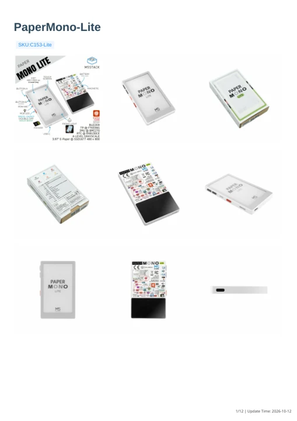

# PaperMono-Lite

**M5Stack** · ESP32-S3R8

Revision: Match revision in each original source

Coverage: Manufacturer references available; physical pinout and complete connector review are tracked separately

[Browse all manufacturers](../../../../BROWSE.md) · [Devices & IoT](../../../../DEVICES.md) · [Open in the browser guide](https://valleytech-black-wire-guide.pages.dev/?board=m5stack-papermono-lite)

Device category: **Controllers & instruments**

Manufacturer documentation recorded; confirm the exact hardware revision before use.

## Datasheets and original documentation

Board datasheet: **not yet recorded**. Visual reference: **available**.

[Manufacturer model documentation](https://docs.m5stack.com/en/core/PaperMono-Lite)

- **schematic / board**: [PaperMono-Lite Schematics PDF](https://m5stack-doc.oss-cn-shenzhen.aliyuncs.com/1268/PaperMono-Lite_PRJ_V0.6.2_20260522.pdf) · [saved document](../../../../library/media/e27b138e9104d3550531c9a9757ddc3d14941a546acc698ba7df4f40cd37095e.pdf)
- **hardware-guide / board**: [Manufacturer pin and hardware documentation](https://docs.m5stack.com/en/core/PaperMono-Lite) · online
- **hardware-guide / board**: [PaperMono-Lite — manufacturer hardware guide](https://m5stack.oss-cn-shenzhen.aliyuncs.com/resource/docs/static/pdf/static/en/core/PaperMono-Lite.pdf) · [saved document](../../../../library/media/27b041a4cc840ab870d490c6eb48a1d43bc29e9943f72225612c165346789f87.pdf)

A chip datasheet, schematic and board datasheet have different scopes. Match the exact hardware revision.

[Documentation coverage and remaining gaps](../../../../DOCUMENTATION.md)

## PaperMono-Lite Schematics PDF

**original reference PDF** · Manufacturer source and first-page preview inspected; electrical correctness and all-connector completeness not independently approved. · PDF

[Open original reference](../../../../library/media/e27b138e9104d3550531c9a9757ddc3d14941a546acc698ba7df4f40cd37095e.pdf)

**Credit and rights:** Manufacturer artwork; reuse and print rights not established. Inclusion does not relicense the original.. Source/manufacturer: M5Stack.

[Source 1](https://m5stack-doc.oss-cn-shenzhen.aliyuncs.com/1268/PaperMono-Lite_PRJ_V0.6.2_20260522.pdf) · [Source 2](https://docs.m5stack.com/en/core/PaperMono-Lite)

Manufacturer source retained unchanged. Manufacturer source and first-page preview inspected; electrical correctness and all-connector completeness not independently approved.

Image revision: As supplied in the original; match exact board revision

SHA-256: `e27b138e9104d3550531c9a9757ddc3d14941a546acc698ba7df4f40cd37095e`

## PaperMono-Lite — manufacturer hardware guide

**reference PDF** · Source model/link and PDF signature/title checked; individual pin assignments and electrical validation pending · PDF

[Open original reference](../../../../library/media/27b041a4cc840ab870d490c6eb48a1d43bc29e9943f72225612c165346789f87.pdf)

**Credit and rights:** Original publisher/manufacturer artwork; redistribution and print rights not established. Attribution is not a license grant.. Source/manufacturer: M5Stack.

[Source 1](https://m5stack.oss-cn-shenzhen.aliyuncs.com/resource/docs/static/pdf/static/en/core/PaperMono-Lite.pdf) · [Source 2](https://docs.m5stack.com/en/core/PaperMono-Lite)

Original document linked from this model’s manufacturer page. Preserve the document’s exact revision and named subassembly scope; a linked accessory schematic is not a whole-device pinout. This is a hardware manual, not a separately classified board datasheet.

Image revision: Use the revision printed in the original document; do not assume all hardware revisions are interchangeable

SHA-256: `27b041a4cc840ab870d490c6eb48a1d43bc29e9943f72225612c165346789f87`

Pin assignments have not been independently electrically verified. Check board revision before wiring.
