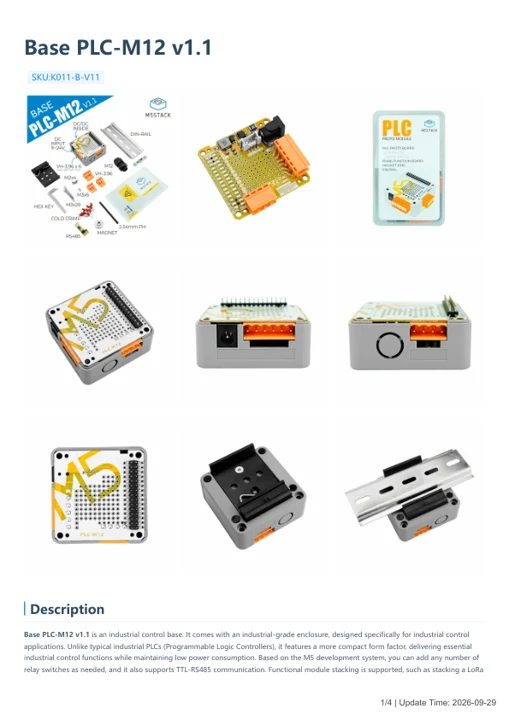
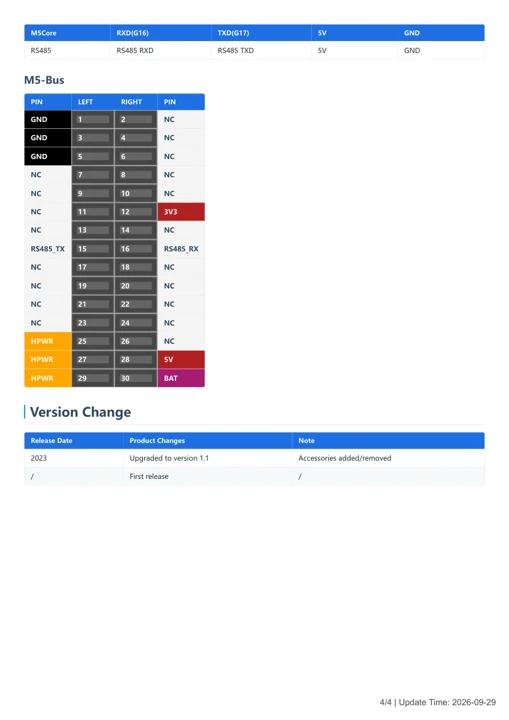

# Base PLC-M12 v1.1

**M5Stack** · Expansion module

Revision: v1.1

Coverage: Partial manufacturer references; all-connector review pending

[Browse all manufacturers](../../../../BROWSE.md) · [Devices & IoT](../../../../DEVICES.md) · [Open in the browser guide](https://valleytech-black-wire-guide.pages.dev/?board=m5stack-base-plc-m12-v1-1)

## Datasheets and original documentation

Board datasheet: **not yet recorded**. Visual reference: **available**.

[Manufacturer hardware documentation](https://docs.m5stack.com/en/base/Base_PLC-M12_v1.1)

- **hardware-guide / board**: [Base PLC-M12 v1.1 hardware guide](https://m5stack.oss-cn-shenzhen.aliyuncs.com/resource/docs/static/pdf/static/en/base/Base_PLC-M12_v1.1.pdf) · [saved document](../../../../library/media/514a83dd82d104b64d5a94fb1ffdf9210dc95095fdd7d44825fdbd0b2afe3ce3.pdf)
- **hardware-guide / board**: [Manufacturer specifications and hardware documentation](https://docs.m5stack.com/en/base/Base_PLC-M12_v1.1) · online

A chip datasheet, schematic and board datasheet have different scopes. Match the exact hardware revision.

[Documentation coverage and remaining gaps](../../../../DOCUMENTATION.md)

## Base PLC-M12 v1.1 hardware guide

**reference PDF** · Visually reviewed for identity and reference scope; independent electrical and all-connector review pending · PDF

[Open original reference](../../../../library/media/514a83dd82d104b64d5a94fb1ffdf9210dc95095fdd7d44825fdbd0b2afe3ce3.pdf)

**Credit and rights:** Manufacturer artwork; reuse and print rights not established. Inclusion does not relicense the original.. Source/manufacturer: M5Stack.

[Source 1](https://m5stack.oss-cn-shenzhen.aliyuncs.com/resource/docs/static/pdf/static/en/base/Base_PLC-M12_v1.1.pdf) · [Source 2](https://docs.m5stack.com/en/base/Base_PLC-M12_v1.1)

Original four-page manufacturer guide, including schematics, RS485 and M5-Bus references. Hardware revision v1.1; document dated 2026-09-29.

Image revision: v1.1

SHA-256: `514a83dd82d104b64d5a94fb1ffdf9210dc95095fdd7d44825fdbd0b2afe3ce3`

## Base PLC-M12 v1.1 RS485 and M5-Bus functions - PDF page 4

**pin function reference** · Visually reviewed for identity and reference scope; independent electrical and all-connector review pending · PNG

[Open original reference](../../../../library/media/e4daea1cafeed7aefaa3e7025769032013eb0337a685490def11977b53bc947b.png)

**Credit and rights:** Manufacturer artwork; reuse and print rights not established. Inclusion does not relicense the original.. Source/manufacturer: M5Stack.

[Source 1](https://m5stack.oss-cn-shenzhen.aliyuncs.com/resource/docs/static/pdf/static/en/base/Base_PLC-M12_v1.1.pdf) · [Source 2](https://docs.m5stack.com/en/base/Base_PLC-M12_v1.1)

Uncropped page 4 of the original guide. Connector function reference, not a whole-board physical map. Keep M5Core RX/TX names and RS485 bus signals distinct.

Image revision: v1.1

SHA-256: `e4daea1cafeed7aefaa3e7025769032013eb0337a685490def11977b53bc947b`

Pin assignments have not been independently electrically verified. Check board revision before wiring.
