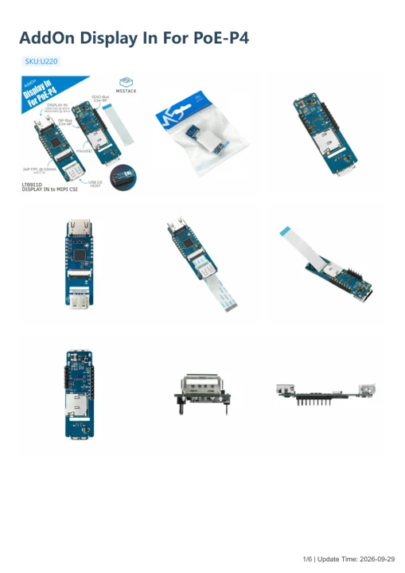
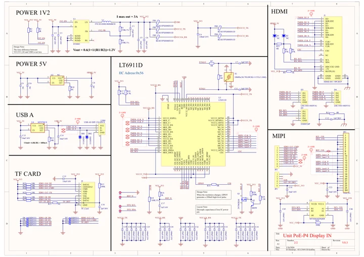

# AddOn Display In For PoE-P4

**M5Stack** · Expansion

Revision: Not identified

Coverage: Manufacturer references available; physical pinout and complete connector review are tracked separately

[Browse all manufacturers](../../../../BROWSE.md) · [Devices & IoT](../../../../DEVICES.md) · [Open in the browser guide](https://valleytech-black-wire-guide.pages.dev/?board=m5stack-expansion-addon-display-in-for-poe-p4)

## Datasheets and original documentation

Board datasheet: **not yet recorded**. Visual reference: **available**.

[Manufacturer model documentation](https://docs.m5stack.com/en/addon/AddOn_Display_In_For_PoE-P4)

- **hardware-guide / board**: [AddOn Display In For PoE-P4 — manufacturer hardware guide](https://m5stack.oss-cn-shenzhen.aliyuncs.com/resource/docs/static/pdf/static/en/addon/AddOn_Display_In_For_PoE-P4.pdf) · [saved document](../../../../library/media/9fcdbcb7c886ad32a65c16d524377779a7b5415c447fc8ee0daf6a3969ecb51d.pdf)
- **schematic / board**: [AddOn Display In For PoE-P4 Schematics PDF — schematic](https://m5stack-doc.oss-cn-shenzhen.aliyuncs.com/1265/SCH_UnitPoEP4_display_in_V0.3_SCH_PDF_20260326_2026_03_26_16_04_18.pdf) · [saved document](../../../../library/media/3bf94123f22f333210240564d83dd291facc36de42c3886918dd6b8b68a1ddad.pdf)

A chip datasheet, schematic and board datasheet have different scopes. Match the exact hardware revision.

[Documentation coverage and remaining gaps](../../../../DOCUMENTATION.md)

## Pinout

**pinout image** · Reviewed source · JPG

[Open original reference](../../../../library/media/93728a8fb1332d891ea04f35da05161045e76b58534fd420d6c5c478ae6db122.jpg)

**Credit and rights:** Not established; source attribution retained. Source/manufacturer: M5Stack.

[Source 1](https://m5stack-doc.oss-cn-shenzhen.aliyuncs.com/1265/U220_AddOn_Display_In_For_PoE-P4_pinmap.jpg) · [Source 2](https://docs.m5stack.com/en/addon/AddOn_Display_In_For_PoE-P4)

Imported from existing M5Stack Board Reference; original working path preserved.

Image revision: Not identified

SHA-256: `93728a8fb1332d891ea04f35da05161045e76b58534fd420d6c5c478ae6db122`

## Dimensions

**source reference** · Unreviewed source · PNG

[Open original reference](../../../../library/media/86d409fd87b3dcb3c75fd4ab438ee6f14282795b7df5cc607a4c87a9f9821e63.png)

**Credit and rights:** Source rights not yet established. Source/manufacturer: M5Stack.

[Source 1](https://m5stack-doc.oss-cn-shenzhen.aliyuncs.com/1265/U220-AddOn_Display_In_For_PoE-P4_model_size_page_01.png) · [Source 2](https://docs.m5stack.com/en/addon/AddOn_Display_In_For_PoE-P4)

Original source index: Dimensions. This file is searchable but has not been promoted to a reviewed physical board pinout.

Image revision: Not identified

SHA-256: `86d409fd87b3dcb3c75fd4ab438ee6f14282795b7df5cc607a4c87a9f9821e63`

## AddOn Display In For PoE-P4 — manufacturer hardware guide

**reference PDF** · Source model/link and PDF signature/title checked; individual pin assignments and electrical validation pending · PDF

[Open original reference](../../../../library/media/9fcdbcb7c886ad32a65c16d524377779a7b5415c447fc8ee0daf6a3969ecb51d.pdf)

**Credit and rights:** Original publisher/manufacturer artwork; redistribution and print rights not established. Attribution is not a license grant.. Source/manufacturer: M5Stack.

[Source 1](https://m5stack.oss-cn-shenzhen.aliyuncs.com/resource/docs/static/pdf/static/en/addon/AddOn_Display_In_For_PoE-P4.pdf) · [Source 2](https://docs.m5stack.com/en/addon/AddOn_Display_In_For_PoE-P4)

Original document linked from this model’s manufacturer page. Preserve the document’s exact revision and named subassembly scope; a linked accessory schematic is not a whole-device pinout. This is a hardware manual, not a separately classified board datasheet.

Image revision: Use the revision printed in the original document; do not assume all hardware revisions are interchangeable

SHA-256: `9fcdbcb7c886ad32a65c16d524377779a7b5415c447fc8ee0daf6a3969ecb51d`

## AddOn Display In For PoE-P4 Schematics PDF — schematic

**reference PDF** · Source model/link and PDF signature/title checked; individual pin assignments and electrical validation pending · PDF

[Open original reference](../../../../library/media/3bf94123f22f333210240564d83dd291facc36de42c3886918dd6b8b68a1ddad.pdf)

**Credit and rights:** Original publisher/manufacturer artwork; redistribution and print rights not established. Attribution is not a license grant.. Source/manufacturer: M5Stack.

[Source 1](https://m5stack-doc.oss-cn-shenzhen.aliyuncs.com/1265/SCH_UnitPoEP4_display_in_V0.3_SCH_PDF_20260326_2026_03_26_16_04_18.pdf) · [Source 2](https://docs.m5stack.com/en/addon/AddOn_Display_In_For_PoE-P4)

Original document linked from this model’s manufacturer page. Preserve the document’s exact revision and named subassembly scope; a linked accessory schematic is not a whole-device pinout. This is a circuit schematic, not a physical board pinout.

Image revision: Use the revision printed in the original document; do not assume all hardware revisions are interchangeable

SHA-256: `3bf94123f22f333210240564d83dd291facc36de42c3886918dd6b8b68a1ddad`

Pin assignments have not been independently electrically verified. Check board revision before wiring.
