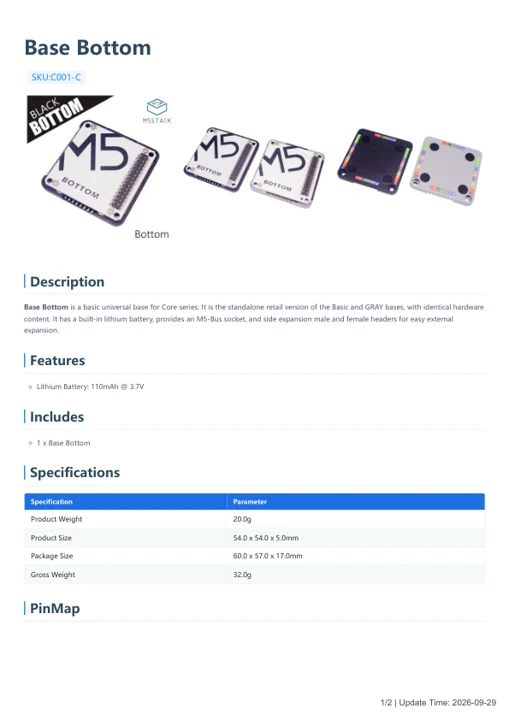

# Base Bottom

**M5Stack** · Expansion

Revision: Not identified

Coverage: Manufacturer references available; physical pinout and complete connector review are tracked separately

[Browse all manufacturers](../../../../BROWSE.md) · [Devices & IoT](../../../../DEVICES.md) · [Open in the browser guide](https://valleytech-black-wire-guide.pages.dev/?board=m5stack-expansion-base-bottom)

## Datasheets and original documentation

Board datasheet: **not yet recorded**. Visual reference: **available**.

[Manufacturer model documentation](https://docs.m5stack.com/en/base/core_bottom)

- **hardware-guide / board**: [Base Bottom — manufacturer hardware guide](https://m5stack.oss-cn-shenzhen.aliyuncs.com/resource/docs/static/pdf/static/en/base/Base_Bottom.pdf) · [saved document](../../../../library/media/6a8864225b9a8bdf9d233f4f1a03ad2c2f4539aa4fc57a757997852884f5cf20.pdf)

A chip datasheet, schematic and board datasheet have different scopes. Match the exact hardware revision.

[Documentation coverage and remaining gaps](../../../../DOCUMENTATION.md)

## Pinout

**pinout image** · Reviewed source · PNG

[Open original reference](../../../../library/media/2d6cedf02e902fe8dfe4a7a7e1e4eb76a215dac78152bff1246ecd8d0d68e7be.png)

**Credit and rights:** Not established; source attribution retained. Source/manufacturer: M5Stack.

[Source 1](https://static-cdn.m5stack.com/resource/docs/products/base/core_bottom/core_bottom_04.webp) · [Source 2](https://docs.m5stack.com/en/base/core_bottom)

Imported from existing M5Stack Board Reference; original working path preserved.

Image revision: Not identified

SHA-256: `2d6cedf02e902fe8dfe4a7a7e1e4eb76a215dac78152bff1246ecd8d0d68e7be`

## Base Bottom — manufacturer hardware guide

**reference PDF** · Source model/link and PDF signature/title checked; individual pin assignments and electrical validation pending · PDF

[Open original reference](../../../../library/media/6a8864225b9a8bdf9d233f4f1a03ad2c2f4539aa4fc57a757997852884f5cf20.pdf)

**Credit and rights:** Original publisher/manufacturer artwork; redistribution and print rights not established. Attribution is not a license grant.. Source/manufacturer: M5Stack.

[Source 1](https://m5stack.oss-cn-shenzhen.aliyuncs.com/resource/docs/static/pdf/static/en/base/Base_Bottom.pdf) · [Source 2](https://docs.m5stack.com/en/base/core_bottom)

Original document linked from this model’s manufacturer page. Preserve the document’s exact revision and named subassembly scope; a linked accessory schematic is not a whole-device pinout. This is a hardware manual, not a separately classified board datasheet.

Image revision: Use the revision printed in the original document; do not assume all hardware revisions are interchangeable

SHA-256: `6a8864225b9a8bdf9d233f4f1a03ad2c2f4539aa4fc57a757997852884f5cf20`

Pin assignments have not been independently electrically verified. Check board revision before wiring.
