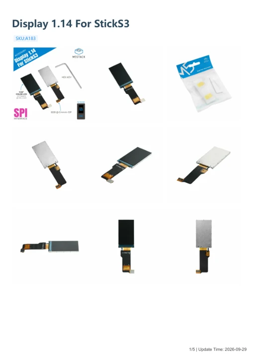

# Display 1.14 For StickS3

**M5Stack** · Expansion

Revision: Not identified

Coverage: Manufacturer references available; physical pinout and complete connector review are tracked separately

[Browse all manufacturers](../../../../BROWSE.md) · [Devices & IoT](../../../../DEVICES.md) · [Open in the browser guide](https://valleytech-black-wire-guide.pages.dev/?board=m5stack-expansion-display-1-14-for-sticks3)

## Datasheets and original documentation

Board datasheet: **not yet recorded**. Visual reference: **available**.

[Manufacturer model documentation](https://docs.m5stack.com/en/accessory/display/Display_1.14_For_StickS3)

- **hardware-guide / board**: [Display 1.14 For StickS3 — manufacturer hardware guide](https://m5stack.oss-cn-shenzhen.aliyuncs.com/resource/docs/static/pdf/static/en/accessory/display/Display_1.14_For_StickS3.pdf) · [saved document](../../../../library/media/a8229e9d8c0fcae8e9f0634235f6ac88c9d5ba524e98d600240092565538acdb.pdf)

A chip datasheet, schematic and board datasheet have different scopes. Match the exact hardware revision.

[Documentation coverage and remaining gaps](../../../../DOCUMENTATION.md)

## Pinout

**pinout image** · Reviewed source · JPG

[Open original reference](../../../../library/media/a7d42df665d2e6366724daa714ef4a71975ce6bdc708a52110a9f0b4ab14aef6.jpg)

**Credit and rights:** Not established; source attribution retained. Source/manufacturer: M5Stack.

[Source 1](https://m5stack-doc.oss-cn-shenzhen.aliyuncs.com/1278/A183_Display_1.14_For_StickS3_pinmap.jpg) · [Source 2](https://docs.m5stack.com/en/accessory/display/Display_1.14_For_StickS3)

Imported from existing M5Stack Board Reference; original working path preserved. Only the named connector or subsection is covered.

Image revision: Not identified

SHA-256: `a7d42df665d2e6366724daa714ef4a71975ce6bdc708a52110a9f0b4ab14aef6`

## Dimensions

**source reference** · Unreviewed source · PNG

[Open original reference](../../../../library/media/84831c6758301b3e5ede44482f87c74c1f06bf1fc32d42ce7da84a3dc3258969.png)

**Credit and rights:** Source rights not yet established. Source/manufacturer: M5Stack.

[Source 1](https://m5stack-doc.oss-cn-shenzhen.aliyuncs.com/1278/A183_Display_1.14_For_StickS3_page_01.png) · [Source 2](https://docs.m5stack.com/en/accessory/display/Display_1.14_For_StickS3)

Original source index: Dimensions. This file is searchable but has not been promoted to a reviewed physical board pinout.

Image revision: Not identified

SHA-256: `84831c6758301b3e5ede44482f87c74c1f06bf1fc32d42ce7da84a3dc3258969`

## Display 1.14 For StickS3 — manufacturer hardware guide

**reference PDF** · Source model/link and PDF signature/title checked; individual pin assignments and electrical validation pending · PDF

[Open original reference](../../../../library/media/a8229e9d8c0fcae8e9f0634235f6ac88c9d5ba524e98d600240092565538acdb.pdf)

**Credit and rights:** Original publisher/manufacturer artwork; redistribution and print rights not established. Attribution is not a license grant.. Source/manufacturer: M5Stack.

[Source 1](https://m5stack.oss-cn-shenzhen.aliyuncs.com/resource/docs/static/pdf/static/en/accessory/display/Display_1.14_For_StickS3.pdf) · [Source 2](https://docs.m5stack.com/en/accessory/display/Display_1.14_For_StickS3)

Original document linked from this model’s manufacturer page. Preserve the document’s exact revision and named subassembly scope; a linked accessory schematic is not a whole-device pinout. This is a hardware manual, not a separately classified board datasheet.

Image revision: Use the revision printed in the original document; do not assume all hardware revisions are interchangeable

SHA-256: `a8229e9d8c0fcae8e9f0634235f6ac88c9d5ba524e98d600240092565538acdb`

Pin assignments have not been independently electrically verified. Check board revision before wiring.
