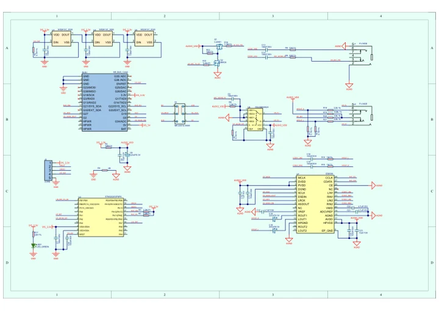
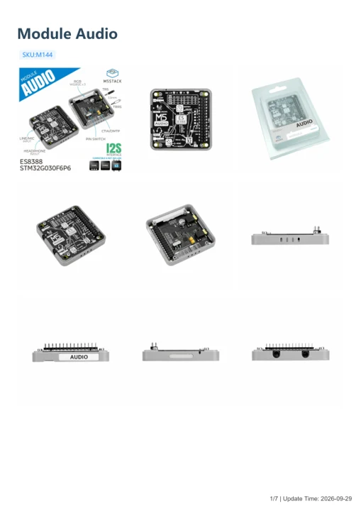

# Module Audio

**M5Stack** · Expansion

Revision: Not identified

Coverage: Manufacturer references available; physical pinout and complete connector review are tracked separately

[Browse all manufacturers](../../../../BROWSE.md) · [Devices & IoT](../../../../DEVICES.md) · [Open in the browser guide](https://valleytech-black-wire-guide.pages.dev/?board=m5stack-expansion-module-audio)

## Datasheets and original documentation

Board datasheet: **not yet recorded**. Visual reference: **available**.

[Manufacturer model documentation](https://docs.m5stack.com/en/module/Module-Audio)

- **schematic / board**: [Module Audio Schematics PDF — schematic](https://m5stack-doc.oss-cn-shenzhen.aliyuncs.com/1141/M144_sch_moduleaudio_v10.pdf) · [saved document](../../../../library/media/3232cab5a76f5ae513fcd989ef217d9eb70377929b1b6f39b25d09d21704da4d.pdf)
- **hardware-guide / board**: [Module Audio — manufacturer hardware guide](https://m5stack.oss-cn-shenzhen.aliyuncs.com/resource/docs/static/pdf/static/en/module/Module_Audio.pdf) · [saved document](../../../../library/media/e73f5606856309ad7c5fde39109ac62a14b685cb0dd22e011e0d96d81daacf5a.pdf)

A chip datasheet, schematic and board datasheet have different scopes. Match the exact hardware revision.

[Documentation coverage and remaining gaps](../../../../DOCUMENTATION.md)

## Pinout

**pinout image** · Reviewed source · JPG

[Open original reference](../../../../library/media/a95cc380fa0ae8a7deb825a810458bd80055a98257659207630bc34cc9a42c93.jpg)

**Credit and rights:** Not established; source attribution retained. Source/manufacturer: M5Stack.

[Source 1](https://m5stack-doc.oss-cn-shenzhen.aliyuncs.com/1141/M144_AB_Mode.jpg) · [Source 2](https://docs.m5stack.com/en/module/Module-Audio)

Imported from existing M5Stack Board Reference; original working path preserved. Only the named connector or subsection is covered.

Image revision: Not identified

SHA-256: `a95cc380fa0ae8a7deb825a810458bd80055a98257659207630bc34cc9a42c93`

## Dimensions

**source reference** · Unreviewed source · PNG

[Open original reference](../../../../library/media/c18bb915fd9bb98f2366176edb798a80fc1d9c203887bcf871965362b1b67a0f.png)

**Credit and rights:** Source rights not yet established. Source/manufacturer: M5Stack.

[Source 1](https://m5stack-doc.oss-cn-shenzhen.aliyuncs.com/1141/M144_Model_sizel_page_01.png) · [Source 2](https://docs.m5stack.com/en/module/Module-Audio)

Original source index: Dimensions. This file is searchable but has not been promoted to a reviewed physical board pinout.

Image revision: Not identified

SHA-256: `c18bb915fd9bb98f2366176edb798a80fc1d9c203887bcf871965362b1b67a0f`

## Module Audio Schematics PDF — schematic

**reference PDF** · Source model/link and PDF signature/title checked; individual pin assignments and electrical validation pending · PDF

[Open original reference](../../../../library/media/3232cab5a76f5ae513fcd989ef217d9eb70377929b1b6f39b25d09d21704da4d.pdf)

**Credit and rights:** Original publisher/manufacturer artwork; redistribution and print rights not established. Attribution is not a license grant.. Source/manufacturer: M5Stack.

[Source 1](https://m5stack-doc.oss-cn-shenzhen.aliyuncs.com/1141/M144_sch_moduleaudio_v10.pdf) · [Source 2](https://docs.m5stack.com/en/module/Module-Audio)

Original document linked from this model’s manufacturer page. Preserve the document’s exact revision and named subassembly scope; a linked accessory schematic is not a whole-device pinout. This is a circuit schematic, not a physical board pinout.

Image revision: Use the revision printed in the original document; do not assume all hardware revisions are interchangeable

SHA-256: `3232cab5a76f5ae513fcd989ef217d9eb70377929b1b6f39b25d09d21704da4d`

## Module Audio — manufacturer hardware guide

**reference PDF** · Source model/link and PDF signature/title checked; individual pin assignments and electrical validation pending · PDF

[Open original reference](../../../../library/media/e73f5606856309ad7c5fde39109ac62a14b685cb0dd22e011e0d96d81daacf5a.pdf)

**Credit and rights:** Original publisher/manufacturer artwork; redistribution and print rights not established. Attribution is not a license grant.. Source/manufacturer: M5Stack.

[Source 1](https://m5stack.oss-cn-shenzhen.aliyuncs.com/resource/docs/static/pdf/static/en/module/Module_Audio.pdf) · [Source 2](https://docs.m5stack.com/en/module/Module-Audio)

Original document linked from this model’s manufacturer page. Preserve the document’s exact revision and named subassembly scope; a linked accessory schematic is not a whole-device pinout. This is a hardware manual, not a separately classified board datasheet.

Image revision: Use the revision printed in the original document; do not assume all hardware revisions are interchangeable

SHA-256: `e73f5606856309ad7c5fde39109ac62a14b685cb0dd22e011e0d96d81daacf5a`

Pin assignments have not been independently electrically verified. Check board revision before wiring.
