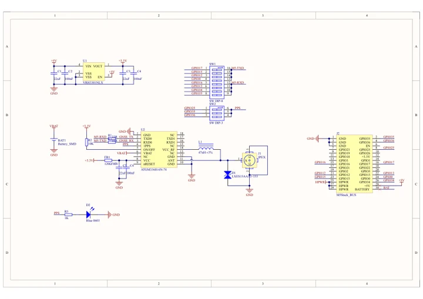

# Module GPS v2.0

**M5Stack** · Expansion

Revision: Not identified

Coverage: Manufacturer references available; physical pinout and complete connector review are tracked separately

[Browse all manufacturers](../../../../BROWSE.md) · [Devices & IoT](../../../../DEVICES.md) · [Open in the browser guide](https://valleytech-black-wire-guide.pages.dev/?board=m5stack-expansion-module-gps-v2-0)

## Datasheets and original documentation

Board datasheet: **not yet recorded**. Visual reference: **available**.

[Manufacturer model documentation](https://docs.m5stack.com/en/module/Module%20GPS%20v2.0)

- **schematic / board**: [Module GPS v2.0 Schematic PDF — schematic](https://m5stack.oss-cn-shenzhen.aliyuncs.com/resource/docs/products/module/Module%20GPS%20v2.0/SCH_Module%20GPS%20V2.pdf) · [saved document](../../../../library/media/6c2d7c2f4190b1683346ab83c6773853d81880b0e498a3cbd62732e3833df79f.pdf)

A chip datasheet, schematic and board datasheet have different scopes. Match the exact hardware revision.

[Documentation coverage and remaining gaps](../../../../DOCUMENTATION.md)

## Pinout

**pinout image** · Reviewed source · JPG

[Open original reference](../../../../library/media/ba9ae005684eb4b90d6d4553561151016485769c074c37ed75a5dae3396f0b0f.jpg)

**Credit and rights:** Not established; source attribution retained. Source/manufacturer: M5Stack.

[Source 1](https://m5stack-doc.oss-cn-shenzhen.aliyuncs.com/950/M003-V2-pinmap-note-en.jpg) · [Source 2](https://docs.m5stack.com/en/module/Module%20GPS%20v2.0)

Imported from existing M5Stack Board Reference; original working path preserved. Only the named connector or subsection is covered.

Image revision: Not identified

SHA-256: `ba9ae005684eb4b90d6d4553561151016485769c074c37ed75a5dae3396f0b0f`

## Dimensions

**source reference** · Unreviewed source · JPG

[Open original reference](../../../../library/media/c3dc929f0944e1a130dda9f8c74006fd1380394b02f488d97f88f184879c0a81.jpg)

**Credit and rights:** Source rights not yet established. Source/manufacturer: M5Stack.

[Source 1](https://m5stack.oss-cn-shenzhen.aliyuncs.com/resource/docs/products/module/Module%20GPS%20v2.0/model%20size.jpg) · [Source 2](https://docs.m5stack.com/en/module/Module%20GPS%20v2.0)

Original source index: Dimensions. This file is searchable but has not been promoted to a reviewed physical board pinout.

Image revision: Not identified

SHA-256: `c3dc929f0944e1a130dda9f8c74006fd1380394b02f488d97f88f184879c0a81`

## Module GPS v2.0 Schematic PDF — schematic

**reference PDF** · Source model/link and PDF signature/title checked; individual pin assignments and electrical validation pending · PDF

[Open original reference](../../../../library/media/6c2d7c2f4190b1683346ab83c6773853d81880b0e498a3cbd62732e3833df79f.pdf)

**Credit and rights:** Original publisher/manufacturer artwork; redistribution and print rights not established. Attribution is not a license grant.. Source/manufacturer: M5Stack.

[Source 1](https://m5stack.oss-cn-shenzhen.aliyuncs.com/resource/docs/products/module/Module%20GPS%20v2.0/SCH_Module%20GPS%20V2.pdf) · [Source 2](https://docs.m5stack.com/en/module/Module%20GPS%20v2.0)

Original document linked from this model’s manufacturer page. Preserve the document’s exact revision and named subassembly scope; a linked accessory schematic is not a whole-device pinout. This is a circuit schematic, not a physical board pinout.

Image revision: Use the revision printed in the original document; do not assume all hardware revisions are interchangeable

SHA-256: `6c2d7c2f4190b1683346ab83c6773853d81880b0e498a3cbd62732e3833df79f`

Pin assignments have not been independently electrically verified. Check board revision before wiring.
