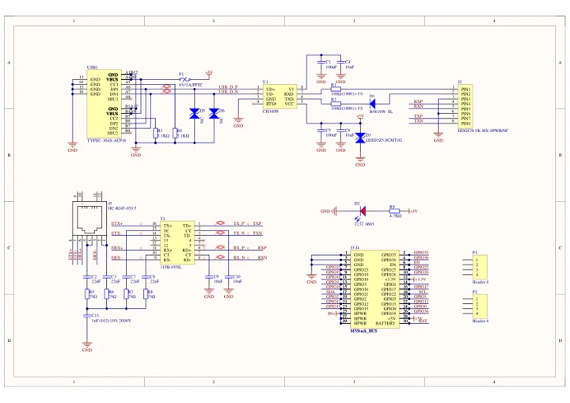

# Module LLM Kit

**M5Stack** · Expansion

Revision: Not identified

Coverage: Manufacturer references available; physical pinout and complete connector review are tracked separately

[Browse all manufacturers](../../../../BROWSE.md) · [Devices & IoT](../../../../DEVICES.md) · [Open in the browser guide](https://valleytech-black-wire-guide.pages.dev/?board=m5stack-expansion-module-llm-kit)

## Datasheets and original documentation

Board datasheet: **not yet recorded**. Visual reference: **available**.

[Manufacturer model documentation](https://docs.m5stack.com/en/module/Module%20LLM%20Kit)

- **schematic / board**: [Module13.2 LLM Mate Schematic Download — schematic](https://m5stack-doc.oss-cn-shenzhen.aliyuncs.com/1131/K144_Sch_Module13.2_LLM_MATE.pdf) · [saved document](../../../../library/media/1ba3b45996ed27fa2cedb8b47010795598fc3989514b06cad4c79992ec0e0361.pdf)

A chip datasheet, schematic and board datasheet have different scopes. Match the exact hardware revision.

[Documentation coverage and remaining gaps](../../../../DOCUMENTATION.md)

## Pinout

**pinout image** · Reviewed source · JPG

[Open original reference](../../../../library/media/6bdb99d8d30cd11f5acb0e249c72af7a88e247753e048377fc58df8d6d1993bb.jpg)

**Credit and rights:** Not established; source attribution retained. Source/manufacturer: M5Stack.

[Source 1](https://m5stack.oss-cn-shenzhen.aliyuncs.com/resource/docs/products/module/Module%20LLM/03.jpg) · [Source 2](https://docs.m5stack.com/en/module/Module%20LLM%20Kit)

Imported from existing M5Stack Board Reference; original working path preserved.

Image revision: Not identified

SHA-256: `6bdb99d8d30cd11f5acb0e249c72af7a88e247753e048377fc58df8d6d1993bb`

## Dimensions

**source reference** · Unreviewed source · PNG

[Open original reference](../../../../library/media/d27619141d9e7e3da852a970317fa6da0fb1a90130e072ba76d47b04a4a961c5.png)

**Credit and rights:** Source rights not yet established. Source/manufacturer: M5Stack.

[Source 1](https://m5stack-doc.oss-cn-shenzhen.aliyuncs.com/1131/K144_Module13.2_LLM_Mate_page_01.png) · [Source 2](https://docs.m5stack.com/en/module/Module%20LLM%20Kit)

Original source index: Dimensions. This file is searchable but has not been promoted to a reviewed physical board pinout.

Image revision: Not identified

SHA-256: `d27619141d9e7e3da852a970317fa6da0fb1a90130e072ba76d47b04a4a961c5`

## Module13.2 LLM Mate Schematic Download — schematic

**reference PDF** · Source model/link and PDF signature/title checked; individual pin assignments and electrical validation pending · PDF

[Open original reference](../../../../library/media/1ba3b45996ed27fa2cedb8b47010795598fc3989514b06cad4c79992ec0e0361.pdf)

**Credit and rights:** Original publisher/manufacturer artwork; redistribution and print rights not established. Attribution is not a license grant.. Source/manufacturer: M5Stack.

[Source 1](https://m5stack-doc.oss-cn-shenzhen.aliyuncs.com/1131/K144_Sch_Module13.2_LLM_MATE.pdf) · [Source 2](https://docs.m5stack.com/en/module/Module%20LLM%20Kit)

Original document linked from this model’s manufacturer page. Preserve the document’s exact revision and named subassembly scope; a linked accessory schematic is not a whole-device pinout. This is a circuit schematic, not a physical board pinout.

Image revision: Use the revision printed in the original document; do not assume all hardware revisions are interchangeable

SHA-256: `1ba3b45996ed27fa2cedb8b47010795598fc3989514b06cad4c79992ec0e0361`

Pin assignments have not been independently electrically verified. Check board revision before wiring.
