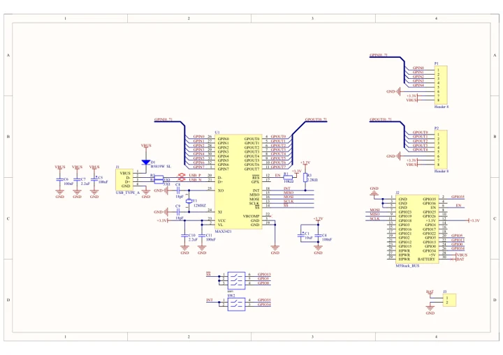

# Module USB v1.2

**M5Stack** · Expansion

Revision: Not identified

Coverage: Manufacturer references available; physical pinout and complete connector review are tracked separately

[Browse all manufacturers](../../../../BROWSE.md) · [Devices & IoT](../../../../DEVICES.md) · [Open in the browser guide](https://valleytech-black-wire-guide.pages.dev/?board=m5stack-expansion-module-usb-v1-2)

## Datasheets and original documentation

Board datasheet: **not yet recorded**. Visual reference: **available**.

[Manufacturer model documentation](https://docs.m5stack.com/en/module/USB%20v1.2%20Module)

- **schematic / board**: [Module USB v1.2 Schematics PDF — schematic](https://m5stack-doc.oss-cn-shenzhen.aliyuncs.com/544/SCH_USBHost_V1.2.pdf) · [saved document](../../../../library/media/bfcf7d84c1b873d5a7590f5ab92cd0fbb1d1c5d075aea1a845de066186b6b320.pdf)

A chip datasheet, schematic and board datasheet have different scopes. Match the exact hardware revision.

[Documentation coverage and remaining gaps](../../../../DOCUMENTATION.md)

## Pinout

**GPIO reference image** · Reviewed source · PNG

[Open original reference](../../../../library/media/96cbf04b32462969243a80711a48211248287b7847dcd8e9f68faa3cbbba8f23.png)

**Credit and rights:** Not established; source attribution retained. Source/manufacturer: M5Stack.

[Source 1](https://static-cdn.m5stack.com/resource/docs/products/module/USB v1.2 Module/pinMap-70b8e2ad-8325-4887-af33-44e3dae91520.png) · [Source 2](https://docs.m5stack.com/en/module/USB%20v1.2%20Module)

Imported from existing M5Stack Board Reference; original working path preserved.

Image revision: Not identified

SHA-256: `96cbf04b32462969243a80711a48211248287b7847dcd8e9f68faa3cbbba8f23`

## Dimensions

**source reference** · Unreviewed source · JPG

[Open original reference](../../../../library/media/904223cb5b5913b4ed81f3b22f427c258dccb46529ec5e6b03682a4365b29723.jpg)

**Credit and rights:** Source rights not yet established. Source/manufacturer: M5Stack.

[Source 1](https://static-cdn.m5stack.com/resource/docs/products/module/USB v1.2 Module/img-76853f1e-17c5-4a94-9c66-74e1b150a27c.jpg) · [Source 2](https://docs.m5stack.com/en/module/USB%20v1.2%20Module)

Original source index: Dimensions. This file is searchable but has not been promoted to a reviewed physical board pinout.

Image revision: Not identified

SHA-256: `904223cb5b5913b4ed81f3b22f427c258dccb46529ec5e6b03682a4365b29723`

## Module USB v1.2 Schematics PDF — schematic

**reference PDF** · Source model/link and PDF signature/title checked; individual pin assignments and electrical validation pending · PDF

[Open original reference](../../../../library/media/bfcf7d84c1b873d5a7590f5ab92cd0fbb1d1c5d075aea1a845de066186b6b320.pdf)

**Credit and rights:** Original publisher/manufacturer artwork; redistribution and print rights not established. Attribution is not a license grant.. Source/manufacturer: M5Stack.

[Source 1](https://m5stack-doc.oss-cn-shenzhen.aliyuncs.com/544/SCH_USBHost_V1.2.pdf) · [Source 2](https://docs.m5stack.com/en/module/USB%20v1.2%20Module)

Original document linked from this model’s manufacturer page. Preserve the document’s exact revision and named subassembly scope; a linked accessory schematic is not a whole-device pinout. This is a circuit schematic, not a physical board pinout.

Image revision: Use the revision printed in the original document; do not assume all hardware revisions are interchangeable

SHA-256: `bfcf7d84c1b873d5a7590f5ab92cd0fbb1d1c5d075aea1a845de066186b6b320`

Pin assignments have not been independently electrically verified. Check board revision before wiring.
