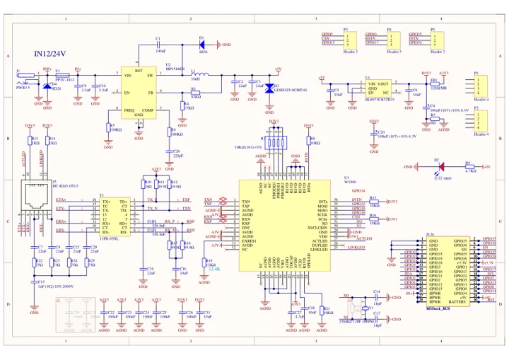
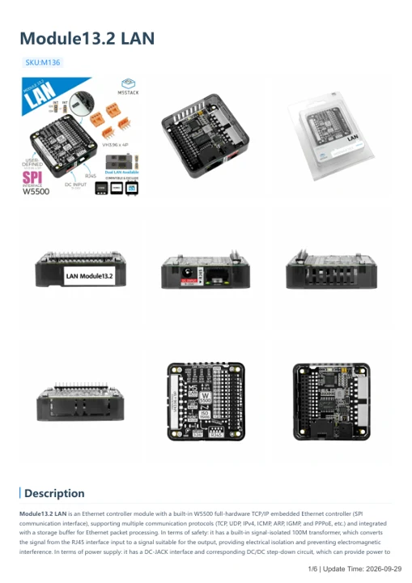

# Module13.2 LAN

**M5Stack** · Expansion

Revision: Not identified

Coverage: Manufacturer references available; physical pinout and complete connector review are tracked separately

[Browse all manufacturers](../../../../BROWSE.md) · [Devices & IoT](../../../../DEVICES.md) · [Open in the browser guide](https://valleytech-black-wire-guide.pages.dev/?board=m5stack-expansion-module13-2-lan)

## Datasheets and original documentation

Board datasheet: **not yet recorded**. Visual reference: **available**.

[Manufacturer model documentation](https://docs.m5stack.com/en/module/LAN%20Module%2013.2)

- **schematic / board**: [Module13.2 LAN Schematics PDF — schematic](https://m5stack-doc.oss-cn-shenzhen.aliyuncs.com/562/Sch_Module13.2_LAN.pdf) · [saved document](../../../../library/media/0d8402a2d5436469efd5662932b84a7d192de6746fcf962e245ca817ca2f5d55.pdf)
- **hardware-guide / board**: [Module13.2 LAN — manufacturer hardware guide](https://m5stack.oss-cn-shenzhen.aliyuncs.com/resource/docs/static/pdf/static/en/module/Module13.2_LAN.pdf) · [saved document](../../../../library/media/ea74ed7903125ee4da641eae86f2e8dcbfa1640f99446feb210fb885d3840c94.pdf)

A chip datasheet, schematic and board datasheet have different scopes. Match the exact hardware revision.

[Documentation coverage and remaining gaps](../../../../DOCUMENTATION.md)

## Pinout

**pinout image** · Reviewed source · PNG

[Open original reference](../../../../library/media/673be65512a92b4543eff73255b9ef4ede1262f132a79bc40b0c2e570ef803a6.png)

**Credit and rights:** Not established; source attribution retained. Source/manufacturer: M5Stack.

[Source 1](https://m5stack-doc.oss-cn-shenzhen.aliyuncs.com/957/M136_pins_change_01.png) · [Source 2](https://docs.m5stack.com/en/module/LAN%20Module%2013.2)

Imported from existing M5Stack Board Reference; original working path preserved. Only the named connector or subsection is covered.

Image revision: Not identified

SHA-256: `673be65512a92b4543eff73255b9ef4ede1262f132a79bc40b0c2e570ef803a6`

## Dimensions

**source reference** · Unreviewed source · PNG

[Open original reference](../../../../library/media/fa3d8e7857a4f8caa7b492fe23be10c0ac6d305431deb96ce8991687dc7a6eff.png)

**Credit and rights:** Source rights not yet established. Source/manufacturer: M5Stack.

[Source 1](https://m5stack-doc.oss-cn-shenzhen.aliyuncs.com/957/lan-module_page_01.png) · [Source 2](https://docs.m5stack.com/en/module/LAN%20Module%2013.2)

Original source index: Dimensions. This file is searchable but has not been promoted to a reviewed physical board pinout.

Image revision: Not identified

SHA-256: `fa3d8e7857a4f8caa7b492fe23be10c0ac6d305431deb96ce8991687dc7a6eff`

## Module13.2 LAN Schematics PDF — schematic

**reference PDF** · Source model/link and PDF signature/title checked; individual pin assignments and electrical validation pending · PDF

[Open original reference](../../../../library/media/0d8402a2d5436469efd5662932b84a7d192de6746fcf962e245ca817ca2f5d55.pdf)

**Credit and rights:** Original publisher/manufacturer artwork; redistribution and print rights not established. Attribution is not a license grant.. Source/manufacturer: M5Stack.

[Source 1](https://m5stack-doc.oss-cn-shenzhen.aliyuncs.com/562/Sch_Module13.2_LAN.pdf) · [Source 2](https://docs.m5stack.com/en/module/LAN%20Module%2013.2)

Original document linked from this model’s manufacturer page. Preserve the document’s exact revision and named subassembly scope; a linked accessory schematic is not a whole-device pinout. This is a circuit schematic, not a physical board pinout.

Image revision: Use the revision printed in the original document; do not assume all hardware revisions are interchangeable

SHA-256: `0d8402a2d5436469efd5662932b84a7d192de6746fcf962e245ca817ca2f5d55`

## Module13.2 LAN — manufacturer hardware guide

**reference PDF** · Source model/link and PDF signature/title checked; individual pin assignments and electrical validation pending · PDF

[Open original reference](../../../../library/media/ea74ed7903125ee4da641eae86f2e8dcbfa1640f99446feb210fb885d3840c94.pdf)

**Credit and rights:** Original publisher/manufacturer artwork; redistribution and print rights not established. Attribution is not a license grant.. Source/manufacturer: M5Stack.

[Source 1](https://m5stack.oss-cn-shenzhen.aliyuncs.com/resource/docs/static/pdf/static/en/module/Module13.2_LAN.pdf) · [Source 2](https://docs.m5stack.com/en/module/LAN%20Module%2013.2)

Original document linked from this model’s manufacturer page. Preserve the document’s exact revision and named subassembly scope; a linked accessory schematic is not a whole-device pinout. This is a hardware manual, not a separately classified board datasheet.

Image revision: Use the revision printed in the original document; do not assume all hardware revisions are interchangeable

SHA-256: `ea74ed7903125ee4da641eae86f2e8dcbfa1640f99446feb210fb885d3840c94`

Pin assignments have not been independently electrically verified. Check board revision before wiring.
