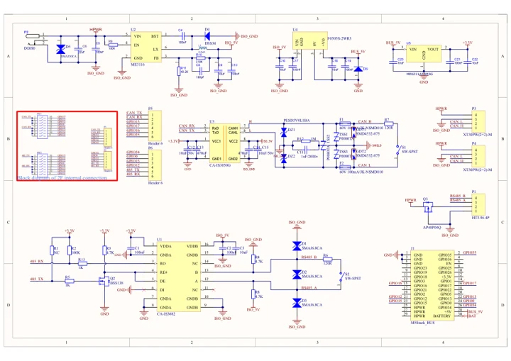
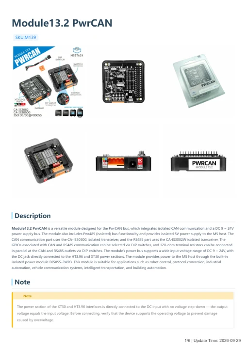

# Module13.2 PwrCAN

**M5Stack** · Expansion

Revision: Not identified

Coverage: Manufacturer references available; physical pinout and complete connector review are tracked separately

[Browse all manufacturers](../../../../BROWSE.md) · [Devices & IoT](../../../../DEVICES.md) · [Open in the browser guide](https://valleytech-black-wire-guide.pages.dev/?board=m5stack-expansion-module13-2-pwrcan)

## Datasheets and original documentation

Board datasheet: **not yet recorded**. Visual reference: **available**.

[Manufacturer model documentation](https://docs.m5stack.com/en/module/Module13.2-PwrCAN)

- **schematic / board**: [Module13.2 PwrCAN Schematics PDF — schematic](https://m5stack-doc.oss-cn-shenzhen.aliyuncs.com/565/SCH_Module_PwrCan_V1.0.pdf) · [saved document](../../../../library/media/8f883444e39282acb92edca57aa9cbf1315004bd2e28525440160464acd554bb.pdf)
- **hardware-guide / board**: [Module13.2 PwrCAN — manufacturer hardware guide](https://m5stack.oss-cn-shenzhen.aliyuncs.com/resource/docs/static/pdf/static/en/module/Module13.2_PwrCAN.pdf) · [saved document](../../../../library/media/3798d5c47489a2251c9cb481367ca6629fbce119ff8a1bd18f73a98f73cc80cc.pdf)

A chip datasheet, schematic and board datasheet have different scopes. Match the exact hardware revision.

[Documentation coverage and remaining gaps](../../../../DOCUMENTATION.md)

## Pinout

**pinout image** · Reviewed source · PNG

[Open original reference](../../../../library/media/db793dbaa8bb1213a6809544158369f6bbe7af8c54ecc98084ecd04c6e9d4e91.png)

**Credit and rights:** Not established; source attribution retained. Source/manufacturer: M5Stack.

[Source 1](https://m5stack.oss-cn-shenzhen.aliyuncs.com/resource/docs/products/module/Module13.2-PwrCAN/38c324f157b3ec044fbe91acfb0571b.png) · [Source 2](https://docs.m5stack.com/en/module/Module13.2-PwrCAN)

Imported from existing M5Stack Board Reference; original working path preserved. Only the named connector or subsection is covered.

Image revision: Not identified

SHA-256: `db793dbaa8bb1213a6809544158369f6bbe7af8c54ecc98084ecd04c6e9d4e91`

## Dimensions

**source reference** · Unreviewed source · JPG

[Open original reference](../../../../library/media/7115cfbb7c3c58bd052dcffdcd59e2551f845f27bc86d6fcc1f8cbf25fa10335.jpg)

**Credit and rights:** Source rights not yet established. Source/manufacturer: M5Stack.

[Source 1](https://static-cdn.m5stack.com/resource/docs/products/module/Module13.2-PwrCAN/img-66ce1d4e-78ae-497f-bd11-ed33e4d5fdcb.jpg) · [Source 2](https://docs.m5stack.com/en/module/Module13.2-PwrCAN)

Original source index: Dimensions. This file is searchable but has not been promoted to a reviewed physical board pinout.

Image revision: Not identified

SHA-256: `7115cfbb7c3c58bd052dcffdcd59e2551f845f27bc86d6fcc1f8cbf25fa10335`

## Module13.2 PwrCAN Schematics PDF — schematic

**reference PDF** · Source model/link and PDF signature/title checked; individual pin assignments and electrical validation pending · PDF

[Open original reference](../../../../library/media/8f883444e39282acb92edca57aa9cbf1315004bd2e28525440160464acd554bb.pdf)

**Credit and rights:** Original publisher/manufacturer artwork; redistribution and print rights not established. Attribution is not a license grant.. Source/manufacturer: M5Stack.

[Source 1](https://m5stack-doc.oss-cn-shenzhen.aliyuncs.com/565/SCH_Module_PwrCan_V1.0.pdf) · [Source 2](https://docs.m5stack.com/en/module/Module13.2-PwrCAN)

Original document linked from this model’s manufacturer page. Preserve the document’s exact revision and named subassembly scope; a linked accessory schematic is not a whole-device pinout. This is a circuit schematic, not a physical board pinout.

Image revision: Use the revision printed in the original document; do not assume all hardware revisions are interchangeable

SHA-256: `8f883444e39282acb92edca57aa9cbf1315004bd2e28525440160464acd554bb`

## Module13.2 PwrCAN — manufacturer hardware guide

**reference PDF** · Source model/link and PDF signature/title checked; individual pin assignments and electrical validation pending · PDF

[Open original reference](../../../../library/media/3798d5c47489a2251c9cb481367ca6629fbce119ff8a1bd18f73a98f73cc80cc.pdf)

**Credit and rights:** Original publisher/manufacturer artwork; redistribution and print rights not established. Attribution is not a license grant.. Source/manufacturer: M5Stack.

[Source 1](https://m5stack.oss-cn-shenzhen.aliyuncs.com/resource/docs/static/pdf/static/en/module/Module13.2_PwrCAN.pdf) · [Source 2](https://docs.m5stack.com/en/module/Module13.2-PwrCAN)

Original document linked from this model’s manufacturer page. Preserve the document’s exact revision and named subassembly scope; a linked accessory schematic is not a whole-device pinout. This is a hardware manual, not a separately classified board datasheet.

Image revision: Use the revision printed in the original document; do not assume all hardware revisions are interchangeable

SHA-256: `3798d5c47489a2251c9cb481367ca6629fbce119ff8a1bd18f73a98f73cc80cc`

Pin assignments have not been independently electrically verified. Check board revision before wiring.
