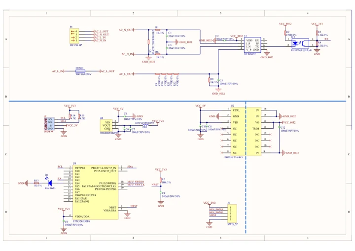

# Unit AC Measure

**M5Stack** · Expansion

Revision: Not identified

Coverage: Manufacturer references available; physical pinout and complete connector review are tracked separately

[Browse all manufacturers](../../../../BROWSE.md) · [Devices & IoT](../../../../DEVICES.md) · [Open in the browser guide](https://valleytech-black-wire-guide.pages.dev/?board=m5stack-expansion-unit-ac-measure)

## Datasheets and original documentation

Board datasheet: **not yet recorded**. Visual reference: **available**.

[Manufacturer model documentation](https://docs.m5stack.com/en/unit/AC%20Measure%20Unit)

- **schematic / board**: [Unit AC Measure Schematics PDF — schematic](https://m5stack-doc.oss-cn-shenzhen.aliyuncs.com/619/SCH_UNIT_AC_Measure_V1.01.pdf) · [saved document](../../../../library/media/8189ed3b7a9fbf9e5ea115a035459c2105f064039ae8eab5e8381a84be1019f8.pdf)

A chip datasheet, schematic and board datasheet have different scopes. Match the exact hardware revision.

[Documentation coverage and remaining gaps](../../../../DOCUMENTATION.md)

## Pinout

**GPIO reference image** · Reviewed source · PNG

[Open original reference](../../../../library/media/3612904cfd942fd660e38df0d1ddac1c045734130c21155d243ba075e2fc2c39.png)

**Credit and rights:** Not established; source attribution retained. Source/manufacturer: M5Stack.

[Source 1](https://m5stack-doc.oss-cn-shenzhen.aliyuncs.com/744/connector.png) · [Source 2](https://docs.m5stack.com/en/unit/AC%20Measure%20Unit)

Imported from existing M5Stack Board Reference; original working path preserved.

Image revision: Not identified

SHA-256: `3612904cfd942fd660e38df0d1ddac1c045734130c21155d243ba075e2fc2c39`

## Dimensions

**source reference** · Unreviewed source · PNG

[Open original reference](../../../../library/media/4039cd5836e834f0233f919c1ff0c3b009a9df1daad0bf313049bd43e037aa54.png)

**Credit and rights:** Source rights not yet established. Source/manufacturer: M5Stack.

[Source 1](https://static-cdn.m5stack.com/resource/docs/products/unit/AC Measure Unit/img-9b8c7dfb-082c-4136-8aa8-dd395c2f12fd.png) · [Source 2](https://docs.m5stack.com/en/unit/AC%20Measure%20Unit)

Original source index: Dimensions. This file is searchable but has not been promoted to a reviewed physical board pinout.

Image revision: Not identified

SHA-256: `4039cd5836e834f0233f919c1ff0c3b009a9df1daad0bf313049bd43e037aa54`

## Unit AC Measure Schematics PDF — schematic

**reference PDF** · Source model/link and PDF signature/title checked; individual pin assignments and electrical validation pending · PDF

[Open original reference](../../../../library/media/8189ed3b7a9fbf9e5ea115a035459c2105f064039ae8eab5e8381a84be1019f8.pdf)

**Credit and rights:** Original publisher/manufacturer artwork; redistribution and print rights not established. Attribution is not a license grant.. Source/manufacturer: M5Stack.

[Source 1](https://m5stack-doc.oss-cn-shenzhen.aliyuncs.com/619/SCH_UNIT_AC_Measure_V1.01.pdf) · [Source 2](https://docs.m5stack.com/en/unit/AC%20Measure%20Unit)

Original document linked from this model’s manufacturer page. Preserve the document’s exact revision and named subassembly scope; a linked accessory schematic is not a whole-device pinout. This is a circuit schematic, not a physical board pinout.

Image revision: Use the revision printed in the original document; do not assume all hardware revisions are interchangeable

SHA-256: `8189ed3b7a9fbf9e5ea115a035459c2105f064039ae8eab5e8381a84be1019f8`

Pin assignments have not been independently electrically verified. Check board revision before wiring.
