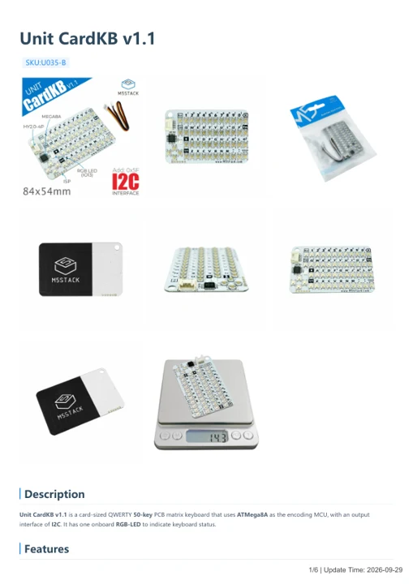

# Unit CardKB v1.1

**M5Stack** · Expansion

Revision: Not identified

Coverage: Manufacturer references available; physical pinout and complete connector review are tracked separately

[Browse all manufacturers](../../../../BROWSE.md) · [Devices & IoT](../../../../DEVICES.md) · [Open in the browser guide](https://valleytech-black-wire-guide.pages.dev/?board=m5stack-expansion-unit-cardkb-v1-1)

## Datasheets and original documentation

Board datasheet: **not yet recorded**. Visual reference: **available**.

[Manufacturer model documentation](https://docs.m5stack.com/en/unit/cardkb_1.1)

- **hardware-guide / board**: [Unit CardKB v1.1 — manufacturer hardware guide](https://m5stack.oss-cn-shenzhen.aliyuncs.com/resource/docs/static/pdf/static/en/unit/Unit_CardKB_v1.1.pdf) · [saved document](../../../../library/media/3055c8cebfbf5c90731633c4e127cc5dd9ddf2de128c073225343a341c8ff44d.pdf)

A chip datasheet, schematic and board datasheet have different scopes. Match the exact hardware revision.

[Documentation coverage and remaining gaps](../../../../DOCUMENTATION.md)

## Pinout (ISP Header)

**GPIO reference image** · Reviewed source · PNG

[Open original reference](../../../../library/media/b4d54e2c19d4d31bd8dd28671a8b5ca6540502456486ad74358e884c4906a8c4.png)

**Credit and rights:** Not established; source attribution retained. Source/manufacturer: M5Stack.

[Source 1](https://static-cdn.m5stack.com/resource/docs/products/hat/hat-cardkb/mega328_isp_sch_01.webp) · [Source 2](https://docs.m5stack.com/en/unit/cardkb_1.1)

Imported from existing M5Stack Board Reference; original working path preserved.

Image revision: Not identified

SHA-256: `b4d54e2c19d4d31bd8dd28671a8b5ca6540502456486ad74358e884c4906a8c4`

## Dimensions

**source reference** · Unreviewed source · PNG

[Open original reference](../../../../library/media/76ed13c3d923979d359c94b7d89d10cab4bee078834088ca8683b88fe454ef57.png)

**Credit and rights:** Source rights not yet established. Source/manufacturer: M5Stack.

[Source 1](https://m5stack-doc.oss-cn-shenzhen.aliyuncs.com/806/cardkeyboard_v1_1_page_01.png) · [Source 2](https://docs.m5stack.com/en/unit/cardkb_1.1)

Original source index: Dimensions. This file is searchable but has not been promoted to a reviewed physical board pinout.

Image revision: Not identified

SHA-256: `76ed13c3d923979d359c94b7d89d10cab4bee078834088ca8683b88fe454ef57`

## Unit CardKB v1.1 — manufacturer hardware guide

**reference PDF** · Source model/link and PDF signature/title checked; individual pin assignments and electrical validation pending · PDF

[Open original reference](../../../../library/media/3055c8cebfbf5c90731633c4e127cc5dd9ddf2de128c073225343a341c8ff44d.pdf)

**Credit and rights:** Original publisher/manufacturer artwork; redistribution and print rights not established. Attribution is not a license grant.. Source/manufacturer: M5Stack.

[Source 1](https://m5stack.oss-cn-shenzhen.aliyuncs.com/resource/docs/static/pdf/static/en/unit/Unit_CardKB_v1.1.pdf) · [Source 2](https://docs.m5stack.com/en/unit/cardkb_1.1)

Original document linked from this model’s manufacturer page. Preserve the document’s exact revision and named subassembly scope; a linked accessory schematic is not a whole-device pinout. This is a hardware manual, not a separately classified board datasheet.

Image revision: Use the revision printed in the original document; do not assume all hardware revisions are interchangeable

SHA-256: `3055c8cebfbf5c90731633c4e127cc5dd9ddf2de128c073225343a341c8ff44d`

Pin assignments have not been independently electrically verified. Check board revision before wiring.
