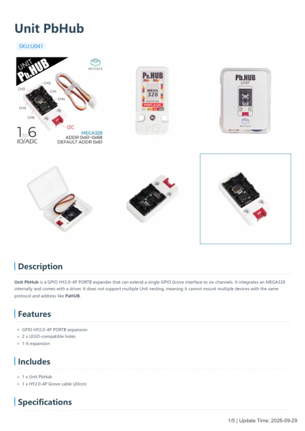

# Unit PbHub

**M5Stack** · Expansion

Revision: Not identified

Coverage: Manufacturer references available; physical pinout and complete connector review are tracked separately

[Browse all manufacturers](../../../../BROWSE.md) · [Devices & IoT](../../../../DEVICES.md) · [Open in the browser guide](https://valleytech-black-wire-guide.pages.dev/?board=m5stack-expansion-unit-pbhub)

## Datasheets and original documentation

Board datasheet: **not yet recorded**. Visual reference: **available**.

[Manufacturer model documentation](https://docs.m5stack.com/en/unit/pbhub)

- **hardware-guide / board**: [Unit PbHub — manufacturer hardware guide](https://m5stack.oss-cn-shenzhen.aliyuncs.com/resource/docs/static/pdf/static/en/unit/Unit_PbHub.pdf) · [saved document](../../../../library/media/fd896bbc5e7fac7533d3619b755464d3370b982ac4db57b1b7b687d541f5a6b2.pdf)

A chip datasheet, schematic and board datasheet have different scopes. Match the exact hardware revision.

[Documentation coverage and remaining gaps](../../../../DOCUMENTATION.md)

## Pinout (ISP Header)

**GPIO reference image** · Reviewed source · PNG

[Open original reference](../../../../library/media/b4d54e2c19d4d31bd8dd28671a8b5ca6540502456486ad74358e884c4906a8c4.png)

**Credit and rights:** Not established; source attribution retained. Source/manufacturer: M5Stack.

[Source 1](https://static-cdn.m5stack.com/resource/docs/products/hat/hat-cardkb/mega328_isp_sch_01.webp) · [Source 2](https://docs.m5stack.com/en/unit/pbhub)

Imported from existing M5Stack Board Reference; original working path preserved.

Image revision: Not identified

SHA-256: `b4d54e2c19d4d31bd8dd28671a8b5ca6540502456486ad74358e884c4906a8c4`

## Unit PbHub — manufacturer hardware guide

**reference PDF** · Source model/link and PDF signature/title checked; individual pin assignments and electrical validation pending · PDF

[Open original reference](../../../../library/media/fd896bbc5e7fac7533d3619b755464d3370b982ac4db57b1b7b687d541f5a6b2.pdf)

**Credit and rights:** Original publisher/manufacturer artwork; redistribution and print rights not established. Attribution is not a license grant.. Source/manufacturer: M5Stack.

[Source 1](https://m5stack.oss-cn-shenzhen.aliyuncs.com/resource/docs/static/pdf/static/en/unit/Unit_PbHub.pdf) · [Source 2](https://docs.m5stack.com/en/unit/pbhub)

Original document linked from this model’s manufacturer page. Preserve the document’s exact revision and named subassembly scope; a linked accessory schematic is not a whole-device pinout. This is a hardware manual, not a separately classified board datasheet.

Image revision: Use the revision printed in the original document; do not assume all hardware revisions are interchangeable

SHA-256: `fd896bbc5e7fac7533d3619b755464d3370b982ac4db57b1b7b687d541f5a6b2`

Pin assignments have not been independently electrically verified. Check board revision before wiring.
