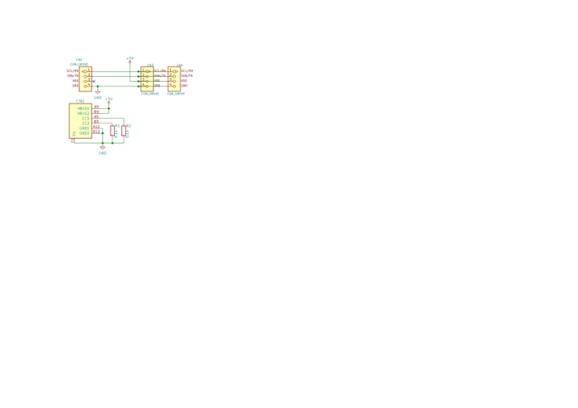
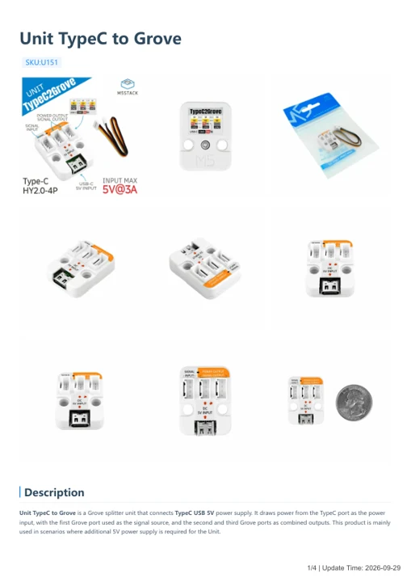

# Unit TypeC to Grove

**M5Stack** · Expansion

Revision: Not identified

Coverage: Manufacturer references available; physical pinout and complete connector review are tracked separately

[Browse all manufacturers](../../../../BROWSE.md) · [Devices & IoT](../../../../DEVICES.md) · [Open in the browser guide](https://valleytech-black-wire-guide.pages.dev/?board=m5stack-expansion-unit-typec-to-grove)

## Datasheets and original documentation

Board datasheet: **not yet recorded**. Visual reference: **available**.

[Manufacturer model documentation](https://docs.m5stack.com/en/unit/typec2grove)

- **schematic / board**: [Unit TypeC to Grove Schematics PDF — schematic](https://m5stack-doc.oss-cn-shenzhen.aliyuncs.com/605/UNIT-TypeC2Grove_sch.pdf) · [saved document](../../../../library/media/3967fe7a3b2d0f333506fe5ce4246f134b00c1bbf3b004a395d8682509248dde.pdf)
- **hardware-guide / board**: [Unit TypeC to Grove — manufacturer hardware guide](https://m5stack.oss-cn-shenzhen.aliyuncs.com/resource/docs/static/pdf/static/en/unit/Unit_TypeC_to_Grove.pdf) · [saved document](../../../../library/media/113890a8e4e40f7b3563d939102363f5fc6b43f1ef217ca535c8a3e5e11e63c8.pdf)

A chip datasheet, schematic and board datasheet have different scopes. Match the exact hardware revision.

[Documentation coverage and remaining gaps](../../../../DOCUMENTATION.md)

## Pinout

**pinout image** · Reviewed source · PNG

[Open original reference](../../../../library/media/aa47603c2d10f1e2dccfc7d94546e683374718b93b11445e3ffaa62f5bce9641.png)

**Credit and rights:** Not established; source attribution retained. Source/manufacturer: M5Stack.

[Source 1](https://m5stack.oss-cn-shenzhen.aliyuncs.com/resource/docs/products/unit/typec2grove/typec2grove_10.webp) · [Source 2](https://docs.m5stack.com/en/unit/typec2grove)

Imported from existing M5Stack Board Reference; original working path preserved.

Image revision: Not identified

SHA-256: `aa47603c2d10f1e2dccfc7d94546e683374718b93b11445e3ffaa62f5bce9641`

## Dimensions

**source reference** · Unreviewed source · PNG

[Open original reference](../../../../library/media/881d6202ca120ff399cabe2b571d425d99613fca3bb3e93c2f2d8234bbb6f182.png)

**Credit and rights:** Source rights not yet established. Source/manufacturer: M5Stack.

[Source 1](https://m5stack-doc.oss-cn-shenzhen.aliyuncs.com/798/U151_Model_Size_sch_01.png) · [Source 2](https://docs.m5stack.com/en/unit/typec2grove)

Original source index: Dimensions. This file is searchable but has not been promoted to a reviewed physical board pinout.

Image revision: Not identified

SHA-256: `881d6202ca120ff399cabe2b571d425d99613fca3bb3e93c2f2d8234bbb6f182`

## Unit TypeC to Grove Schematics PDF — schematic

**reference PDF** · Source model/link and PDF signature/title checked; individual pin assignments and electrical validation pending · PDF

[Open original reference](../../../../library/media/3967fe7a3b2d0f333506fe5ce4246f134b00c1bbf3b004a395d8682509248dde.pdf)

**Credit and rights:** Original publisher/manufacturer artwork; redistribution and print rights not established. Attribution is not a license grant.. Source/manufacturer: M5Stack.

[Source 1](https://m5stack-doc.oss-cn-shenzhen.aliyuncs.com/605/UNIT-TypeC2Grove_sch.pdf) · [Source 2](https://docs.m5stack.com/en/unit/typec2grove)

Original document linked from this model’s manufacturer page. Preserve the document’s exact revision and named subassembly scope; a linked accessory schematic is not a whole-device pinout. This is a circuit schematic, not a physical board pinout.

Image revision: Use the revision printed in the original document; do not assume all hardware revisions are interchangeable

SHA-256: `3967fe7a3b2d0f333506fe5ce4246f134b00c1bbf3b004a395d8682509248dde`

## Unit TypeC to Grove — manufacturer hardware guide

**reference PDF** · Source model/link and PDF signature/title checked; individual pin assignments and electrical validation pending · PDF

[Open original reference](../../../../library/media/113890a8e4e40f7b3563d939102363f5fc6b43f1ef217ca535c8a3e5e11e63c8.pdf)

**Credit and rights:** Original publisher/manufacturer artwork; redistribution and print rights not established. Attribution is not a license grant.. Source/manufacturer: M5Stack.

[Source 1](https://m5stack.oss-cn-shenzhen.aliyuncs.com/resource/docs/static/pdf/static/en/unit/Unit_TypeC_to_Grove.pdf) · [Source 2](https://docs.m5stack.com/en/unit/typec2grove)

Original document linked from this model’s manufacturer page. Preserve the document’s exact revision and named subassembly scope; a linked accessory schematic is not a whole-device pinout. This is a hardware manual, not a separately classified board datasheet.

Image revision: Use the revision printed in the original document; do not assume all hardware revisions are interchangeable

SHA-256: `113890a8e4e40f7b3563d939102363f5fc6b43f1ef217ca535c8a3e5e11e63c8`

Pin assignments have not been independently electrically verified. Check board revision before wiring.
