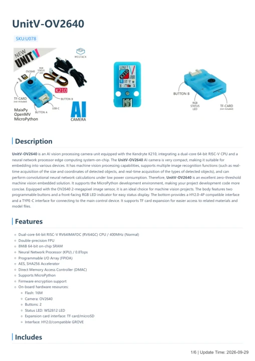

# UnitV-OV2640

**M5Stack** · GPIO device

Revision: Not identified

Coverage: Manufacturer references available; physical pinout and complete connector review are tracked separately

[Browse all manufacturers](../../../../BROWSE.md) · [Devices & IoT](../../../../DEVICES.md) · [Open in the browser guide](https://valleytech-black-wire-guide.pages.dev/?board=m5stack-gpio-device-unitv-ov2640)

Device category: **Cameras & audio**

## Datasheets and original documentation

Board datasheet: **not yet recorded**. Visual reference: **available**.

[Manufacturer model documentation](https://docs.m5stack.com/en/unit/unitv)

- **hardware-guide / board**: [UnitV-OV2640 — manufacturer hardware guide](https://m5stack.oss-cn-shenzhen.aliyuncs.com/resource/docs/static/pdf/static/en/unit/UnitV-OV2640.pdf) · [saved document](../../../../library/media/35b5083a28b4f35ed8ed5f8c40df2732723330e7d9c0cd58980d6a5d48770d22.pdf)

A chip datasheet, schematic and board datasheet have different scopes. Match the exact hardware revision.

[Documentation coverage and remaining gaps](../../../../DOCUMENTATION.md)

## Pinout

**pinout image** · Reviewed source · PNG

[Open original reference](../../../../library/media/629396d7e80dd92cb60a0fc95699c71e9eca345efd1367d49c594d1e955c2852.png)

**Credit and rights:** Not established; source attribution retained. Source/manufacturer: M5Stack.

[Source 1](https://static-cdn.m5stack.com/resource/docs/products/unit/unitv/unitv_05.webp) · [Source 2](https://docs.m5stack.com/en/unit/unitv)

Imported from existing M5Stack Board Reference; original working path preserved.

Image revision: Not identified

SHA-256: `629396d7e80dd92cb60a0fc95699c71e9eca345efd1367d49c594d1e955c2852`

## Dimensions

**source reference** · Unreviewed source · PNG

[Open original reference](../../../../library/media/5294f1ee3fd074b41fea57b5ef2d9397657166b1c1dca0387707e11eb28bbfd4.png)

**Credit and rights:** Source rights not yet established. Source/manufacturer: M5Stack.

[Source 1](https://static-cdn.m5stack.com/resource/docs/products/unit/unitv/unitv_07.webp) · [Source 2](https://docs.m5stack.com/en/unit/unitv)

Original source index: Dimensions. This file is searchable but has not been promoted to a reviewed physical board pinout.

Image revision: Not identified

SHA-256: `5294f1ee3fd074b41fea57b5ef2d9397657166b1c1dca0387707e11eb28bbfd4`

## UnitV-OV2640 — manufacturer hardware guide

**reference PDF** · Source model/link and PDF signature/title checked; individual pin assignments and electrical validation pending · PDF

[Open original reference](../../../../library/media/35b5083a28b4f35ed8ed5f8c40df2732723330e7d9c0cd58980d6a5d48770d22.pdf)

**Credit and rights:** Original publisher/manufacturer artwork; redistribution and print rights not established. Attribution is not a license grant.. Source/manufacturer: M5Stack.

[Source 1](https://m5stack.oss-cn-shenzhen.aliyuncs.com/resource/docs/static/pdf/static/en/unit/UnitV-OV2640.pdf) · [Source 2](https://docs.m5stack.com/en/unit/unitv)

Original document linked from this model’s manufacturer page. Preserve the document’s exact revision and named subassembly scope; a linked accessory schematic is not a whole-device pinout. This is a hardware manual, not a separately classified board datasheet.

Image revision: Use the revision printed in the original document; do not assume all hardware revisions are interchangeable

SHA-256: `35b5083a28b4f35ed8ed5f8c40df2732723330e7d9c0cd58980d6a5d48770d22`

Pin assignments have not been independently electrically verified. Check board revision before wiring.
