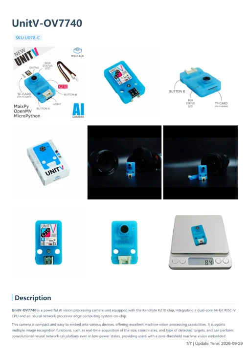

# UnitV-OV7740

**M5Stack** · GPIO device

Revision: Not identified

Coverage: Manufacturer references available; physical pinout and complete connector review are tracked separately

[Browse all manufacturers](../../../../BROWSE.md) · [Devices & IoT](../../../../DEVICES.md) · [Open in the browser guide](https://valleytech-black-wire-guide.pages.dev/?board=m5stack-gpio-device-unitv-ov7740)

Device category: **Cameras & audio**

## Datasheets and original documentation

Board datasheet: **not yet recorded**. Visual reference: **available**.

[Manufacturer model documentation](https://docs.m5stack.com/en/unit/unitv_ov7740)

- **hardware-guide / board**: [UnitV-OV7740 — manufacturer hardware guide](https://m5stack.oss-cn-shenzhen.aliyuncs.com/resource/docs/static/pdf/static/en/unit/UnitV-OV7740.pdf) · [saved document](../../../../library/media/2aa6aae99d6577e6d3b0455401b7b8acc9c37c51ec29053106598ac596402372.pdf)

A chip datasheet, schematic and board datasheet have different scopes. Match the exact hardware revision.

[Documentation coverage and remaining gaps](../../../../DOCUMENTATION.md)

## Pinout

**pinout image** · Reviewed source · PNG

[Open original reference](../../../../library/media/8ef02336edee8d9faad229efc29b0ad888146865e715ee4c392708d9fc3d8e5b.png)

**Credit and rights:** Not established; source attribution retained. Source/manufacturer: M5Stack.

[Source 1](https://static-cdn.m5stack.com/resource/docs/products/unit/unitv_ov7740/unitv_ov7740_12.webp) · [Source 2](https://docs.m5stack.com/en/unit/unitv_ov7740)

Imported from existing M5Stack Board Reference; original working path preserved.

Image revision: Not identified

SHA-256: `8ef02336edee8d9faad229efc29b0ad888146865e715ee4c392708d9fc3d8e5b`

## Dimensions

**source reference** · Unreviewed source · PNG

[Open original reference](../../../../library/media/36ba51ffca625278db3ec53a73aeb5af9a410594a9cb4e65b1e3dc4d1b6aee79.png)

**Credit and rights:** Source rights not yet established. Source/manufacturer: M5Stack.

[Source 1](https://m5stack-doc.oss-cn-shenzhen.aliyuncs.com/1055/U078-C_Model_Size_page_01.png) · [Source 2](https://docs.m5stack.com/en/unit/unitv_ov7740)

Original source index: Dimensions. This file is searchable but has not been promoted to a reviewed physical board pinout.

Image revision: Not identified

SHA-256: `36ba51ffca625278db3ec53a73aeb5af9a410594a9cb4e65b1e3dc4d1b6aee79`

## UnitV-OV7740 — manufacturer hardware guide

**reference PDF** · Source model/link and PDF signature/title checked; individual pin assignments and electrical validation pending · PDF

[Open original reference](../../../../library/media/2aa6aae99d6577e6d3b0455401b7b8acc9c37c51ec29053106598ac596402372.pdf)

**Credit and rights:** Original publisher/manufacturer artwork; redistribution and print rights not established. Attribution is not a license grant.. Source/manufacturer: M5Stack.

[Source 1](https://m5stack.oss-cn-shenzhen.aliyuncs.com/resource/docs/static/pdf/static/en/unit/UnitV-OV7740.pdf) · [Source 2](https://docs.m5stack.com/en/unit/unitv_ov7740)

Original document linked from this model’s manufacturer page. Preserve the document’s exact revision and named subassembly scope; a linked accessory schematic is not a whole-device pinout. This is a hardware manual, not a separately classified board datasheet.

Image revision: Use the revision printed in the original document; do not assume all hardware revisions are interchangeable

SHA-256: `2aa6aae99d6577e6d3b0455401b7b8acc9c37c51ec29053106598ac596402372`

Pin assignments have not been independently electrically verified. Check board revision before wiring.
