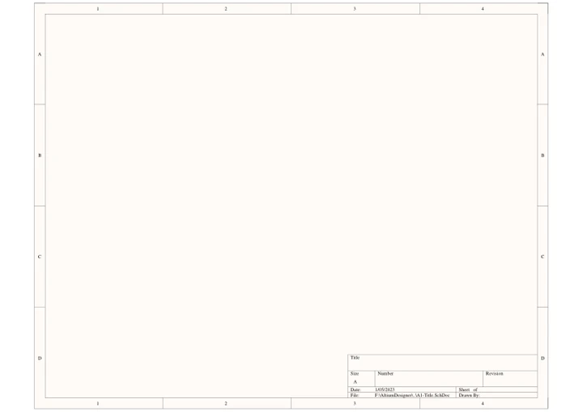
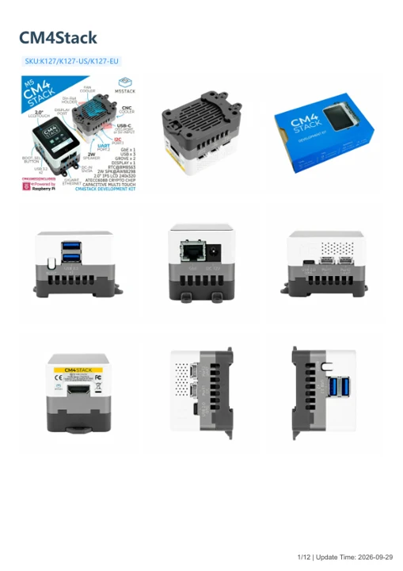

# CM4Stack

**M5Stack** · Other SBC

Revision: Not identified

Coverage: Manufacturer references available; physical pinout and complete connector review are tracked separately

[Browse all manufacturers](../../../../BROWSE.md) · [Devices & IoT](../../../../DEVICES.md) · [Open in the browser guide](https://valleytech-black-wire-guide.pages.dev/?board=m5stack-other-sbc-cm4stack)

## Datasheets and original documentation

Board datasheet: **not yet recorded**. Visual reference: **available**.

[Manufacturer model documentation](https://docs.m5stack.com/en/core/CM4Stack)

- **schematic / board**: [CM4Stack Schematics PDF — schematic](https://m5stack-doc.oss-cn-shenzhen.aliyuncs.com/484/Sch_M5_EdgeCM4.pdf) · [saved document](../../../../library/media/11746a3117055b8f5af00487d936cde37b794a4e082c1c14ce6bcfb31715ac42.pdf)
- **hardware-guide / board**: [CM4Stack — manufacturer hardware guide](https://m5stack.oss-cn-shenzhen.aliyuncs.com/resource/docs/static/pdf/static/en/core/CM4Stack.pdf) · [saved document](../../../../library/media/f5eb5678f1b1d1079bfe4721dedeb67a0fd6743c306ffc66b9f6dfbca471e26d.pdf)

A chip datasheet, schematic and board datasheet have different scopes. Match the exact hardware revision.

[Documentation coverage and remaining gaps](../../../../DOCUMENTATION.md)

## Pinout

**GPIO reference image** · Reviewed source · PNG

[Open original reference](../../../../library/media/9766b1c532fa83d3f8a7bfb393a2cc0e70437f40d666916302d93685442b30bf.png)

**Credit and rights:** Not established; source attribution retained. Source/manufacturer: M5Stack.

[Source 1](https://m5stack-doc.oss-cn-shenzhen.aliyuncs.com/484/K127_PinMap_01.png) · [Source 2](https://docs.m5stack.com/en/core/CM4Stack)

Imported from existing M5Stack Board Reference; original working path preserved.

Image revision: Not identified

SHA-256: `9766b1c532fa83d3f8a7bfb393a2cc0e70437f40d666916302d93685442b30bf`

## Dimensions

**source reference** · Unreviewed source · JPG

[Open original reference](../../../../library/media/8bb462b53cc152f7b6048f4d7030980963e365f7517804d6bc325b4a3dea68da.jpg)

**Credit and rights:** Source rights not yet established. Source/manufacturer: M5Stack.

[Source 1](https://m5stack.oss-cn-shenzhen.aliyuncs.com/resource/docs/products/core/CM4Stack/%E5%B0%BA%E5%AF%B8%E5%9B%BE.jpg) · [Source 2](https://docs.m5stack.com/en/core/CM4Stack)

Original source index: Dimensions. This file is searchable but has not been promoted to a reviewed physical board pinout.

Image revision: Not identified

SHA-256: `8bb462b53cc152f7b6048f4d7030980963e365f7517804d6bc325b4a3dea68da`

## CM4Stack Schematics PDF — schematic

**reference PDF** · Source model/link and PDF signature/title checked; individual pin assignments and electrical validation pending · PDF

[Open original reference](../../../../library/media/11746a3117055b8f5af00487d936cde37b794a4e082c1c14ce6bcfb31715ac42.pdf)

**Credit and rights:** Original publisher/manufacturer artwork; redistribution and print rights not established. Attribution is not a license grant.. Source/manufacturer: M5Stack.

[Source 1](https://m5stack-doc.oss-cn-shenzhen.aliyuncs.com/484/Sch_M5_EdgeCM4.pdf) · [Source 2](https://docs.m5stack.com/en/core/CM4Stack)

Original document linked from this model’s manufacturer page. Preserve the document’s exact revision and named subassembly scope; a linked accessory schematic is not a whole-device pinout. This is a circuit schematic, not a physical board pinout.

Image revision: Use the revision printed in the original document; do not assume all hardware revisions are interchangeable

SHA-256: `11746a3117055b8f5af00487d936cde37b794a4e082c1c14ce6bcfb31715ac42`

## CM4Stack — manufacturer hardware guide

**reference PDF** · Source model/link and PDF signature/title checked; individual pin assignments and electrical validation pending · PDF

[Open original reference](../../../../library/media/f5eb5678f1b1d1079bfe4721dedeb67a0fd6743c306ffc66b9f6dfbca471e26d.pdf)

**Credit and rights:** Original publisher/manufacturer artwork; redistribution and print rights not established. Attribution is not a license grant.. Source/manufacturer: M5Stack.

[Source 1](https://m5stack.oss-cn-shenzhen.aliyuncs.com/resource/docs/static/pdf/static/en/core/CM4Stack.pdf) · [Source 2](https://docs.m5stack.com/en/core/CM4Stack)

Original document linked from this model’s manufacturer page. Preserve the document’s exact revision and named subassembly scope; a linked accessory schematic is not a whole-device pinout. This is a hardware manual, not a separately classified board datasheet.

Image revision: Use the revision printed in the original document; do not assume all hardware revisions are interchangeable

SHA-256: `f5eb5678f1b1d1079bfe4721dedeb67a0fd6743c306ffc66b9f6dfbca471e26d`

Pin assignments have not been independently electrically verified. Check board revision before wiring.
