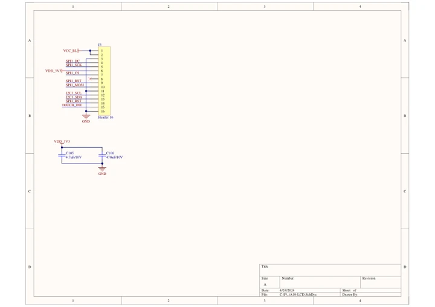
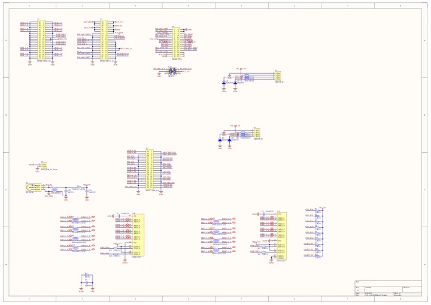

# CoreMP135

**M5Stack** · Other SBC

Revision: Not identified

Coverage: Manufacturer references available; physical pinout and complete connector review are tracked separately

[Browse all manufacturers](../../../../BROWSE.md) · [Devices & IoT](../../../../DEVICES.md) · [Open in the browser guide](https://valleytech-black-wire-guide.pages.dev/?board=m5stack-other-sbc-coremp135)

Device category: **Controllers & instruments**

## Datasheets and original documentation

Board datasheet: **not yet recorded**. Visual reference: **available**.

[Manufacturer model documentation](https://docs.m5stack.com/en/core/M5CoreMP135)

- **schematic / board**: [CoreMP135 Schematics PDF — schematic](https://m5stack-doc.oss-cn-shenzhen.aliyuncs.com/497/Sch_M5_CoreMP135_2024-04-24.pdf) · [saved document](../../../../library/media/bbe7da21022472dfa81fbbd74dbb202b2f31e505264a592db39310a350a92918.pdf)
- **schematic / board**: [CoreMP135 MidLayer Schematics PDF — schematic](https://m5stack-doc.oss-cn-shenzhen.aliyuncs.com/497/Sch_M5_CoreMP1_MidLayer_2024-04-24.pdf) · [saved document](../../../../library/media/9215bb5d36afa7ab18fa7a00d965702a1cc96b9828b9fa669b147dbe478bf607.pdf)

A chip datasheet, schematic and board datasheet have different scopes. Match the exact hardware revision.

[Documentation coverage and remaining gaps](../../../../DOCUMENTATION.md)

## Pinout

**GPIO reference image** · Reviewed source · PNG

[Open original reference](../../../../library/media/5815628dca61b43ccdc2fee72bfca4ddc0584b12afe92b38e5ec2bd7d9fcad52.png)

**Credit and rights:** Not established; source attribution retained. Source/manufacturer: M5Stack.

[Source 1](https://m5stack-doc.oss-cn-shenzhen.aliyuncs.com/497/K135_pinmap_01.png) · [Source 2](https://docs.m5stack.com/en/core/M5CoreMP135)

Imported from existing M5Stack Board Reference; original working path preserved.

Image revision: Not identified

SHA-256: `5815628dca61b43ccdc2fee72bfca4ddc0584b12afe92b38e5ec2bd7d9fcad52`

## Dimensions

**source reference** · Unreviewed source · PNG

[Open original reference](../../../../library/media/90f396543cae00185a17254df7558b6abdeedf17f1cf41916c108e5ae4212d99.png)

**Credit and rights:** Source rights not yet established. Source/manufacturer: M5Stack.

[Source 1](https://static-cdn.m5stack.com/resource/docs/products/core/M5CoreMP135/img-505b3448-ea63-497b-85d9-07a7a4259edb.png) · [Source 2](https://docs.m5stack.com/en/core/M5CoreMP135)

Original source index: Dimensions. This file is searchable but has not been promoted to a reviewed physical board pinout.

Image revision: Not identified

SHA-256: `90f396543cae00185a17254df7558b6abdeedf17f1cf41916c108e5ae4212d99`

## CoreMP135 Schematics PDF — schematic

**reference PDF** · Source model/link and PDF signature/title checked; individual pin assignments and electrical validation pending · PDF

[Open original reference](../../../../library/media/bbe7da21022472dfa81fbbd74dbb202b2f31e505264a592db39310a350a92918.pdf)

**Credit and rights:** Original publisher/manufacturer artwork; redistribution and print rights not established. Attribution is not a license grant.. Source/manufacturer: M5Stack.

[Source 1](https://m5stack-doc.oss-cn-shenzhen.aliyuncs.com/497/Sch_M5_CoreMP135_2024-04-24.pdf) · [Source 2](https://docs.m5stack.com/en/core/M5CoreMP135)

Original document linked from this model’s manufacturer page. Preserve the document’s exact revision and named subassembly scope; a linked accessory schematic is not a whole-device pinout. This is a circuit schematic, not a physical board pinout.

Image revision: Use the revision printed in the original document; do not assume all hardware revisions are interchangeable

SHA-256: `bbe7da21022472dfa81fbbd74dbb202b2f31e505264a592db39310a350a92918`

## CoreMP135 MidLayer Schematics PDF — schematic

**reference PDF** · Source model/link and PDF signature/title checked; individual pin assignments and electrical validation pending · PDF

[Open original reference](../../../../library/media/9215bb5d36afa7ab18fa7a00d965702a1cc96b9828b9fa669b147dbe478bf607.pdf)

**Credit and rights:** Original publisher/manufacturer artwork; redistribution and print rights not established. Attribution is not a license grant.. Source/manufacturer: M5Stack.

[Source 1](https://m5stack-doc.oss-cn-shenzhen.aliyuncs.com/497/Sch_M5_CoreMP1_MidLayer_2024-04-24.pdf) · [Source 2](https://docs.m5stack.com/en/core/M5CoreMP135)

Original document linked from this model’s manufacturer page. Preserve the document’s exact revision and named subassembly scope; a linked accessory schematic is not a whole-device pinout. This is a circuit schematic, not a physical board pinout.

Image revision: Use the revision printed in the original document; do not assume all hardware revisions are interchangeable

SHA-256: `9215bb5d36afa7ab18fa7a00d965702a1cc96b9828b9fa669b147dbe478bf607`

Pin assignments have not been independently electrically verified. Check board revision before wiring.
