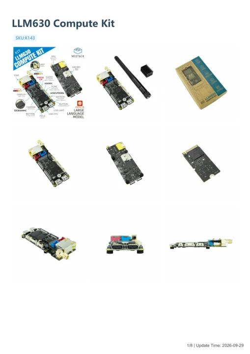
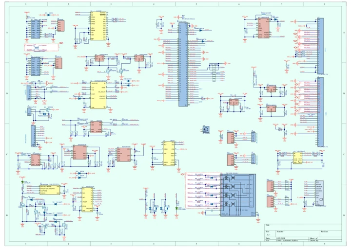

# LLM630 Compute Kit

**M5Stack** · Other SBC

Revision: Not identified

Coverage: Manufacturer references available; physical pinout and complete connector review are tracked separately

[Browse all manufacturers](../../../../BROWSE.md) · [Devices & IoT](../../../../DEVICES.md) · [Open in the browser guide](https://valleytech-black-wire-guide.pages.dev/?board=m5stack-other-sbc-llm630-compute-kit)

## Datasheets and original documentation

Board datasheet: **not yet recorded**. Visual reference: **available**.

[Manufacturer model documentation](https://docs.m5stack.com/en/core/LLM630%20Compute%20Kit)

- **hardware-guide / board**: [LLM630 Compute Kit — manufacturer hardware guide](https://m5stack.oss-cn-shenzhen.aliyuncs.com/resource/docs/static/pdf/static/en/core/LLM630_Compute_Kit.pdf) · [saved document](../../../../library/media/2eb11cf982b283a3c554fb8c2aae43a9240d1ca6c2f6bc1e970bc1e643edefc7.pdf)
- **schematic / board**: [LLM630 Compute Kit Schematic PDF — schematic](https://m5stack-doc.oss-cn-shenzhen.aliyuncs.com/459/K143_SCH_ax630c_m2_base_b03_SCH_2024_11_29_17_06_23.pdf) · [saved document](../../../../library/media/54073acdc8438a7e3af9917c5bab114ca094c455559e718434cf9915a32f6664.pdf)

A chip datasheet, schematic and board datasheet have different scopes. Match the exact hardware revision.

[Documentation coverage and remaining gaps](../../../../DOCUMENTATION.md)

## Pinout

**GPIO reference image** · Reviewed source · JPG

[Open original reference](../../../../library/media/25c21fc75f8e57d8fe641fa552d9a346766db263a1ed04eee308d847d0f6677a.jpg)

**Credit and rights:** Not established; source attribution retained. Source/manufacturer: M5Stack.

[Source 1](https://m5stack.oss-cn-shenzhen.aliyuncs.com/resource/docs/products/core/LLM630%20Computer%20Kit/LLM630%20PinMap.jpg) · [Source 2](https://docs.m5stack.com/en/core/LLM630%20Compute%20Kit)

Imported from existing M5Stack Board Reference; original working path preserved.

Image revision: Not identified

SHA-256: `25c21fc75f8e57d8fe641fa552d9a346766db263a1ed04eee308d847d0f6677a`

## Dimensions

**source reference** · Unreviewed source · PNG

[Open original reference](../../../../library/media/84e8db4c9296ccf2d8d4d01faab10cb3042b84828a9ea287b8b60baf920b4a9a.png)

**Credit and rights:** Source rights not yet established. Source/manufacturer: M5Stack.

[Source 1](https://m5stack.oss-cn-shenzhen.aliyuncs.com/resource/docs/products/core/LLM630%20Computer%20Kit/model%20size.png) · [Source 2](https://docs.m5stack.com/en/core/LLM630%20Compute%20Kit)

Original source index: Dimensions. This file is searchable but has not been promoted to a reviewed physical board pinout.

Image revision: Not identified

SHA-256: `84e8db4c9296ccf2d8d4d01faab10cb3042b84828a9ea287b8b60baf920b4a9a`

## LLM630 Compute Kit — manufacturer hardware guide

**reference PDF** · Source model/link and PDF signature/title checked; individual pin assignments and electrical validation pending · PDF

[Open original reference](../../../../library/media/2eb11cf982b283a3c554fb8c2aae43a9240d1ca6c2f6bc1e970bc1e643edefc7.pdf)

**Credit and rights:** Original publisher/manufacturer artwork; redistribution and print rights not established. Attribution is not a license grant.. Source/manufacturer: M5Stack.

[Source 1](https://m5stack.oss-cn-shenzhen.aliyuncs.com/resource/docs/static/pdf/static/en/core/LLM630_Compute_Kit.pdf) · [Source 2](https://docs.m5stack.com/en/core/LLM630%20Compute%20Kit)

Original document linked from this model’s manufacturer page. Preserve the document’s exact revision and named subassembly scope; a linked accessory schematic is not a whole-device pinout. This is a hardware manual, not a separately classified board datasheet.

Image revision: Use the revision printed in the original document; do not assume all hardware revisions are interchangeable

SHA-256: `2eb11cf982b283a3c554fb8c2aae43a9240d1ca6c2f6bc1e970bc1e643edefc7`

## LLM630 Compute Kit Schematic PDF — schematic

**reference PDF** · Source model/link and PDF signature/title checked; individual pin assignments and electrical validation pending · PDF

[Open original reference](../../../../library/media/54073acdc8438a7e3af9917c5bab114ca094c455559e718434cf9915a32f6664.pdf)

**Credit and rights:** Original publisher/manufacturer artwork; redistribution and print rights not established. Attribution is not a license grant.. Source/manufacturer: M5Stack.

[Source 1](https://m5stack-doc.oss-cn-shenzhen.aliyuncs.com/459/K143_SCH_ax630c_m2_base_b03_SCH_2024_11_29_17_06_23.pdf) · [Source 2](https://docs.m5stack.com/en/core/LLM630%20Compute%20Kit)

Original document linked from this model’s manufacturer page. Preserve the document’s exact revision and named subassembly scope; a linked accessory schematic is not a whole-device pinout. This is a circuit schematic, not a physical board pinout.

Image revision: Use the revision printed in the original document; do not assume all hardware revisions are interchangeable

SHA-256: `54073acdc8438a7e3af9917c5bab114ca094c455559e718434cf9915a32f6664`

Pin assignments have not been independently electrically verified. Check board revision before wiring.
