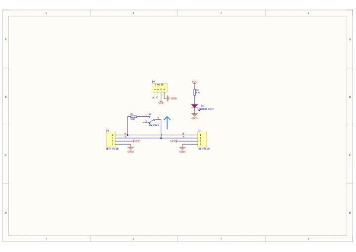

# 485T

**M5Stack** · Source collection

Revision: Unverified source identity

Coverage: Manufacturer references available; physical pinout and complete connector review are tracked separately

[Browse all manufacturers](../../../../BROWSE.md) · [Devices & IoT](../../../../DEVICES.md) · [Open in the browser guide](https://valleytech-black-wire-guide.pages.dev/?board=source-board-0a22ad2de84e38d923)

## Datasheets and original documentation

Board datasheet: **not yet recorded**. Visual reference: **available**.

[Manufacturer model documentation](https://docs.m5stack.com/en/accessory/485t)

- **schematic / board**: [485T Schematics PDF — schematic](https://m5stack-doc.oss-cn-shenzhen.aliyuncs.com/1108/A071-SCH_485T.pdf) · [saved document](../../../../library/media/3a97f452925c2ac868c23763d03dd75ac3c3446b7b580206a51365e6f9fedbee.pdf)

A chip datasheet, schematic and board datasheet have different scopes. Match the exact hardware revision.

[Documentation coverage and remaining gaps](../../../../DOCUMENTATION.md)

## Dimensions

**source reference** · Unreviewed source · PNG

[Open original reference](../../../../library/media/c1e3c6f3cafcbfe869ac5a8ed09338ef3bd973d85c09810b2d10b1ea0b43159e.png)

**Credit and rights:** Source rights not yet established. Source/manufacturer: M5Stack.

[Source 1](https://m5stack-doc.oss-cn-shenzhen.aliyuncs.com/1108/A071-485T-model-size_page_01.png) · [Source 2](https://docs.m5stack.com/en/accessory/485t)

Original source index: Dimensions. This file is searchable but has not been promoted to a reviewed physical board pinout.

Image revision: Not identified

SHA-256: `c1e3c6f3cafcbfe869ac5a8ed09338ef3bd973d85c09810b2d10b1ea0b43159e`

## 485T Schematics PDF — schematic

**reference PDF** · Source model/link and PDF signature/title checked; individual pin assignments and electrical validation pending · PDF

[Open original reference](../../../../library/media/3a97f452925c2ac868c23763d03dd75ac3c3446b7b580206a51365e6f9fedbee.pdf)

**Credit and rights:** Original publisher/manufacturer artwork; redistribution and print rights not established. Attribution is not a license grant.. Source/manufacturer: M5Stack.

[Source 1](https://m5stack-doc.oss-cn-shenzhen.aliyuncs.com/1108/A071-SCH_485T.pdf) · [Source 2](https://docs.m5stack.com/en/accessory/485t)

Original document linked from this model’s manufacturer page. Preserve the document’s exact revision and named subassembly scope; a linked accessory schematic is not a whole-device pinout. This is a circuit schematic, not a physical board pinout.

Image revision: Use the revision printed in the original document; do not assume all hardware revisions are interchangeable

SHA-256: `3a97f452925c2ac868c23763d03dd75ac3c3446b7b580206a51365e6f9fedbee`

Pin assignments have not been independently electrically verified. Check board revision before wiring.
