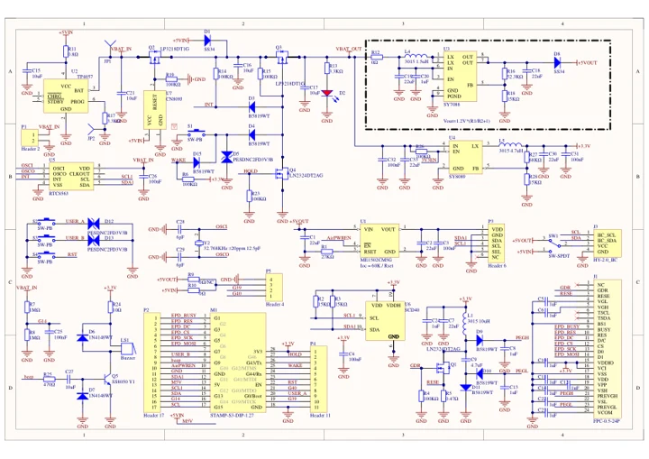
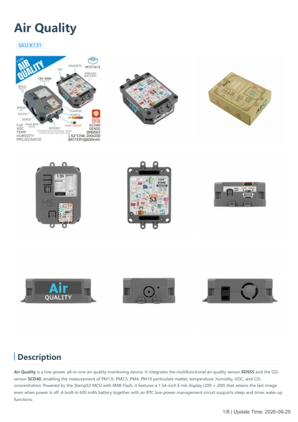

# Air Quality

**M5Stack** · Source collection

Revision: Unverified source identity

Coverage: Manufacturer references available; physical pinout and complete connector review are tracked separately

[Browse all manufacturers](../../../../BROWSE.md) · [Devices & IoT](../../../../DEVICES.md) · [Open in the browser guide](https://valleytech-black-wire-guide.pages.dev/?board=source-board-4a3f46fbd1ee9fafcc)

## Datasheets and original documentation

Board datasheet: **not yet recorded**. Visual reference: **available**.

[Manufacturer model documentation](https://docs.m5stack.com/en/core/Air_Quality)

- **schematic / board**: [Air Quality schematic PDF — schematic](https://m5stack-doc.oss-cn-shenzhen.aliyuncs.com/467/Sch_AirQ_v1.0.pdf) · [saved document](../../../../library/media/0fd9c1576c889de780f311a908ab35d8b5de43b96ea1ae283cdb4c55937c630f.pdf)
- **hardware-guide / board**: [Air Quality — manufacturer hardware guide](https://m5stack.oss-cn-shenzhen.aliyuncs.com/resource/docs/static/pdf/static/en/core/Air_Quality.pdf) · [saved document](../../../../library/media/5febb9e206c9ba1eabf98898ecf60427efb2fd4eb5bc781eef35b8cb26f43dbc.pdf)

A chip datasheet, schematic and board datasheet have different scopes. Match the exact hardware revision.

[Documentation coverage and remaining gaps](../../../../DOCUMENTATION.md)

## Dimensions

**source reference** · Unreviewed source · JPG

[Open original reference](../../../../library/media/8ca76cc890f02f1790a87c2feddb3f7cffb9f9d468e2684f55e6383418461c0e.jpg)

**Credit and rights:** Source rights not yet established. Source/manufacturer: M5Stack.

[Source 1](https://static-cdn.m5stack.com/resource/docs/products/core/AirQ/img-cb5c5066-ca41-40f2-943c-64ddc02de03b.jpg) · [Source 2](https://docs.m5stack.com/en/core/Air_Quality)

Original source index: Dimensions. This file is searchable but has not been promoted to a reviewed physical board pinout.

Image revision: Not identified

SHA-256: `8ca76cc890f02f1790a87c2feddb3f7cffb9f9d468e2684f55e6383418461c0e`

## Air Quality schematic PDF — schematic

**reference PDF** · Source model/link and PDF signature/title checked; individual pin assignments and electrical validation pending · PDF

[Open original reference](../../../../library/media/0fd9c1576c889de780f311a908ab35d8b5de43b96ea1ae283cdb4c55937c630f.pdf)

**Credit and rights:** Original publisher/manufacturer artwork; redistribution and print rights not established. Attribution is not a license grant.. Source/manufacturer: M5Stack.

[Source 1](https://m5stack-doc.oss-cn-shenzhen.aliyuncs.com/467/Sch_AirQ_v1.0.pdf) · [Source 2](https://docs.m5stack.com/en/core/Air_Quality)

Original document linked from this model’s manufacturer page. Preserve the document’s exact revision and named subassembly scope; a linked accessory schematic is not a whole-device pinout. This is a circuit schematic, not a physical board pinout.

Image revision: Use the revision printed in the original document; do not assume all hardware revisions are interchangeable

SHA-256: `0fd9c1576c889de780f311a908ab35d8b5de43b96ea1ae283cdb4c55937c630f`

## Air Quality — manufacturer hardware guide

**reference PDF** · Source model/link and PDF signature/title checked; individual pin assignments and electrical validation pending · PDF

[Open original reference](../../../../library/media/5febb9e206c9ba1eabf98898ecf60427efb2fd4eb5bc781eef35b8cb26f43dbc.pdf)

**Credit and rights:** Original publisher/manufacturer artwork; redistribution and print rights not established. Attribution is not a license grant.. Source/manufacturer: M5Stack.

[Source 1](https://m5stack.oss-cn-shenzhen.aliyuncs.com/resource/docs/static/pdf/static/en/core/Air_Quality.pdf) · [Source 2](https://docs.m5stack.com/en/core/Air_Quality)

Original document linked from this model’s manufacturer page. Preserve the document’s exact revision and named subassembly scope; a linked accessory schematic is not a whole-device pinout. This is a hardware manual, not a separately classified board datasheet.

Image revision: Use the revision printed in the original document; do not assume all hardware revisions are interchangeable

SHA-256: `5febb9e206c9ba1eabf98898ecf60427efb2fd4eb5bc781eef35b8cb26f43dbc`

Pin assignments have not been independently electrically verified. Check board revision before wiring.
