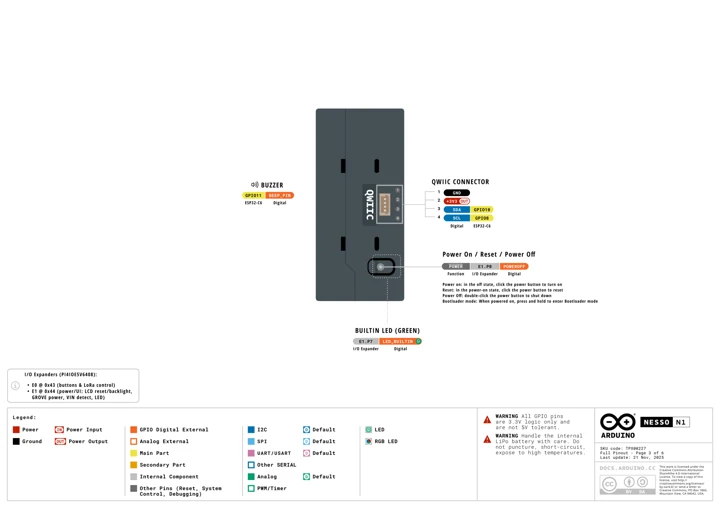
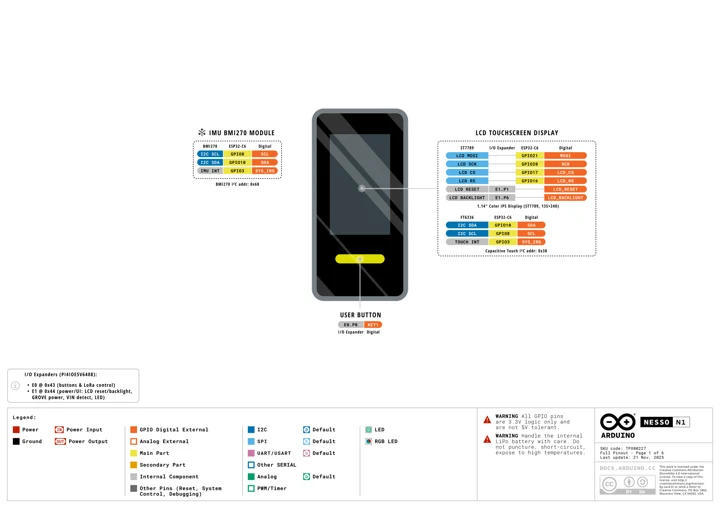
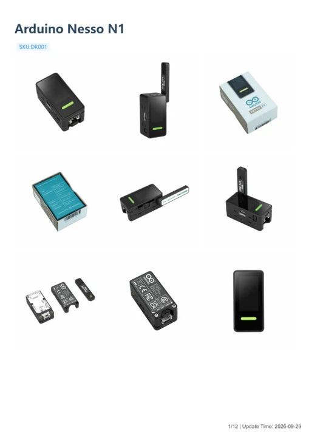
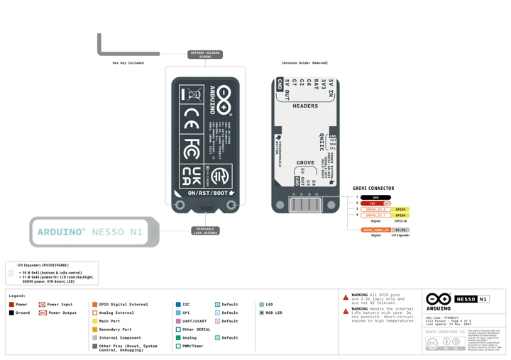
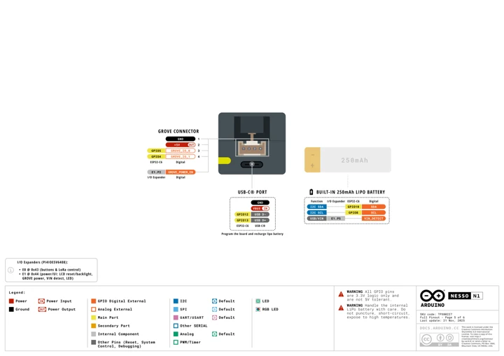

# Arduino Nesso N1

**M5Stack** · Source collection

Revision: Unverified source identity

Coverage: Manufacturer references available; physical pinout and complete connector review are tracked separately

[Browse all manufacturers](../../../../BROWSE.md) · [Devices & IoT](../../../../DEVICES.md) · [Open in the browser guide](https://valleytech-black-wire-guide.pages.dev/?board=source-board-a363aa4df93d30377d)

## Datasheets and original documentation

Board datasheet: **not yet recorded**. Visual reference: **available**.

[Manufacturer model documentation](https://docs.m5stack.com/en/core/Arduino_Nesso_N1)

- **hardware-guide / board**: [Arduino Nesso N1 — manufacturer hardware guide](https://m5stack.oss-cn-shenzhen.aliyuncs.com/resource/docs/static/pdf/static/en/core/Arduino_Nesso_N1.pdf) · [saved document](../../../../library/media/680dcec28ae33cda15da6bad98c8f1a9fb2b9db1a28a0a0f9c3cac5bb7143a5a.pdf)

A chip datasheet, schematic and board datasheet have different scopes. Match the exact hardware revision.

[Documentation coverage and remaining gaps](../../../../DOCUMENTATION.md)

## Dimensions

**source reference** · Unreviewed source · PNG

[Open original reference](../../../../library/media/d41ce73682618f3a18533a6c670b252e8e2fcb5f55ce18ee7424e1314f0f3116.png)

**Credit and rights:** Source rights not yet established. Source/manufacturer: M5Stack.

[Source 1](https://m5stack-doc.oss-cn-shenzhen.aliyuncs.com/1198/DK001-model-size_02.png) · [Source 2](https://docs.m5stack.com/en/core/Arduino_Nesso_N1)

Original source index: Dimensions. This file is searchable but has not been promoted to a reviewed physical board pinout.

Image revision: Not identified

SHA-256: `d41ce73682618f3a18533a6c670b252e8e2fcb5f55ce18ee7424e1314f0f3116`

## Dimensions

**source reference** · Unreviewed source · PNG

[Open original reference](../../../../library/media/65fc19bff3f9706df8f8b9499ed31d5a65396460dcef0bc5dd9e894edcbf6e35.png)

**Credit and rights:** Source rights not yet established. Source/manufacturer: M5Stack.

[Source 1](https://m5stack-doc.oss-cn-shenzhen.aliyuncs.com/1198/DK001-model-size_03.png) · [Source 2](https://docs.m5stack.com/en/core/Arduino_Nesso_N1)

Original source index: Dimensions. This file is searchable but has not been promoted to a reviewed physical board pinout.

Image revision: Not identified

SHA-256: `65fc19bff3f9706df8f8b9499ed31d5a65396460dcef0bc5dd9e894edcbf6e35`

## Dimensions

**source reference** · Unreviewed source · PNG

[Open original reference](../../../../library/media/9ee2d62804bbf4e0c711dbb8d5ee7874309f8b0edb48b77a4a892c8d4a1c30ae.png)

**Credit and rights:** Source rights not yet established. Source/manufacturer: M5Stack.

[Source 1](https://m5stack-doc.oss-cn-shenzhen.aliyuncs.com/1198/DK001-model-size_01.png) · [Source 2](https://docs.m5stack.com/en/core/Arduino_Nesso_N1)

Original source index: Dimensions. This file is searchable but has not been promoted to a reviewed physical board pinout.

Image revision: Not identified

SHA-256: `9ee2d62804bbf4e0c711dbb8d5ee7874309f8b0edb48b77a4a892c8d4a1c30ae`

## Nesso N1 Qwiic connector pinout

**pinout image** · Visually reviewed for identity and reference scope; independent electrical review pending · PNG

[Open original reference](../../../../library/media/e33c2a0b31f78a9dc0ae4f3cbb1984fa49ef4ab6692fba4414abc2a2126ff9bb.png)

**Credit and rights:** Original publisher/manufacturer artwork; redistribution and print rights not established. Attribution is not a license grant.. Source/manufacturer: M5Stack.

[Source 1](https://m5stack-doc.oss-cn-shenzhen.aliyuncs.com/1198/TPX00227-full-pinout_page_03.png) · [Source 2](https://docs.m5stack.com/en/core/Arduino_Nesso_N1)

Partial physical pinout: the illustrated Qwiic connector. Internal button/LED/buzzer labels do not imply exposed GPIO.

Image revision: Use the revision printed in the original document; do not assume all hardware revisions are interchangeable

SHA-256: `e33c2a0b31f78a9dc0ae4f3cbb1984fa49ef4ab6692fba4414abc2a2126ff9bb`

## Nesso N1 display and internal peripheral functions

**GPIO reference image** · Visually reviewed for identity and reference scope; independent electrical review pending · PNG

[Open original reference](../../../../library/media/343dbda5cdf7ebb88e917073bea90c929cda28dd647a94afd970c14b34a3674d.png)

**Credit and rights:** Original publisher/manufacturer artwork; redistribution and print rights not established. Attribution is not a license grant.. Source/manufacturer: M5Stack.

[Source 1](https://m5stack-doc.oss-cn-shenzhen.aliyuncs.com/1198/TPX00227-full-pinout_page_01.png) · [Source 2](https://docs.m5stack.com/en/core/Arduino_Nesso_N1)

Manufacturer diagram of internal functions; not an accessible connector pinout.

Image revision: Use the revision printed in the original document; do not assume all hardware revisions are interchangeable

SHA-256: `343dbda5cdf7ebb88e917073bea90c929cda28dd647a94afd970c14b34a3674d`

## Arduino Nesso N1 — manufacturer hardware guide

**reference PDF** · Source model/link and PDF signature/title checked; individual pin assignments and electrical validation pending · PDF

[Open original reference](../../../../library/media/680dcec28ae33cda15da6bad98c8f1a9fb2b9db1a28a0a0f9c3cac5bb7143a5a.pdf)

**Credit and rights:** Original publisher/manufacturer artwork; redistribution and print rights not established. Attribution is not a license grant.. Source/manufacturer: M5Stack.

[Source 1](https://m5stack.oss-cn-shenzhen.aliyuncs.com/resource/docs/static/pdf/static/en/core/Arduino_Nesso_N1.pdf) · [Source 2](https://docs.m5stack.com/en/core/Arduino_Nesso_N1)

Original document linked from this model’s manufacturer page. Preserve the document’s exact revision and named subassembly scope; a linked accessory schematic is not a whole-device pinout. This is a hardware manual, not a separately classified board datasheet.

Image revision: Use the revision printed in the original document; do not assume all hardware revisions are interchangeable

SHA-256: `680dcec28ae33cda15da6bad98c8f1a9fb2b9db1a28a0a0f9c3cac5bb7143a5a`

## Nesso N1 rear header and Grove pinout

**pinout image** · Visually reviewed for identity and reference scope; independent electrical review pending · PNG

[Open original reference](../../../../library/media/27ab0be9cc303b18ca582bd4d743aa6e602309b6edfa41ddc03a2caa4a9cb473.png)

**Credit and rights:** Original publisher/manufacturer artwork; redistribution and print rights not established. Attribution is not a license grant.. Source/manufacturer: M5Stack.

[Source 1](https://m5stack-doc.oss-cn-shenzhen.aliyuncs.com/1198/TPX00227-full-pinout_page_04.png) · [Source 2](https://docs.m5stack.com/en/core/Arduino_Nesso_N1)

Partial physical pinout: pictured rear connector locations; preserve viewpoint and connector orientation.

Image revision: Use the revision printed in the original document; do not assume all hardware revisions are interchangeable

SHA-256: `27ab0be9cc303b18ca582bd4d743aa6e602309b6edfa41ddc03a2caa4a9cb473`

## Nesso N1 end connector and Grove pinout

**pinout image** · Visually reviewed for identity and reference scope; independent electrical review pending · PNG

[Open original reference](../../../../library/media/f27a232d9e2dcb7eefcc10c920d3081f818e7452e78d4263f56ba28233f2a669.png)

**Credit and rights:** Original publisher/manufacturer artwork; redistribution and print rights not established. Attribution is not a license grant.. Source/manufacturer: M5Stack.

[Source 1](https://m5stack-doc.oss-cn-shenzhen.aliyuncs.com/1198/TPX00227-full-pinout_page_05.png) · [Source 2](https://docs.m5stack.com/en/core/Arduino_Nesso_N1)

Partial physical pinout: pictured end Grove connector. USB and internal battery labels have separate roles.

Image revision: Use the revision printed in the original document; do not assume all hardware revisions are interchangeable

SHA-256: `f27a232d9e2dcb7eefcc10c920d3081f818e7452e78d4263f56ba28233f2a669`

Pin assignments have not been independently electrically verified. Check board revision before wiring.
