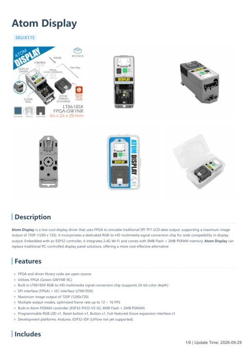

# Atom Display

**M5Stack** · Source collection

Revision: Unverified source identity

Coverage: Manufacturer references available; physical pinout and complete connector review are tracked separately

[Browse all manufacturers](../../../../BROWSE.md) · [Devices & IoT](../../../../DEVICES.md) · [Open in the browser guide](https://valleytech-black-wire-guide.pages.dev/?board=source-board-a3ee65a1394cc4d38c)

Device category: **Displays & HMI**

## Datasheets and original documentation

Board datasheet: **not yet recorded**. Visual reference: **available**.

[Manufacturer model documentation](https://docs.m5stack.com/en/atom/atom_display)

- **schematic / board**: [Atomic Display Base Schematics PDF — schematic](https://m5stack.oss-cn-shenzhen.aliyuncs.com/resource/docs/products/atom/atom_display/Sch_AtomDisplay.pdf) · [saved document](../../../../library/media/819ec635d6afa62ecd31b11032d304f996daf8fa2e527dd1480bad06d5981f8c.pdf)
- **hardware-guide / board**: [Atom Display — manufacturer hardware guide](https://m5stack.oss-cn-shenzhen.aliyuncs.com/resource/docs/static/pdf/static/en/atom/Atom_Display.pdf) · [saved document](../../../../library/media/5152d451507fb4854385934eef35e1ae1c3c36a241173bcc65439f510fc42992.pdf)

A chip datasheet, schematic and board datasheet have different scopes. Match the exact hardware revision.

[Documentation coverage and remaining gaps](../../../../DOCUMENTATION.md)

## Dimensions

**source reference** · Unreviewed source · PNG

[Open original reference](../../../../library/media/33be75532e5562fd498b0c587fb52a9d3d3b622d6118470fd321d862446e2cd2.png)

**Credit and rights:** Source rights not yet established. Source/manufacturer: M5Stack.

[Source 1](https://m5stack-doc.oss-cn-shenzhen.aliyuncs.com/894/K115-atom-display_page_01.png) · [Source 2](https://docs.m5stack.com/en/atom/atom_display)

Original source index: Dimensions. This file is searchable but has not been promoted to a reviewed physical board pinout.

Image revision: Not identified

SHA-256: `33be75532e5562fd498b0c587fb52a9d3d3b622d6118470fd321d862446e2cd2`

## Atomic Display Base Schematics PDF — schematic

**reference PDF** · Source model/link and PDF signature/title checked; individual pin assignments and electrical validation pending · PDF

[Open original reference](../../../../library/media/819ec635d6afa62ecd31b11032d304f996daf8fa2e527dd1480bad06d5981f8c.pdf)

**Credit and rights:** Original publisher/manufacturer artwork; redistribution and print rights not established. Attribution is not a license grant.. Source/manufacturer: M5Stack.

[Source 1](https://m5stack.oss-cn-shenzhen.aliyuncs.com/resource/docs/products/atom/atom_display/Sch_AtomDisplay.pdf) · [Source 2](https://docs.m5stack.com/en/atom/Atomic%20Display%20Base)

Original document linked from this model’s manufacturer page. Preserve the document’s exact revision and named subassembly scope; a linked accessory schematic is not a whole-device pinout. This is a circuit schematic, not a physical board pinout.

Image revision: Use the revision printed in the original document; do not assume all hardware revisions are interchangeable

SHA-256: `819ec635d6afa62ecd31b11032d304f996daf8fa2e527dd1480bad06d5981f8c`

## Atom Display — manufacturer hardware guide

**reference PDF** · Source model/link and PDF signature/title checked; individual pin assignments and electrical validation pending · PDF

[Open original reference](../../../../library/media/5152d451507fb4854385934eef35e1ae1c3c36a241173bcc65439f510fc42992.pdf)

**Credit and rights:** Original publisher/manufacturer artwork; redistribution and print rights not established. Attribution is not a license grant.. Source/manufacturer: M5Stack.

[Source 1](https://m5stack.oss-cn-shenzhen.aliyuncs.com/resource/docs/static/pdf/static/en/atom/Atom_Display.pdf) · [Source 2](https://docs.m5stack.com/en/atom/atom_display)

Original document linked from this model’s manufacturer page. Preserve the document’s exact revision and named subassembly scope; a linked accessory schematic is not a whole-device pinout. This is a hardware manual, not a separately classified board datasheet.

Image revision: Use the revision printed in the original document; do not assume all hardware revisions are interchangeable

SHA-256: `5152d451507fb4854385934eef35e1ae1c3c36a241173bcc65439f510fc42992`

Pin assignments have not been independently electrically verified. Check board revision before wiring.
