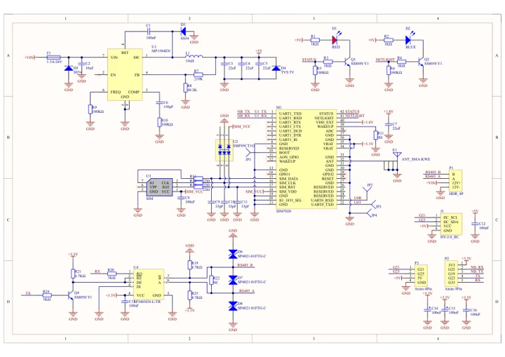
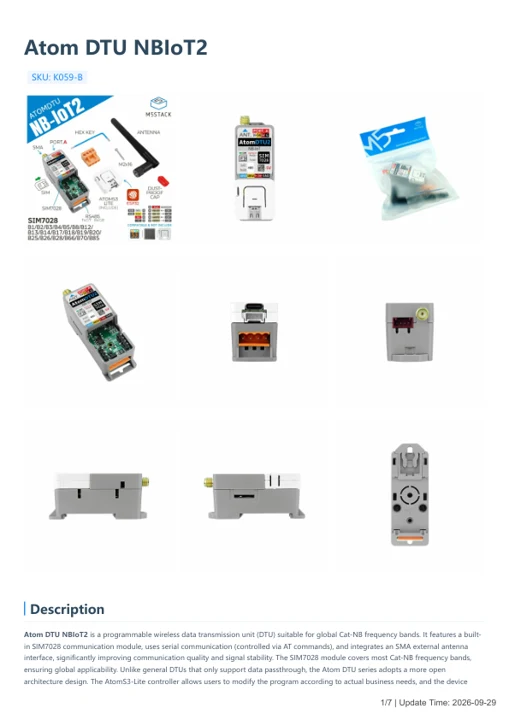

# Atom DTU NBIoT2

**M5Stack** · Source collection

Revision: Unverified source identity

Coverage: Manufacturer references available; physical pinout and complete connector review are tracked separately

[Browse all manufacturers](../../../../BROWSE.md) · [Devices & IoT](../../../../DEVICES.md) · [Open in the browser guide](https://valleytech-black-wire-guide.pages.dev/?board=source-board-d86cb3a1d711815839)

Device category: **Controllers & instruments**

## Datasheets and original documentation

Board datasheet: **not yet recorded**. Visual reference: **available**.

[Manufacturer model documentation](https://docs.m5stack.com/en/atom/Atom%20DTU_NB_IoT2)

- **schematic / board**: [Atom DTU NBIoT2 Schematics PDF — schematic](https://m5stack-doc.oss-cn-shenzhen.aliyuncs.com/542/SCH_AtomNB-DTU2_V1.0.pdf) · [saved document](../../../../library/media/c79704848c01de42eeec994ebead4442c20d293eda936cac053071cca39f6ba6.pdf)
- **hardware-guide / board**: [Atom DTU NBIoT2 — manufacturer hardware guide](https://m5stack.oss-cn-shenzhen.aliyuncs.com/resource/docs/static/pdf/static/en/atom/Atom_DTU_NBIoT2.pdf) · [saved document](../../../../library/media/135dfebf4baeb49eda6c8a6f4a4b856e58d81042a26c4d86f099785a7af611b2.pdf)

A chip datasheet, schematic and board datasheet have different scopes. Match the exact hardware revision.

[Documentation coverage and remaining gaps](../../../../DOCUMENTATION.md)

## Dimensions

**source reference** · Unreviewed source · JPG

[Open original reference](../../../../library/media/5f34a9256b19a7c4db971461df19b5da8686c7ff0c6dac246b55e5b98621a8ec.jpg)

**Credit and rights:** Source rights not yet established. Source/manufacturer: M5Stack.

[Source 1](https://m5stack.oss-cn-shenzhen.aliyuncs.com/resource/docs/products/atom/Atom%20DTU-NB-IoT2/%E5%B0%BA%E5%AF%B8%E5%9B%BE.jpg) · [Source 2](https://docs.m5stack.com/en/atom/Atom%20DTU_NB_IoT2)

Original source index: Dimensions. This file is searchable but has not been promoted to a reviewed physical board pinout.

Image revision: Not identified

SHA-256: `5f34a9256b19a7c4db971461df19b5da8686c7ff0c6dac246b55e5b98621a8ec`

## Atom DTU NBIoT2 Schematics PDF — schematic

**reference PDF** · Source model/link and PDF signature/title checked; individual pin assignments and electrical validation pending · PDF

[Open original reference](../../../../library/media/c79704848c01de42eeec994ebead4442c20d293eda936cac053071cca39f6ba6.pdf)

**Credit and rights:** Original publisher/manufacturer artwork; redistribution and print rights not established. Attribution is not a license grant.. Source/manufacturer: M5Stack.

[Source 1](https://m5stack-doc.oss-cn-shenzhen.aliyuncs.com/542/SCH_AtomNB-DTU2_V1.0.pdf) · [Source 2](https://docs.m5stack.com/en/atom/Atom%20DTU_NB_IoT2)

Original document linked from this model’s manufacturer page. Preserve the document’s exact revision and named subassembly scope; a linked accessory schematic is not a whole-device pinout. This is a circuit schematic, not a physical board pinout.

Image revision: Use the revision printed in the original document; do not assume all hardware revisions are interchangeable

SHA-256: `c79704848c01de42eeec994ebead4442c20d293eda936cac053071cca39f6ba6`

## Atom DTU NBIoT2 — manufacturer hardware guide

**reference PDF** · Source model/link and PDF signature/title checked; individual pin assignments and electrical validation pending · PDF

[Open original reference](../../../../library/media/135dfebf4baeb49eda6c8a6f4a4b856e58d81042a26c4d86f099785a7af611b2.pdf)

**Credit and rights:** Original publisher/manufacturer artwork; redistribution and print rights not established. Attribution is not a license grant.. Source/manufacturer: M5Stack.

[Source 1](https://m5stack.oss-cn-shenzhen.aliyuncs.com/resource/docs/static/pdf/static/en/atom/Atom_DTU_NBIoT2.pdf) · [Source 2](https://docs.m5stack.com/en/atom/Atom%20DTU_NB_IoT2)

Original document linked from this model’s manufacturer page. Preserve the document’s exact revision and named subassembly scope; a linked accessory schematic is not a whole-device pinout. This is a hardware manual, not a separately classified board datasheet.

Image revision: Use the revision printed in the original document; do not assume all hardware revisions are interchangeable

SHA-256: `135dfebf4baeb49eda6c8a6f4a4b856e58d81042a26c4d86f099785a7af611b2`

Pin assignments have not been independently electrically verified. Check board revision before wiring.
