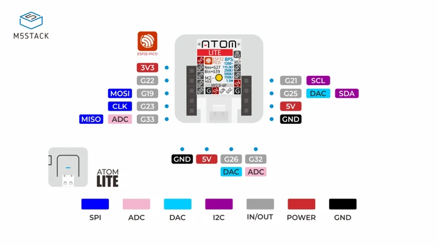
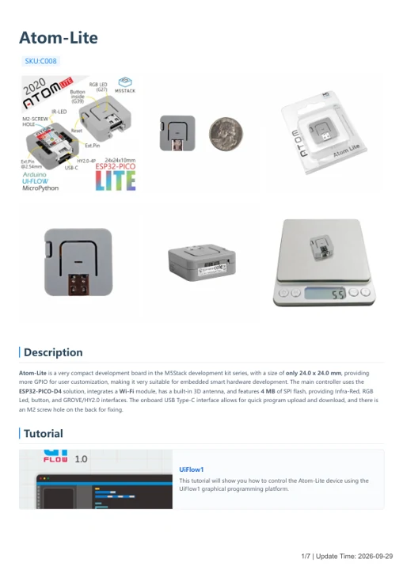

# Atom-Lite

**M5Stack** · Source collection

Revision: Unverified source identity

Coverage: Manufacturer references available; physical pinout and complete connector review are tracked separately

[Browse all manufacturers](../../../../BROWSE.md) · [Devices & IoT](../../../../DEVICES.md) · [Open in the browser guide](https://valleytech-black-wire-guide.pages.dev/?board=source-board-474ca0108b4acc2297)

Device category: **Controllers & instruments**

## Datasheets and original documentation

Board datasheet: **not yet recorded**. Visual reference: **available**.

[Manufacturer model documentation](https://docs.m5stack.com/en/core/ATOM%20Lite)

- **hardware-guide / board**: [Atom-Lite — manufacturer hardware guide](https://m5stack.oss-cn-shenzhen.aliyuncs.com/resource/docs/static/pdf/static/en/core/Atom-Lite.pdf) · [saved document](../../../../library/media/4e39040f32e7bb3a20551ed09adca7215e9420282ea75cd86516de8adf334abb.pdf)

A chip datasheet, schematic and board datasheet have different scopes. Match the exact hardware revision.

[Documentation coverage and remaining gaps](../../../../DOCUMENTATION.md)

## Dimensions

**source reference** · Unreviewed source · PNG

[Open original reference](../../../../library/media/14ba69107f17e22e6f5ca0ffae45c6d6b6e455bacf549a1af1b67a9a7f5c3a80.png)

**Credit and rights:** Source rights not yet established. Source/manufacturer: M5Stack.

[Source 1](https://m5stack.oss-cn-shenzhen.aliyuncs.com/resource/docs/products/core/ATOM%20Lite/model%20size.jpg) · [Source 2](https://docs.m5stack.com/en/core/ATOM%20Lite)

Original source index: Dimensions. This file is searchable but has not been promoted to a reviewed physical board pinout.

Image revision: Not identified

SHA-256: `14ba69107f17e22e6f5ca0ffae45c6d6b6e455bacf549a1af1b67a9a7f5c3a80`

## ATOM Lite physical connector pinout

**pinout image** · Visually reviewed for identity and reference scope; independent electrical review pending · JPG

[Open original reference](../../../../library/media/c560ae52e54a7bf6ed5c0b990a0ab89a1e2f41c220798f03aa412b4ae7efa6c3.jpg)

**Credit and rights:** Original publisher/manufacturer artwork; redistribution and print rights not established. Attribution is not a license grant.. Source/manufacturer: M5Stack.

[Source 1](https://m5stack-doc.oss-cn-shenzhen.aliyuncs.com/673/C008_PinMap_01.jpg) · [Source 2](https://docs.m5stack.com/en/core/ATOM%20Lite)

Original header and Grove connector drawing. Match the pictured ATOM Lite hardware.

Image revision: Use the revision printed in the original document; do not assume all hardware revisions are interchangeable

SHA-256: `c560ae52e54a7bf6ed5c0b990a0ab89a1e2f41c220798f03aa412b4ae7efa6c3`

## Atom-Lite — manufacturer hardware guide

**reference PDF** · Source model/link and PDF signature/title checked; individual pin assignments and electrical validation pending · PDF

[Open original reference](../../../../library/media/4e39040f32e7bb3a20551ed09adca7215e9420282ea75cd86516de8adf334abb.pdf)

**Credit and rights:** Original publisher/manufacturer artwork; redistribution and print rights not established. Attribution is not a license grant.. Source/manufacturer: M5Stack.

[Source 1](https://m5stack.oss-cn-shenzhen.aliyuncs.com/resource/docs/static/pdf/static/en/core/Atom-Lite.pdf) · [Source 2](https://docs.m5stack.com/en/core/ATOM%20Lite)

Original document linked from this model’s manufacturer page. Preserve the document’s exact revision and named subassembly scope; a linked accessory schematic is not a whole-device pinout. This is a hardware manual, not a separately classified board datasheet.

Image revision: Use the revision printed in the original document; do not assume all hardware revisions are interchangeable

SHA-256: `4e39040f32e7bb3a20551ed09adca7215e9420282ea75cd86516de8adf334abb`

Pin assignments have not been independently electrically verified. Check board revision before wiring.
