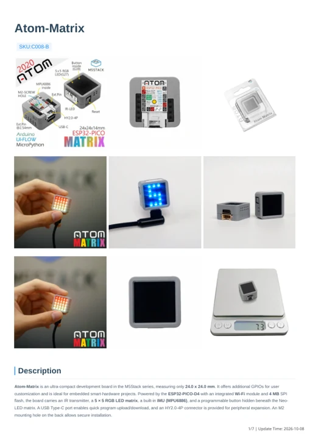

# Atom-Matrix

**M5Stack** · Source collection

Revision: Unverified source identity

Coverage: Manufacturer references available; physical pinout and complete connector review are tracked separately

[Browse all manufacturers](../../../../BROWSE.md) · [Devices & IoT](../../../../DEVICES.md) · [Open in the browser guide](https://valleytech-black-wire-guide.pages.dev/?board=source-board-41f8fa131b3051248e)

Device category: **Controllers & instruments**

## Datasheets and original documentation

Board datasheet: **not yet recorded**. Visual reference: **available**.

[Manufacturer model documentation](https://docs.m5stack.com/en/core/ATOM%20Matrix)

- **hardware-guide / board**: [Atom-Matrix — manufacturer hardware guide](https://m5stack.oss-cn-shenzhen.aliyuncs.com/resource/docs/static/pdf/static/en/core/Atom-Matrix.pdf) · [saved document](../../../../library/media/a0aab04ac5b0dfffef63b2fb4ae35c09b79e5423ae295e133e789a41b5ba88e5.pdf)

A chip datasheet, schematic and board datasheet have different scopes. Match the exact hardware revision.

[Documentation coverage and remaining gaps](../../../../DOCUMENTATION.md)

## Dimensions

**source reference** · Unreviewed source · PNG

[Open original reference](../../../../library/media/7523ba835bc8e2425475310f835e947fff33369bcc9107b91efaed1f516c522f.png)

**Credit and rights:** Source rights not yet established. Source/manufacturer: M5Stack.

[Source 1](https://m5stack-doc.oss-cn-shenzhen.aliyuncs.com/1228/c008b-model-size_page_01.png) · [Source 2](https://docs.m5stack.com/en/core/ATOM%20Matrix)

Original source index: Dimensions. This file is searchable but has not been promoted to a reviewed physical board pinout.

Image revision: Not identified

SHA-256: `7523ba835bc8e2425475310f835e947fff33369bcc9107b91efaed1f516c522f`

## Atom-Matrix — manufacturer hardware guide

**reference PDF** · Source model/link and PDF signature/title checked; individual pin assignments and electrical validation pending · PDF

[Open original reference](../../../../library/media/a0aab04ac5b0dfffef63b2fb4ae35c09b79e5423ae295e133e789a41b5ba88e5.pdf)

**Credit and rights:** Original publisher/manufacturer artwork; redistribution and print rights not established. Attribution is not a license grant.. Source/manufacturer: M5Stack.

[Source 1](https://m5stack.oss-cn-shenzhen.aliyuncs.com/resource/docs/static/pdf/static/en/core/Atom-Matrix.pdf) · [Source 2](https://docs.m5stack.com/en/core/ATOM%20Matrix)

Original document linked from this model’s manufacturer page. Preserve the document’s exact revision and named subassembly scope; a linked accessory schematic is not a whole-device pinout. This is a hardware manual, not a separately classified board datasheet.

Image revision: Use the revision printed in the original document; do not assume all hardware revisions are interchangeable

SHA-256: `a0aab04ac5b0dfffef63b2fb4ae35c09b79e5423ae295e133e789a41b5ba88e5`

Pin assignments have not been independently electrically verified. Check board revision before wiring.
