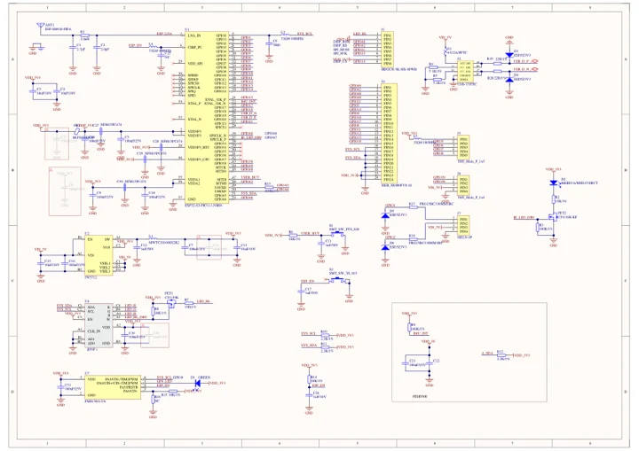
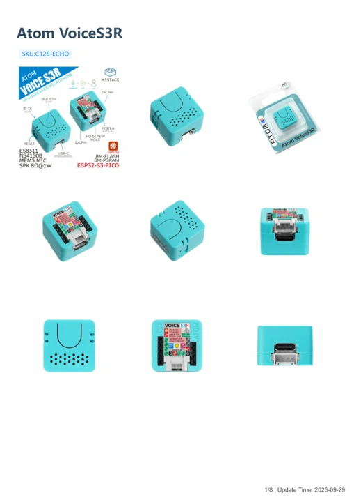
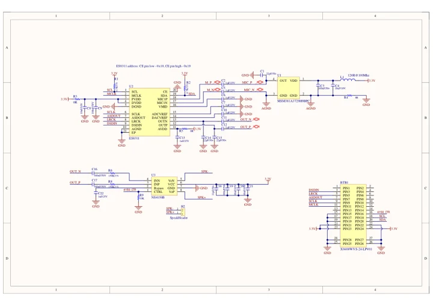

# Atom VoiceS3R

**M5Stack** · Source collection

Revision: Unverified source identity

Coverage: Manufacturer references available; physical pinout and complete connector review are tracked separately

[Browse all manufacturers](../../../../BROWSE.md) · [Devices & IoT](../../../../DEVICES.md) · [Open in the browser guide](https://valleytech-black-wire-guide.pages.dev/?board=source-board-1c1077044dcd101eba)

Device category: **Controllers & instruments**

## Datasheets and original documentation

Board datasheet: **not yet recorded**. Visual reference: **available**.

[Manufacturer model documentation](https://docs.m5stack.com/en/core/Atom_EchoS3R)

- **schematic / board**: [Atom VoiceS3R Mainboard Schematics PDF — schematic](https://m5stack-doc.oss-cn-shenzhen.aliyuncs.com/1182/Sch_M5_AtomS3R_v0.4.1.pdf) · [saved document](../../../../library/media/f6fa37351ba7be29af6b5cc7e4971631e6eec5a83e0c5b423f00cd2e8c8354dc.pdf)
- **hardware-guide / board**: [Atom VoiceS3R — manufacturer hardware guide](https://m5stack.oss-cn-shenzhen.aliyuncs.com/resource/docs/static/pdf/static/en/core/Atom_VoiceS3R.pdf) · [saved document](../../../../library/media/53d7801c1225f012ce40d515e38d44625a081813e299b0deb5c898503fcf8354.pdf)
- **schematic / board**: [Atom VoiceS3R Baseboard Schematics PDF — schematic](https://m5stack-doc.oss-cn-shenzhen.aliyuncs.com/1182/Sch_M5_AtomEchoS3R_Audio_v1.0_20250716.pdf) · [saved document](../../../../library/media/a40c0a34508658f0684334b1b0bfff0d52c7be880e47e7c6c5b2fd41d55423ca.pdf)

A chip datasheet, schematic and board datasheet have different scopes. Match the exact hardware revision.

[Documentation coverage and remaining gaps](../../../../DOCUMENTATION.md)

## Dimensions

**source reference** · Unreviewed source · PNG

[Open original reference](../../../../library/media/9dfb1f577d1f8ca1d3698127180db27893943afe544a3724e87e075359e4979e.png)

**Credit and rights:** Source rights not yet established. Source/manufacturer: M5Stack.

[Source 1](https://m5stack-doc.oss-cn-shenzhen.aliyuncs.com/676/C008-C-atom_sound_page_01.png) · [Source 2](https://docs.m5stack.com/en/core/Atom_EchoS3R)

Original source index: Dimensions. This file is searchable but has not been promoted to a reviewed physical board pinout.

Image revision: Not identified

SHA-256: `9dfb1f577d1f8ca1d3698127180db27893943afe544a3724e87e075359e4979e`

## Atom VoiceS3R Mainboard Schematics PDF — schematic

**reference PDF** · Source model/link and PDF signature/title checked; individual pin assignments and electrical validation pending · PDF

[Open original reference](../../../../library/media/f6fa37351ba7be29af6b5cc7e4971631e6eec5a83e0c5b423f00cd2e8c8354dc.pdf)

**Credit and rights:** Original publisher/manufacturer artwork; redistribution and print rights not established. Attribution is not a license grant.. Source/manufacturer: M5Stack.

[Source 1](https://m5stack-doc.oss-cn-shenzhen.aliyuncs.com/1182/Sch_M5_AtomS3R_v0.4.1.pdf) · [Source 2](https://docs.m5stack.com/en/core/Atom_EchoS3R)

Original document linked from this model’s manufacturer page. Preserve the document’s exact revision and named subassembly scope; a linked accessory schematic is not a whole-device pinout. This is a circuit schematic, not a physical board pinout.

Image revision: Use the revision printed in the original document; do not assume all hardware revisions are interchangeable

SHA-256: `f6fa37351ba7be29af6b5cc7e4971631e6eec5a83e0c5b423f00cd2e8c8354dc`

## Atom VoiceS3R — manufacturer hardware guide

**reference PDF** · Source model/link and PDF signature/title checked; individual pin assignments and electrical validation pending · PDF

[Open original reference](../../../../library/media/53d7801c1225f012ce40d515e38d44625a081813e299b0deb5c898503fcf8354.pdf)

**Credit and rights:** Original publisher/manufacturer artwork; redistribution and print rights not established. Attribution is not a license grant.. Source/manufacturer: M5Stack.

[Source 1](https://m5stack.oss-cn-shenzhen.aliyuncs.com/resource/docs/static/pdf/static/en/core/Atom_VoiceS3R.pdf) · [Source 2](https://docs.m5stack.com/en/core/Atom_EchoS3R)

Original document linked from this model’s manufacturer page. Preserve the document’s exact revision and named subassembly scope; a linked accessory schematic is not a whole-device pinout. This is a hardware manual, not a separately classified board datasheet.

Image revision: Use the revision printed in the original document; do not assume all hardware revisions are interchangeable

SHA-256: `53d7801c1225f012ce40d515e38d44625a081813e299b0deb5c898503fcf8354`

## Atom VoiceS3R Baseboard Schematics PDF — schematic

**reference PDF** · Source model/link and PDF signature/title checked; individual pin assignments and electrical validation pending · PDF

[Open original reference](../../../../library/media/a40c0a34508658f0684334b1b0bfff0d52c7be880e47e7c6c5b2fd41d55423ca.pdf)

**Credit and rights:** Original publisher/manufacturer artwork; redistribution and print rights not established. Attribution is not a license grant.. Source/manufacturer: M5Stack.

[Source 1](https://m5stack-doc.oss-cn-shenzhen.aliyuncs.com/1182/Sch_M5_AtomEchoS3R_Audio_v1.0_20250716.pdf) · [Source 2](https://docs.m5stack.com/en/core/Atom_EchoS3R)

Original document linked from this model’s manufacturer page. Preserve the document’s exact revision and named subassembly scope; a linked accessory schematic is not a whole-device pinout. This is a circuit schematic, not a physical board pinout.

Image revision: Use the revision printed in the original document; do not assume all hardware revisions are interchangeable

SHA-256: `a40c0a34508658f0684334b1b0bfff0d52c7be880e47e7c6c5b2fd41d55423ca`

Pin assignments have not been independently electrically verified. Check board revision before wiring.
