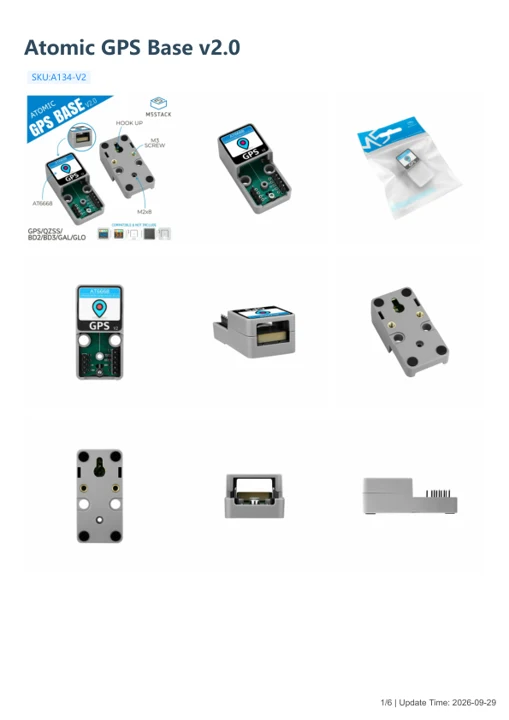
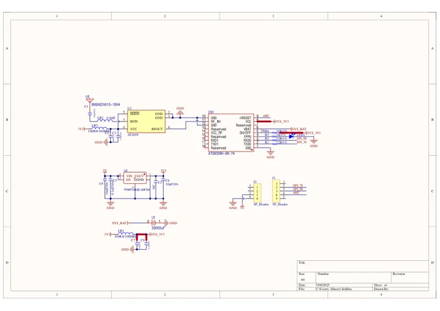

# Atomic GPS Base v2.0

**M5Stack** · Source collection

Revision: Unverified source identity

Coverage: Manufacturer references available; physical pinout and complete connector review are tracked separately

[Browse all manufacturers](../../../../BROWSE.md) · [Devices & IoT](../../../../DEVICES.md) · [Open in the browser guide](https://valleytech-black-wire-guide.pages.dev/?board=source-board-d8f1456f5c9d5feb9d)

Device category: **Controllers & instruments**

## Datasheets and original documentation

Board datasheet: **not yet recorded**. Visual reference: **available**.

[Manufacturer model documentation](https://docs.m5stack.com/en/atom/Atomic_GPS_Base_v2.0)

- **hardware-guide / board**: [Atomic GPS Base v2.0 — manufacturer hardware guide](https://m5stack.oss-cn-shenzhen.aliyuncs.com/resource/docs/static/pdf/static/en/atom/Atomic_GPS_Base_v2.0.pdf) · [saved document](../../../../library/media/448a2f0f1fb0d06822e1c4f801a39e6e52fa7984fcb5899e377ffe1f35bd3e9a.pdf)
- **schematic / board**: [Atomic GPS Base v2.0 Schematics PDF — schematic](https://m5stack-doc.oss-cn-shenzhen.aliyuncs.com/1158/SCH-A134-V2.pdf) · [saved document](../../../../library/media/45ba51f77028c8b1671d75a346a08406e6f54ee18687d76ffa4b9f21685f6e2f.pdf)

A chip datasheet, schematic and board datasheet have different scopes. Match the exact hardware revision.

[Documentation coverage and remaining gaps](../../../../DOCUMENTATION.md)

## Dimensions

**source reference** · Unreviewed source · PNG

[Open original reference](../../../../library/media/08b8b041eb3047c1ee23913e233fe91fffb730976009485f8abcdc1d669290a3.png)

**Credit and rights:** Source rights not yet established. Source/manufacturer: M5Stack.

[Source 1](https://m5stack-doc.oss-cn-shenzhen.aliyuncs.com/1158/ATOMGPS-V2_page_01.png) · [Source 2](https://docs.m5stack.com/en/atom/Atomic_GPS_Base_v2.0)

Original source index: Dimensions. This file is searchable but has not been promoted to a reviewed physical board pinout.

Image revision: Not identified

SHA-256: `08b8b041eb3047c1ee23913e233fe91fffb730976009485f8abcdc1d669290a3`

## Atomic GPS Base v2.0 — manufacturer hardware guide

**reference PDF** · Source model/link and PDF signature/title checked; individual pin assignments and electrical validation pending · PDF

[Open original reference](../../../../library/media/448a2f0f1fb0d06822e1c4f801a39e6e52fa7984fcb5899e377ffe1f35bd3e9a.pdf)

**Credit and rights:** Original publisher/manufacturer artwork; redistribution and print rights not established. Attribution is not a license grant.. Source/manufacturer: M5Stack.

[Source 1](https://m5stack.oss-cn-shenzhen.aliyuncs.com/resource/docs/static/pdf/static/en/atom/Atomic_GPS_Base_v2.0.pdf) · [Source 2](https://docs.m5stack.com/en/atom/Atomic_GPS_Base_v2.0)

Original document linked from this model’s manufacturer page. Preserve the document’s exact revision and named subassembly scope; a linked accessory schematic is not a whole-device pinout. This is a hardware manual, not a separately classified board datasheet.

Image revision: Use the revision printed in the original document; do not assume all hardware revisions are interchangeable

SHA-256: `448a2f0f1fb0d06822e1c4f801a39e6e52fa7984fcb5899e377ffe1f35bd3e9a`

## Atomic GPS Base v2.0 Schematics PDF — schematic

**reference PDF** · Source model/link and PDF signature/title checked; individual pin assignments and electrical validation pending · PDF

[Open original reference](../../../../library/media/45ba51f77028c8b1671d75a346a08406e6f54ee18687d76ffa4b9f21685f6e2f.pdf)

**Credit and rights:** Original publisher/manufacturer artwork; redistribution and print rights not established. Attribution is not a license grant.. Source/manufacturer: M5Stack.

[Source 1](https://m5stack-doc.oss-cn-shenzhen.aliyuncs.com/1158/SCH-A134-V2.pdf) · [Source 2](https://docs.m5stack.com/en/atom/Atomic_GPS_Base_v2.0)

Original document linked from this model’s manufacturer page. Preserve the document’s exact revision and named subassembly scope; a linked accessory schematic is not a whole-device pinout. This is a circuit schematic, not a physical board pinout.

Image revision: Use the revision printed in the original document; do not assume all hardware revisions are interchangeable

SHA-256: `45ba51f77028c8b1671d75a346a08406e6f54ee18687d76ffa4b9f21685f6e2f`

Pin assignments have not been independently electrically verified. Check board revision before wiring.
