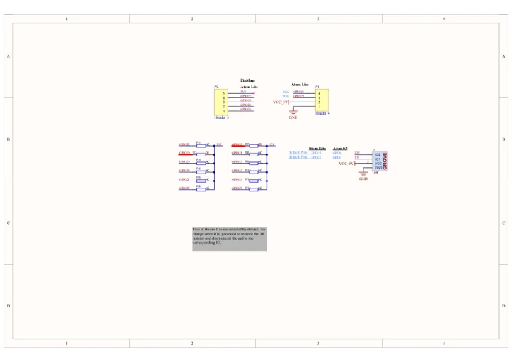
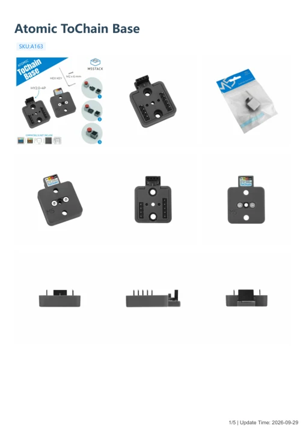

# Atomic ToChain Base

**M5Stack** · Source collection

Revision: Unverified source identity

Coverage: Manufacturer references available; physical pinout and complete connector review are tracked separately

[Browse all manufacturers](../../../../BROWSE.md) · [Devices & IoT](../../../../DEVICES.md) · [Open in the browser guide](https://valleytech-black-wire-guide.pages.dev/?board=source-board-bf541458bf93d6b6b1)

Device category: **Controllers & instruments**

## Datasheets and original documentation

Board datasheet: **not yet recorded**. Visual reference: **available**.

[Manufacturer model documentation](https://docs.m5stack.com/en/accessory/Atomic_ToChain_Base)

- **schematic / board**: [Atomic ToChain Base Schematics PDF — schematic](https://m5stack-doc.oss-cn-shenzhen.aliyuncs.com/1193/A163-Atom-Chain_SCH_Main_V1.0_20250902.pdf) · [saved document](../../../../library/media/7589d88cb8e4c78d4291facf063d3bc8fb744ffc90459fdb46def6b2dc22e3fc.pdf)
- **hardware-guide / board**: [Atomic ToChain Base — manufacturer hardware guide](https://m5stack.oss-cn-shenzhen.aliyuncs.com/resource/docs/static/pdf/static/en/accessory/Atomic_ToChain_Base.pdf) · [saved document](../../../../library/media/2603271ae22ffdef9be52e66c703db292d3b0f2cdafa331240714b0257b7fb71.pdf)

A chip datasheet, schematic and board datasheet have different scopes. Match the exact hardware revision.

[Documentation coverage and remaining gaps](../../../../DOCUMENTATION.md)

## Dimensions

**source reference** · Unreviewed source · PNG

[Open original reference](../../../../library/media/0b7d75606c0b59d6d371fbf5ea3df197b6f986db99d7250366275fbe4c49d0f3.png)

**Credit and rights:** Source rights not yet established. Source/manufacturer: M5Stack.

[Source 1](https://m5stack-doc.oss-cn-shenzhen.aliyuncs.com/1193/A163-ATOMCHAIN_page_01.png) · [Source 2](https://docs.m5stack.com/en/accessory/Atomic_ToChain_Base)

Original source index: Dimensions. This file is searchable but has not been promoted to a reviewed physical board pinout.

Image revision: Not identified

SHA-256: `0b7d75606c0b59d6d371fbf5ea3df197b6f986db99d7250366275fbe4c49d0f3`

## Atomic ToChain Base Schematics PDF — schematic

**reference PDF** · Source model/link and PDF signature/title checked; individual pin assignments and electrical validation pending · PDF

[Open original reference](../../../../library/media/7589d88cb8e4c78d4291facf063d3bc8fb744ffc90459fdb46def6b2dc22e3fc.pdf)

**Credit and rights:** Original publisher/manufacturer artwork; redistribution and print rights not established. Attribution is not a license grant.. Source/manufacturer: M5Stack.

[Source 1](https://m5stack-doc.oss-cn-shenzhen.aliyuncs.com/1193/A163-Atom-Chain_SCH_Main_V1.0_20250902.pdf) · [Source 2](https://docs.m5stack.com/en/accessory/Atomic_ToChain_Base)

Original document linked from this model’s manufacturer page. Preserve the document’s exact revision and named subassembly scope; a linked accessory schematic is not a whole-device pinout. This is a circuit schematic, not a physical board pinout.

Image revision: Use the revision printed in the original document; do not assume all hardware revisions are interchangeable

SHA-256: `7589d88cb8e4c78d4291facf063d3bc8fb744ffc90459fdb46def6b2dc22e3fc`

## Atomic ToChain Base — manufacturer hardware guide

**reference PDF** · Source model/link and PDF signature/title checked; individual pin assignments and electrical validation pending · PDF

[Open original reference](../../../../library/media/2603271ae22ffdef9be52e66c703db292d3b0f2cdafa331240714b0257b7fb71.pdf)

**Credit and rights:** Original publisher/manufacturer artwork; redistribution and print rights not established. Attribution is not a license grant.. Source/manufacturer: M5Stack.

[Source 1](https://m5stack.oss-cn-shenzhen.aliyuncs.com/resource/docs/static/pdf/static/en/accessory/Atomic_ToChain_Base.pdf) · [Source 2](https://docs.m5stack.com/en/accessory/Atomic_ToChain_Base)

Original document linked from this model’s manufacturer page. Preserve the document’s exact revision and named subassembly scope; a linked accessory schematic is not a whole-device pinout. This is a hardware manual, not a separately classified board datasheet.

Image revision: Use the revision printed in the original document; do not assume all hardware revisions are interchangeable

SHA-256: `2603271ae22ffdef9be52e66c703db292d3b0f2cdafa331240714b0257b7fb71`

Pin assignments have not been independently electrically verified. Check board revision before wiring.
