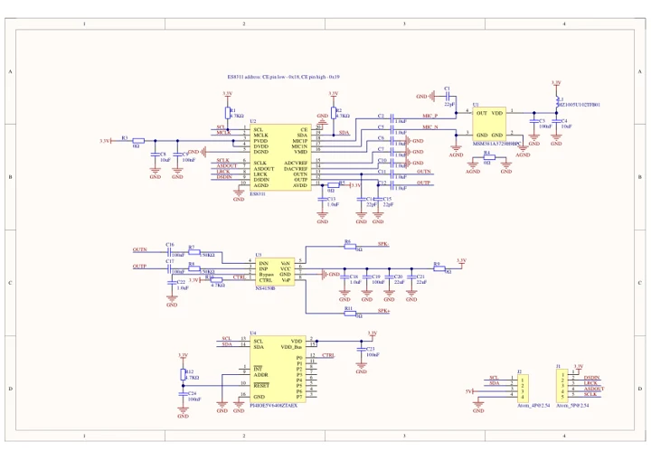
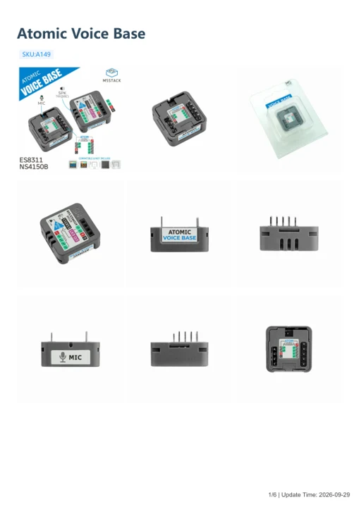

# Atomic Voice Base

**M5Stack** · Source collection

Revision: Unverified source identity

Coverage: Manufacturer references available; physical pinout and complete connector review are tracked separately

[Browse all manufacturers](../../../../BROWSE.md) · [Devices & IoT](../../../../DEVICES.md) · [Open in the browser guide](https://valleytech-black-wire-guide.pages.dev/?board=source-board-0faecc933796bd04ba)

Device category: **Controllers & instruments**

## Datasheets and original documentation

Board datasheet: **not yet recorded**. Visual reference: **available**.

[Manufacturer model documentation](https://docs.m5stack.com/en/atom/Atomic%20Echo%20Base)

- **schematic / board**: [Atomic Voice Base Schematic PDF — schematic](https://m5stack-doc.oss-cn-shenzhen.aliyuncs.com/903/Sch_ECHO_Base_v1.0.pdf) · [saved document](../../../../library/media/a72de240e8ee10428945e724eaefbec1110ecb7124f12c995c216984a03b8e5a.pdf)
- **hardware-guide / board**: [Atomic Voice Base — manufacturer hardware guide](https://m5stack.oss-cn-shenzhen.aliyuncs.com/resource/docs/static/pdf/static/en/atom/Atomic_Voice_Base.pdf) · [saved document](../../../../library/media/a5168a850710de2ea1c9d10f6bad0aef5f33c77443ab0a81267452176254cd74.pdf)

A chip datasheet, schematic and board datasheet have different scopes. Match the exact hardware revision.

[Documentation coverage and remaining gaps](../../../../DOCUMENTATION.md)

## Dimensions

**source reference** · Unreviewed source · JPG

[Open original reference](../../../../library/media/99b82ec0855e80769ee349d2023bc05513aeac31a4d92a4cf3bcc30e03fef806.jpg)

**Credit and rights:** Source rights not yet established. Source/manufacturer: M5Stack.

[Source 1](https://m5stack.oss-cn-shenzhen.aliyuncs.com/resource/docs/products/atom/Atomic%20Echo%20Base/model%20size.jpg) · [Source 2](https://docs.m5stack.com/en/atom/Atomic%20Echo%20Base)

Original source index: Dimensions. This file is searchable but has not been promoted to a reviewed physical board pinout.

Image revision: Not identified

SHA-256: `99b82ec0855e80769ee349d2023bc05513aeac31a4d92a4cf3bcc30e03fef806`

## Atomic Voice Base Schematic PDF — schematic

**reference PDF** · Source model/link and PDF signature/title checked; individual pin assignments and electrical validation pending · PDF

[Open original reference](../../../../library/media/a72de240e8ee10428945e724eaefbec1110ecb7124f12c995c216984a03b8e5a.pdf)

**Credit and rights:** Original publisher/manufacturer artwork; redistribution and print rights not established. Attribution is not a license grant.. Source/manufacturer: M5Stack.

[Source 1](https://m5stack-doc.oss-cn-shenzhen.aliyuncs.com/903/Sch_ECHO_Base_v1.0.pdf) · [Source 2](https://docs.m5stack.com/en/atom/Atomic%20Echo%20Base)

Original document linked from this model’s manufacturer page. Preserve the document’s exact revision and named subassembly scope; a linked accessory schematic is not a whole-device pinout. This is a circuit schematic, not a physical board pinout.

Image revision: Use the revision printed in the original document; do not assume all hardware revisions are interchangeable

SHA-256: `a72de240e8ee10428945e724eaefbec1110ecb7124f12c995c216984a03b8e5a`

## Atomic Voice Base — manufacturer hardware guide

**reference PDF** · Source model/link and PDF signature/title checked; individual pin assignments and electrical validation pending · PDF

[Open original reference](../../../../library/media/a5168a850710de2ea1c9d10f6bad0aef5f33c77443ab0a81267452176254cd74.pdf)

**Credit and rights:** Original publisher/manufacturer artwork; redistribution and print rights not established. Attribution is not a license grant.. Source/manufacturer: M5Stack.

[Source 1](https://m5stack.oss-cn-shenzhen.aliyuncs.com/resource/docs/static/pdf/static/en/atom/Atomic_Voice_Base.pdf) · [Source 2](https://docs.m5stack.com/en/atom/Atomic%20Echo%20Base)

Original document linked from this model’s manufacturer page. Preserve the document’s exact revision and named subassembly scope; a linked accessory schematic is not a whole-device pinout. This is a hardware manual, not a separately classified board datasheet.

Image revision: Use the revision printed in the original document; do not assume all hardware revisions are interchangeable

SHA-256: `a5168a850710de2ea1c9d10f6bad0aef5f33c77443ab0a81267452176254cd74`

Pin assignments have not been independently electrically verified. Check board revision before wiring.
