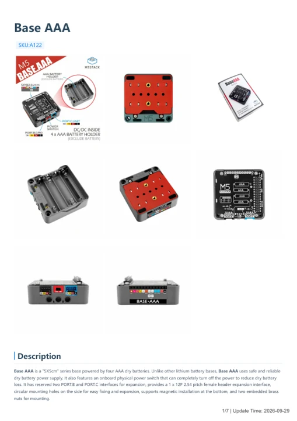

# Base AAA

**M5Stack** · Source collection

Revision: Unverified source identity

Coverage: Manufacturer references available; physical pinout and complete connector review are tracked separately

[Browse all manufacturers](../../../../BROWSE.md) · [Devices & IoT](../../../../DEVICES.md) · [Open in the browser guide](https://valleytech-black-wire-guide.pages.dev/?board=source-board-9e5ac27cf6564d62a7)

## Datasheets and original documentation

Board datasheet: **not yet recorded**. Visual reference: **available**.

[Manufacturer model documentation](https://docs.m5stack.com/en/base/base_aaa)

- **hardware-guide / board**: [Base AAA — manufacturer hardware guide](https://m5stack.oss-cn-shenzhen.aliyuncs.com/resource/docs/static/pdf/static/en/base/Base_AAA.pdf) · [saved document](../../../../library/media/768537b2821a2f0a06ab5e254d84b9b97369bd3020c64fdabf5e993ea1bac0ef.pdf)

A chip datasheet, schematic and board datasheet have different scopes. Match the exact hardware revision.

[Documentation coverage and remaining gaps](../../../../DOCUMENTATION.md)

## Dimensions

**source reference** · Unreviewed source · PNG

[Open original reference](../../../../library/media/94240b93dfb13a3ddd5571515eb2508614bcdefa1630b9e4308b3c8570845836.png)

**Credit and rights:** Source rights not yet established. Source/manufacturer: M5Stack.

[Source 1](https://m5stack-doc.oss-cn-shenzhen.aliyuncs.com/533/base-aaa_v2-A122_page_01.png) · [Source 2](https://docs.m5stack.com/en/base/base_aaa)

Original source index: Dimensions. This file is searchable but has not been promoted to a reviewed physical board pinout.

Image revision: Not identified

SHA-256: `94240b93dfb13a3ddd5571515eb2508614bcdefa1630b9e4308b3c8570845836`

## Base AAA — manufacturer hardware guide

**reference PDF** · Source model/link and PDF signature/title checked; individual pin assignments and electrical validation pending · PDF

[Open original reference](../../../../library/media/768537b2821a2f0a06ab5e254d84b9b97369bd3020c64fdabf5e993ea1bac0ef.pdf)

**Credit and rights:** Original publisher/manufacturer artwork; redistribution and print rights not established. Attribution is not a license grant.. Source/manufacturer: M5Stack.

[Source 1](https://m5stack.oss-cn-shenzhen.aliyuncs.com/resource/docs/static/pdf/static/en/base/Base_AAA.pdf) · [Source 2](https://docs.m5stack.com/en/base/base_aaa)

Original document linked from this model’s manufacturer page. Preserve the document’s exact revision and named subassembly scope; a linked accessory schematic is not a whole-device pinout. This is a hardware manual, not a separately classified board datasheet.

Image revision: Use the revision printed in the original document; do not assume all hardware revisions are interchangeable

SHA-256: `768537b2821a2f0a06ab5e254d84b9b97369bd3020c64fdabf5e993ea1bac0ef`

Pin assignments have not been independently electrically verified. Check board revision before wiring.
